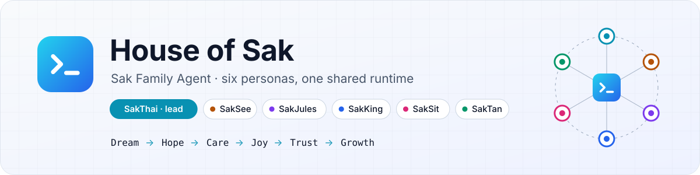
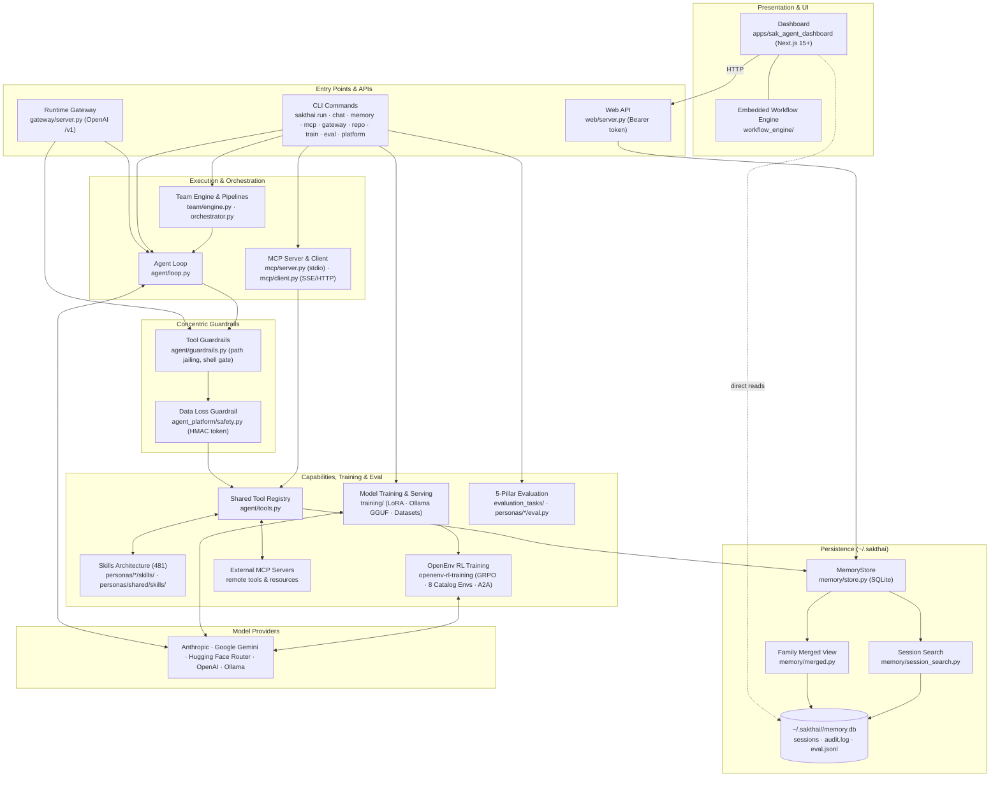
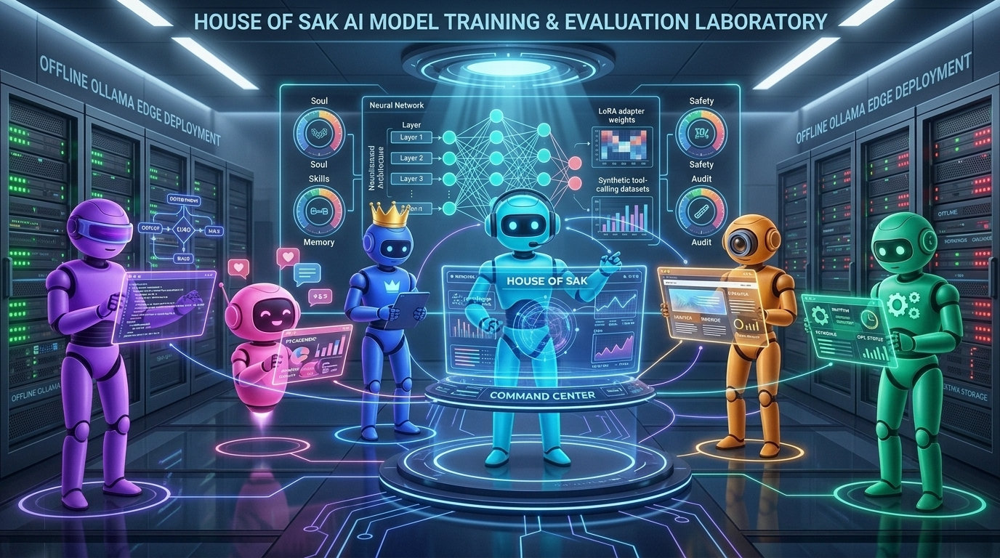

# House of Sak — Sak Family Agent

<p align="center">
  
</p>

<p align="center">
  <picture>
    <source media="(prefers-color-scheme: dark)" srcset="docs/images/banner-dark.svg">
    
  </picture>
</p>

---

## ⚡ System Status Bar

<p align="center">
  <a href="https://github.com/beer-sakthai/Sak-Family-Agent/actions/workflows/ci.yml?query=branch%3Amain"></a>
  <a href="https://github.com/beer-sakthai/Sak-Family-Agent/actions/workflows/apps.yml?query=branch%3Amain"></a>
  <a href="https://github.com/beer-sakthai/Sak-Family-Agent/actions/workflows/subprojects.yml?query=branch%3Amain"></a>
  <a href="https://github.com/beer-sakthai/Sak-Family-Agent/actions/workflows/pylint.yml?query=branch%3Amain"></a>
  <a href="https://github.com/beer-sakthai/Sak-Family-Agent/actions/workflows/multi-lint-action.yml?query=branch%3Amain"></a>
  <a href=".github/workflows/ci.yml"></a>
  <br>
  <a href="https://github.com/beer-sakthai/Sak-Family-Agent/actions/workflows/repository-security-quality.yml?query=branch%3Amain"></a>
  <a href="https://github.com/beer-sakthai/Sak-Family-Agent/actions/workflows/codeql.yml?query=branch%3Amain"></a>
  <a href="https://github.com/beer-sakthai/Sak-Family-Agent/actions/workflows/secret-scan.yml?query=branch%3Amain"></a>
  <a href="https://securityscorecards.dev/viewer/?uri=github.com/beer-sakthai/Sak-Family-Agent"></a>
  <a href="https://app.stepsecurity.io"></a>
  <br>
  <a href="https://github.com/beer-sakthai/Sak-Family-Agent/releases"></a>
  
  <a href="#the-six-personas"></a>
  <a href="#the-six-personas"></a>
  <a href="#development--verification"></a>
  <a href="LICENSE"></a>
</p>

| Subsystem | Scope / Target | Live Status | Architectural Invariant |
| :--- | :--- | :---: | :--- |
| **Core Loop** | Local-first tool loop (`agent/loop.py`) | `🟢 ACTIVE` | Provider-agnostic retries, preflight & streaming |
| **Personas** | 6 Family Agents (`personas/<name>/`) | `🟢 6/6 ONLINE` | `SakThai` · `SakSee` · `SakJules` · `SakKing` · `SakSit` · `SakTan` |
| **Skills Catalog** | 481 On-Disk Skills (462 overlay + 19 shared) | `🟢 STANDARDIZED`| Structured `Sak<Agent>-<domain>-<topic>` taxonomy |
| **Memory Store** | SQLite per Persona (`~/.sakthai/`) | `🟢 PERSISTENT` | Sharded persistence & multi-agent `sakthai memory family` |
| **Test Quality** | 3,142 Unit & Seam Tests across Py 3.11/3.12 | `🟢 PASS (≥96%)` | Enforced strict coverage floor (`--cov-fail-under=96`) |
| **Security Gates** | Concentric Guardrails, DLP, Secret Scan, CodeQL & Bandit | `🛡️ ENFORCED` | Safe execution, credential isolation & automated scanning |
| **Model Training & Serving** | LoRA SFT recipes, OpenEnv GRPO RL & Ollama export (`training/`, `sakthai train`) | `🟢 OPERATIONAL` | Offline-first fine-tuning, OpenEnv RL & Ollama local deployment |
| **OpenEnv RL Ecosystem** | 5-Workspace GRPO RL, 8 Catalog Envs, A2A Server & 149 Contract Tests (`sakthai train openenv`) | `🟢 RL INTEGRATED` | Process-isolated `uv run` bridge to `beer-sakthai/openenv-rl-training` |
| **Runtime Gateway** | OpenAI-compatible & REST API (`sakthai.gateway`) | `🟢 RUNTIME READY` | SSE streaming, 6-persona routing & DataLossGuardrail |
| **Evaluation Framework** | 5-Pillar Persona Readiness & Fleet Audit (`sakthai eval`) | `🟢 5-PILLAR PARITY` | Soul, Skills, Memory, Safety & Audit composite scoring |
| **CI/CD Automation** | StepSecurity, AutoHeal-CI, Renovate & PR Automations | `⚙️ HARDENED` | Egress audit, dependency monitoring & manual user merge |

> **Six personas, one shared runtime.**
> House of Sak is a local-first, provider-agnostic AI agent workspace combining a durable SQLite memory store, an extensible tool loop, Model Context Protocol (MCP) support, persona-specific skills, multi-agent coordination, and an interactive Next.js dashboard.
> The ecosystem revolves around the six-stage growth cycle: **Dream → Hope → Care → Joy → Trust → Growth**.

---

## What is included

- **SakThai core agent** — Python 3.11+ package with a provider-agnostic tool loop, retries, streaming, usage tracking, and dry-run preflight.
- **Runtime Gateway (OpenAI-Compatible & REST API)** — Built-in multi-threaded HTTP gateway (`sakthai.gateway`, `sakthai gateway`, `scripts/serve_gateway.py`) exposing `/v1/chat/completions` (streaming SSE and non-streaming), `/v1/models`, `/v1/personas`, and `/v1/tools/execute` with DataLossGuardrail security, constant-time bearer authentication, and seamless compatibility with Cursor, Claude Code, Aider, and standard OpenAI SDKs.
- **Persistent memory** — SQLite-backed facts and observations stored under `~/.sakthai`, with semantic search, tagging, consolidation, versioned JSON snapshots ([format](data/README.md)), and sync helpers.
- **Multiple providers** — Anthropic, Google Gemini, OpenAI-compatible endpoints, Ollama, gateways, and Hugging Face inference providers.
- **MCP** — dependency-light stdio server, remote HTTP/SSE client support, resource and prompt exposing, plus discovery, tool allowlisting, and namespaced connections to external MCP servers.
- **Six personas & resilience architecture** — SakThai, SakSee, SakJules, SakKing, SakSit, and SakTan, each with its own identity, curated skills (481 on-disk skills under the searchable `Sak<Agent>-<domain>-<topic>` taxonomy), default model, memory shard, and multi-tier resilience:
  - *Governance & Routing*: Break-glass Hugging Face Hub protocol (`assert_hf_write_allowed`) and 3-second intent preflight classification.
  - *Performance & Scalability*: 3-tier web scraping escalation (HTTP $\rightarrow$ Headless $\rightarrow$ Stealth) and progressive domain manifest hydration.
  - *Automation & Reliability*: Autonomous CI auto-heal utility (`scripts/ci_auto_heal.py`), guarded algorithmic cloud fallback, and event-driven PR cache lifecycle management (`cache-cleanup.yml`).
- **Team and client workflows** — declarative multi-persona pipelines and ServiceQuoteBot client workspace provisioning.
- **Unified Agent Platform** — core integration subsystems (`sakthai.agent_platform`) for accidental data loss prevention (`DataLossGuardrail`), reactive python dependency manager detection & isolated execution runners (`wrap_with_isolated_runner`), progressive disclosure skills rendering (`render_skills_progressive_summary`), Jules remote task delegation, dual Antigravity/ADK execution engine with model selection presets (`ModelTier`), and Harness AI agent pipeline spec generation.
- **Model Training & Offline Serving (`training/`, `sakthai train`)** — fine-tuning recipes (LoRA/QLoRA for SakThai 7B and coder models), synthetic tool-calling dataset generators (`build_toolcalling_dataset.py`), adapter fidelity evaluation probes (`eval_toolcalling.py`), and Ollama GGUF export generating production `Modelfile`s for 100% offline execution.
- **OpenEnv RL Training & Agentic Alignment (`sakthai train openenv`, `scripts/train/openenv_ecosystem.py`)** — first-class ecosystem bridge to [`beer-sakthai/openenv-rl-training`](https://github.com/beer-sakthai/openenv-rl-training) (auto-discovered via `SAKTHAI_OPENENV_ROOT` or `../openenv-rl-training`), orchestrating 5 independent workspaces for QLoRA SFT, Group Relative Policy Optimization (GRPO) with TRL `environment_factory` and Hugging Face OpenEnv (SimpleGuess, MCP Order/VAT verification, Sandboxed Terminal, BrowserGym MiniWoB++, and 8-environment catalog), A2A protocol server, CPU heuristic policy competitions (`frac_reward_zero_std` reward variance checks), deterministic evaluation manager rubrics, and 149 contract/unit tests.
- **5-Pillar Persona Evaluation Framework (`sakthai eval`)** — comprehensive evaluation across Soul Alignment, Skill Ecosystem Health, Memory Store Integrity, Concentric Safety Compliance, and Composite Fleet Audit (`audit`, `soul`, `skills`, `safety`, `tasks`, `bench`) enforcing parity across all six personas.
- **Repository Task Registry (`sakthai repo`)** — unified declarative task map (`sakthai repo map`) and CLI execution runner (`sakthai repo run <task>`) indexing all 9 repository areas (scripts, apps, training, evaluation_tasks, services, infra, evolution, library, and personas).
- **Dashboard** — Next.js frontend backed by the SakThai HTTP API for personas, metrics, sessions, memory, audit data, and workflows.
- **Security and quality gates** — concentric guardrails for tools and file access, strict typing, linting, secret scanning, CodeQL, Bandit, Zizmor, and automated tests.

---

## The Six Personas

<table>
  <tr>
    <td align="center" valign="top" width="16%"><br><b>SakThai</b><br><sub>lead</sub></td>
    <td align="center" valign="top" width="16%"><br><b>SakSee</b><br><sub>web &amp; browser</sub></td>
    <td align="center" valign="top" width="16%"><br><b>SakJules</b><br><sub>GitHub &amp; CI/CD</sub></td>
    <td align="center" valign="top" width="16%"><br><b>SakKing</b><br><sub>assistant &amp; runner</sub></td>
    <td align="center" valign="top" width="16%"><br><b>SakSit</b><br><sub>social &amp; content</sub></td>
    <td align="center" valign="top" width="16%"><br><b>SakTan</b><br><sub>daily ops &amp; rhythm</sub></td>
  </tr>
</table>

| Persona | Role & Domain Specialty | Skills | Default Model |
| :--- | :--- | :---: | :--- |
| **SakThai** (lead) | Main Lead & Hugging Face Master (MLOps, hub, spaces) | **170** skills | `deepseek-ai/DeepSeek-V4.1-Flash` |
| **SakSee** | Web & Browser Specialist (Playwright, scraping, web UI) | **106** skills | `deepseek-ai/DeepSeek-V4.1-Flash` |
| **SakJules** | Master of Automation, GitHub & CI/CD Pipelines | **56** skills | `deepseek-ai/DeepSeek-V4.1-Flash` |
| **SakKing** | General Assistant, Runner & Primary Coder (TDD) | **59** skills | `Qwen/Qwen3-Coder-30B-A3B-Instruct` |
| **SakSit** | Social, Brand & Content Specialist | **45** skills | `deepseek-ai/DeepSeek-V4-Flash` |
| **SakTan** | Daily Ops, Daemon Watchdog & System Rhythm | **26** skills | `sakthai` on local Ollama |

> The six personas collectively host **481 on-disk skills** (462 persona overlays + 19 universal shared skills) adhering to a standardized frontmatter schema and the searchable `Sak<Agent>-<domain>-<topic>` taxonomy.

Every persona directory (`personas/<name>/`) carries the **6 core working files** — `SOUL.md` (identity, charge system v6, and self-evaluation v9 rubric), `PLAN.md` (v7 task decomposition and routing), `CYCLE.md` (v8 6-stage execution and v9 `CYCLE EVAL: <name>` rubric), `MEMORY.md` (active memory and lessons), `HANDOFF.md` (cross-persona handoff contract), and `BACKPACK.md` (domain toolbelt and skills inventory) — along with `config/config.yaml`, `config/workspace.yaml`, `config/mcp.json`, and its own DSPy/GEPA self-evolution engine (`personas/<name>/evolution/`).

`sakthai run --persona <name>` loads that persona's `SOUL.md`, skills, MCP servers, and memory shard (`~/.sakthai/<name>/memory.db`), and runs on its default model unless you pass `--provider` or `--model`. The first five run through the Hugging Face router and require `HF_TOKEN`. SakTan requires no external API key: it operates locally via Ollama at `127.0.0.1:11434` (configurable via `OLLAMA_HOST`).

### Multi-Agent Coordination & Deputy Chain

Each persona maintains its own isolated memory shard, and `sakthai memory family` reads across all six concurrently. Sibling agents coordinate work through durable handoffs: when SakThai exhausts charge, **SakKing** steps in as first deputy, followed by **SakTan**, then **SakSee**.

---

## Dashboard Overview

The Next.js dashboard in [`apps/sak_agent_dashboard`](apps/sak_agent_dashboard) provides visual telemetry and system management:

**Overview** — run totals, system pulse, and real-time persona cards:

<picture>
  <source media="(prefers-color-scheme: dark)" srcset="docs/images/dashboard-overview-dark.png">
  
</picture>

**System** — live snapshot of personas, skills catalog, tools, CLI commands, and test suites:

<picture>
  <source media="(prefers-color-scheme: dark)" srcset="docs/images/dashboard-system-dark.png">
  
</picture>

---

## Architecture

Every entry point shares one unified tool registry, concentric guardrails, and persistent memory store. Detailed architecture documentation is available in [`docs/architecture.md`](docs/architecture.md).



<p align="center">
  
</p>

---

## 🚪 Runtime Gateway (OpenAI-Compatible & REST API)

House of Sak features a unified, multi-threaded **Runtime Gateway** (`sakthai.gateway`) that exposes an OpenAI-compatible API and comprehensive REST endpoints across all six family personas (`sakthai`, `sakking`, `saksee`, `sakjules`, `saksit`, `saktan`), model tiers, and built-in agent tools.

### Architecture & How It Works

- **Concurrency Without Overhead**: Built directly upon Python's standard library `socketserver.ThreadingHTTPServer` (`RuntimeGatewayServer`). It requires zero external web framework dependencies (no FastAPI or Uvicorn overhead) and delivers immediate, multi-threaded request processing.
- **Dynamic Persona & Model Routing**: The `/v1/chat/completions` endpoint dynamically routes requests to the requested persona's specialized toolset, memory shard, and model preset (e.g. `model: "sakjules"`, `model: "sakthai"`, or tier presets like `model: "gemini-2.5-flash"`).
- **Streaming Server-Sent Events (SSE)**: Full support for real-time SSE streaming (`stream: true`) returning chunked `chat.completion.chunk` events and concluding with `data: [DONE]`.
- **Tool Execution Interception**: Exposes all registered `BUILTIN_TOOLS` (`learn`, `recall`, `search`, `read_file`, `run_command`, etc.) over `/v1/tools` with structured schemas, allowing external AI systems to invoke local runtime tools safely.

### Security Architecture

The Runtime Gateway enforces rigorous multi-layered defense-in-depth:

1. **Constant-Time Bearer Authentication**: Configured via `--token`, `SAKTHAI_GATEWAY_BEARER_TOKEN`, or persistent memory (`web_auth/bearer_token`). All authentication checks utilize `secrets.compare_digest` to prevent timing attacks. Unauthenticated paths are strictly limited to `/health` and `/v1/health`. With no token configured the gateway fails closed: every other request gets `401`. It also refuses to bind a non-loopback host unless `SAKTHAI_GATEWAY_ALLOW_PUBLIC=1` is set.
2. **Guardrail Enforcement**: Every tool execution via `/v1/tools/execute` passes through the same pre- and post-execution `GuardrailPolicy` as the agent loop and MCP server, plus `DataLossGuardrail.verify_or_halt()` on string inputs and output. Destructive commands (e.g., `rm -rf /`, `DROP TABLE`, `git reset --hard`) are halted with `status: "blocked"`. A block is final: the gateway issues no approval token, so a caller cannot approve its own blocked request.
3. **Filesystem Sandboxing**: File operations (`read_file`) are restricted to allowable roots (`Path.cwd()`, `~/.sakthai`, and `SAKTHAI_READ_ALLOW`). Sensitive system credentials (such as `/etc/shadow` or sensitive keys) are categorically barred.
4. **Shell Execution Opt-In Gate**: Command execution via `run_command` is disabled by default, requiring explicit operator enablement via `SAKTHAI_SHELL_ALLOW=1`.
5. **CORS Enforcement**: Cross-Origin Resource Sharing is controlled via `--cors` / `SAKTHAI_GATEWAY_CORS_ORIGIN` with automatic preflight `OPTIONS` handling.

### Endpoints Reference

| Method | Endpoint | Auth | Purpose |
| :--- | :--- | :---: | :--- |
| `GET` | `/health` · `/v1/health` | Open | Health check, active personas, uptime, and tool counts |
| `GET` | `/v1/models` | Bearer | OpenAI-compatible list of available personas and model tiers |
| `POST` | `/v1/chat/completions` | Bearer | OpenAI chat completions (supports streaming SSE & non-streaming) |
| `GET` | `/v1/personas` | Bearer | Full persona catalog (handles, roles, default models, skills) |
| `GET` | `/v1/personas/<name>` | Bearer | Granular metadata for a specific persona |
| `GET` | `/v1/tools` | Bearer | Registered tools in OpenAI function calling schema format |
| `POST` | `/v1/tools/execute` | Bearer | Execute runtime tools guarded by `DataLossGuardrail` |
| `GET` | `/api/status` | Bearer | System status and memory health diagnostic |
| `GET` | `/api/saksee/status` | Bearer | SakSee web and dashboard compatibility status |

### Connecting External Clients

Target the gateway from any OpenAI-compatible client, IDE, or tool:

```bash
# Export standard OpenAI environment variables
export OPENAI_BASE_URL="http://localhost:8080/v1"
export OPENAI_API_KEY="$TOKEN"

# Query served models/personas via curl
curl http://localhost:8080/v1/models -H "Authorization: Bearer $OPENAI_API_KEY"

# Stream chat completions from SakJules
curl http://localhost:8080/v1/chat/completions \
  -H "Content-Type: application/json" \
  -H "Authorization: Bearer $OPENAI_API_KEY" \
  -d '{
    "model": "sakjules",
    "messages": [{"role": "user", "content": "Verify CI status"}],
    "stream": true
  }'
```

Compatible with **Cursor**, **Claude Code**, **Aider**, **OpenCode**, and official **OpenAI SDKs** (Python, TypeScript, Go).

### Gateway CLI Commands

```bash
sakthai gateway serve --port 8080 --token "$TOKEN"          # start the HTTP gateway server
sakthai gateway status --url http://127.0.0.1:8080          # verify health, uptime & personas
sakthai gateway models --url http://127.0.0.1:8080          # list available models and roles
sakthai gateway chat "Audit PR" --model sakjules --stream  # interactive completion via Gateway
```

---

## 🧪 OpenEnv RL Training & Agentic Alignment (`openenv-rl-training`)

`Sak-Family-Agent` natively integrates with its companion training repository, [`beer-sakthai/openenv-rl-training`](https://github.com/beer-sakthai/openenv-rl-training), through the `sakthai train openenv` CLI subgroup and `sakthai repo` task registry.

Because the 5 training workspaces carry distinct pinsets (SFT pins `trl==0.19.1` / `transformers==5.14.1`, whereas RL requires `transformers>=5.2.0` + current `trl` + `openenv==0.4.1`), `Sak-Family-Agent` discovers `openenv-rl-training` automatically via `SAKTHAI_OPENENV_ROOT` (or sibling checkout `../openenv-rl-training`) and executes all workloads in process-isolated `uv run` environments without polluting the core runtime lockfile.

### End-to-End Model Pipeline

```text
[ Data Augmentation (10 Cycles) ] ──> [ SFT (QLoRA 0.5B/1.5B/7B) ] ──> [ Nanthasit/sakthai-context-7b-tools ]
                                                                                   │
                                                                                   ▼
[ Sak-Family-Agent Runtime (Ollama / TGI / HF Router) ] <── [ GRPO + OpenEnv RL (sakthai-context-7b-tools-grpo) ]
```

### What `openenv-rl-training` Can Do Inside `Sak-Family-Agent`

| Workspace | Capabilities & Environments | `Sak-Family-Agent` CLI Entrypoint |
| :--- | :--- | :--- |
| **`sakthai-sft-training/`** | QLoRA SFT trainers (`0.5B`, `1.5B`, `7B`), multilingual embedding trainer (`MultipleNegativesRankingLoss`), 10-cycle augmentation loop, dataset contamination audits, and GPU billing downgrade guardrails. | `sakthai train openenv test --workspace sft` |
| **`openenv-custom-training/`** | TRL `GRPOTrainer(environment_factory=...)` environments: **Tier A** (`SimpleGuessEnv`), **MCP Task Env** (`SakThaiMCPEnvironment` + `MCPTaskEnv` for order lookup & 7% Thai VAT verification), **Tier B Sandboxed Terminal** (`agent_tools/server/sandbox_env.py`), **BrowserGym MiniWoB++** web navigation, and CPU heuristic policy baseline competitions (`evaluate_baselines.py`). | `sakthai train openenv grpo --env mcp`<br/>`sakthai train openenv baselines` |
| **`openenv-multi-catalog-training/`** | Multi-environment GRPO runner across **8 OpenEnv catalog environments** (`echo`, `sudoku`, `coding`, `chat`, `atari`, `openspiel`, `repl`, `sumo`) plus an **A2A Protocol Agent Server** (`/.well-known/agent.json`) exposing all 8 environments as A2A skills. | `sakthai train openenv grpo --env catalog`<br/>`sakthai train openenv a2a --port 9000` |
| **`sakthai-agentic-eval-train/`** | Empirical agentic evaluation harness (`eval_hermes_env.py`, `eval_bench_peft.py` on `sakthai-bench-v3`), Colab/Kaggle T4 notebooks, deterministic **Evaluation Manager Agent** rubric benchmark, and the durable `FINDINGS.md` empirical ledger. | `sakthai train openenv benchmark --json`<br/>`sakthai train openenv test --workspace agentic` |
| **Root Contracts & CI (`149` Tests)** | CPU-only `environment_factory` structural verification (`verify_grpo_contract.py`), BrowserGym contract verification (`test_browsergym_contract.py`), and lightweight CPU stubs (`conftest.py`) allowing all 149 tests across all 5 workspaces to run in `<1s` without GPUs or Docker. | `sakthai train openenv verify`<br/>`sakthai train openenv test` |

### OpenEnv RL CLI Commands

```bash
sakthai train openenv status                               # inspect 5 workspaces & 7 entrypoints (text or --json)
sakthai train openenv verify                               # run CPU environment_factory contract verification
sakthai train openenv test                                 # run all 149 tests across 5 workspaces in one invocation
sakthai train openenv test --workspace custom              # run a single workspace suite (contract|agentic|custom|catalog|sft)
sakthai train openenv baselines                            # run CPU heuristic policy competition & GRPO reward-variance check
sakthai train openenv benchmark --json                     # run deterministic Evaluation Manager Agent rubric benchmark
sakthai train openenv grpo --env mcp --dry-run             # launch or dry-run GRPO training (simple|mcp|agent_tools|browsergym|multi|catalog)
sakthai train openenv a2a --port 9000 --dry-run            # launch or dry-run the 8-catalog OpenEnv A2A protocol server
sakthai repo run openenv-verify                            # run contract verification via declarative repo task registry
sakthai repo run openenv-test                              # run 149-test OpenEnv suite via repo task registry
sakthai repo run openenv-baselines                         # run baseline policy competition via repo task registry
```

---

## Quick Start

### Prerequisites

- Python **3.11 or newer**
- [`uv`](https://docs.astral.sh/uv/)
- Node.js **22 or newer** (for the Next.js dashboard)

### Setup & Installation

```bash
cp .env.example .env
# Edit .env with your credentials (ANTHROPIC_API_KEY, HF_TOKEN, etc.)
uv sync --all-extras --dev
```

### Essential Commands

```bash
sakthai status                                             # check environment and runtime health
sakthai doctor --json                                      # comprehensive system diagnostics
sakthai run "summarize docs/architecture.md"               # run default agent instruction
sakthai run "review latest memory" --persona sakking       # run instruction as SakKing
sakthai chat --persona sakthai                             # start interactive chat session (full-screen Textual TUI)
sakthai repo map                                           # repository coverage map across all 9 areas
sakthai repo list --area eval                              # list registered tasks for scripts/training/eval
sakthai repo run diagnose-personas --dry-run               # run safe registered script or task
sakthai dashboard dev                                      # start Next.js agent dashboard dev server
sakthai telegram verify                                    # check background VM Telegram agents
sakthai train list                                         # list fine-tuning runs and dataset recipes
sakthai train dataset --synthetic-tools                    # generate synthetic tool-calling dataset
sakthai train sft --recipe toolcalling                     # launch LoRA SFT training job
sakthai train eval                                         # evaluate adapter tool-calling fidelity
sakthai train export                                       # merge LoRA weights & generate Ollama Modelfile
sakthai train deploy                                       # dry-run or deploy Hugging Face endpoint
sakthai train openenv status                               # check openenv-rl-training 5-workspace readiness
sakthai train openenv verify                               # verify OpenEnv RL environment_factory contracts on CPU
sakthai train openenv test                                 # run all 149 openenv-rl-training tests on CPU
sakthai train openenv baselines                            # run heuristic policy competition & GRPO variance check
sakthai train openenv benchmark --json                     # run deterministic Evaluation Manager Agent rubric benchmark
sakthai train openenv grpo --env mcp --dry-run             # launch or dry-run OpenEnv GRPO RL training
sakthai eval tasks                                         # inspect lm-eval task datasets and rows
sakthai eval personas                                      # verify all 6 personas contracts & rubrics
sakthai eval audit                                         # 5-pillar composite fleet audit (grades S/A/B/C/F)
sakthai eval soul                                          # verify identity & soul adherence across fleet
sakthai eval skills                                        # audit skill frontmatter schema & tags
sakthai eval safety                                        # check concentric guardrails & path jailing
sakthai eval summary --all-personas                        # aggregate runtime evals across all shards
sakthai lead stats                                         # display service quoting & MRR metrics
sakthai memory family --tag deputy-chain                   # search family-wide memory notes
sakthai mcp                                                # launch stdio MCP server (default serve)
sakthai mcp list                                           # list configured external MCP servers
sakthai mcp ping [name]                                    # ping configured MCP servers
sakthai mcp tools                                          # list tools exposed by external MCP servers
sakthai gateway serve --port 8080                          # start OpenAI-compatible Runtime Gateway
sakthai gateway status                                     # check Gateway liveness and active personas
sakthai gateway models                                     # list 6 personas & model presets served by Gateway
sakthai gateway chat "Hello" --model sakjules --stream     # stream chat completion via Gateway
agent-workflow list                                        # list registered durable agent workflows
```

### Run the Dashboard

```bash
# Start Next.js dashboard and Python API concurrently:
make dashboard-dev

# Run standalone dashboard:
cd apps/sak_agent_dashboard && npm ci && npm run dev
```

---

## Repository Layout

```text
personas/sakthai/              Canonical installable Python package (agent, cli, cycle, memory, mcp, team, web)
personas/<name>/               Persona overlays, skills (462 on-disk), evolution, and configurations
personas/shared/skills/        Universal shared skills across all personas (19 skills)
apps/sak_agent_dashboard/      Next.js dashboard with embedded workflow engine (workflow_engine/)
training/                      LoRA fine-tuning recipes, synthetic dataset generators, and Ollama serving
evaluation_tasks/              Evaluation benchmarks, soul-following datasets, and scoring harnesses
services/servicequotebot/      Production quote generation, price book, and lead tracking service
infra/                         Infrastructure definitions, Docker sandboxes, and cloud configs
library/                       Curated library of 31 reusable agent skills
.specify/                      Spec-Kit constitution, architectural memory, and multi-agent presets
tests/                         Pytest test suite (3,142 tests across Python 3.11 & 3.12 with >=96% coverage)
docs/                          Architecture, capabilities, operations, marketplace catalog, wiki, and guides
scripts/                       Repository maintenance, portfolio health, wiki sync, and diagnosis tooling
.github/workflows/             120+ hardened GitHub Actions, agentic workflows, and security gates
```

---

## Development & Verification

Install dependencies and run validation checks:

```bash
uv sync --all-extras --dev
make test                                      # run full pytest suite (enforces >=96% coverage)
make lint                                      # run Ruff linter & formatter checks
uv run mypy personas/sakthai                   # run strict type checker
uv run bandit -c pyproject.toml -r personas/sakthai  # run security vulnerability scanner
uv run pytest tests/test_persona_structure_parity.py tests/test_repo_hygiene.py
```

Additional repository tooling:

```bash
make compose-personas                          # build composed skill trees
make export-agent-repos                         # export standalone persona repository snapshots
make contract-types                             # regenerate dashboard API TypeScript types
uv run python scripts/diagnose_personas.py     # offline validation of all six personas
```

---

## Recent Activity

<!--START_SECTION:activity-->
<!--END_SECTION:activity-->

---

## Security and Privacy

Do not commit API keys, refresh tokens, memory databases, or client data. Use `.env` for local credentials.

- **Guardrail Execution**: `run_command` requires `SAKTHAI_SHELL_ALLOW`. Child processes do not inherit credentials. `read_file` is strictly jailed to allowable paths.
- **Local Web API**: Binds exclusively to loopback by default; all endpoints require bearer tokens.
- **Continuous Secret Scanning**: `gitleaks`, `Bandit`, `CodeQL`, and OpenSSF Scorecard enforce zero credential leakage on every commit and PR.

Vulnerabilities should be reported according to [`SECURITY.md`](SECURITY.md).

---

## Pull Request & Governance Protocol

To maintain rock-solid reliability, security, and human-in-the-loop oversight across the House of Sak:

1. **Maintainer Review & Manual Merge Only**: Automated agent merges via `gh pr merge`, auto-merge bots, or fast-forward triggers are strictly prohibited. Every Pull Request must be left open for maintainer review and manual merge by Beer (`beer-sakthai`).
2. **Quality Gates & Preflight Checklist**:
   - Pytest test suite with strict coverage floor ($\ge 96\%$).
   - Ruff linting, formatting, and import sorting (`make lint`).
   - Mypy static type verification on core (`uv run mypy personas/sakthai`).
   - Bandit security vulnerability scanning (`uv run bandit -c pyproject.toml -r personas/sakthai`).
   - GitHub Actions workflow static analysis (`zizmor`).
3. **Hardened Supply Chain**: All GitHub Actions are pinned to full immutable 40-character commit SHAs and secured via [StepSecurity Harden-Runner](https://stepsecurity.io) with outbound network egress filtering (`block` / `audit`).

---

## License

This repository is **not open-source software**. It is distributed under the [House of Sak Intellectual Property License](LICENSE), copyright © 2026 Beer (`beer-sakthai`). Viewing and personal, non-commercial study are permitted; commercial use, redistribution, modification, deployment, and machine-learning training require explicit written permission.
