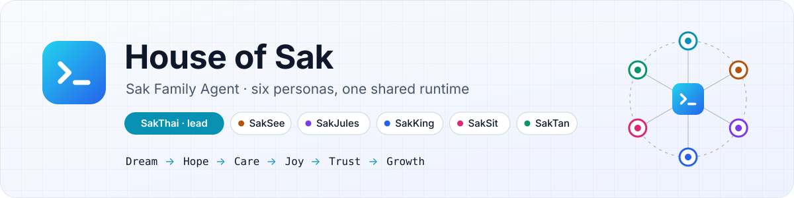
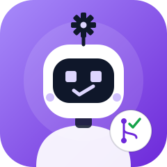
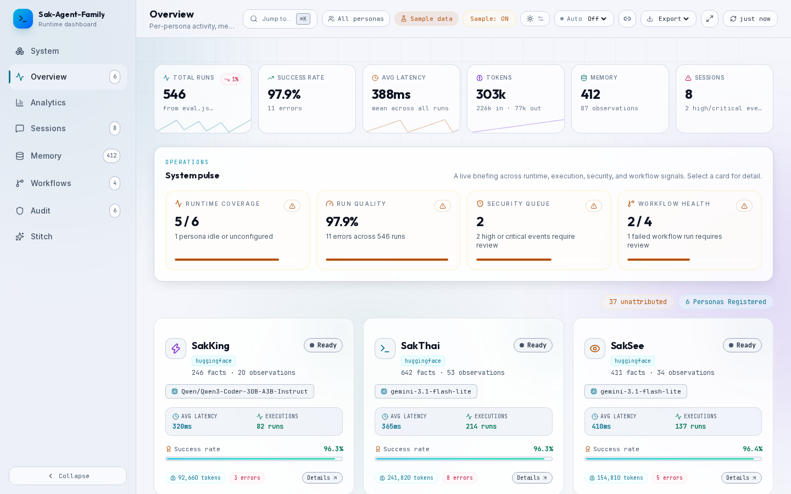
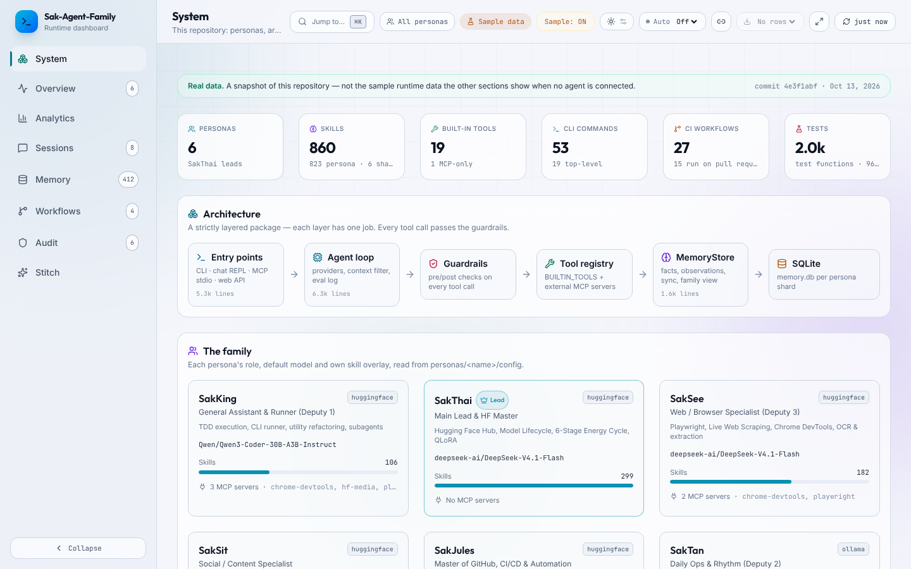
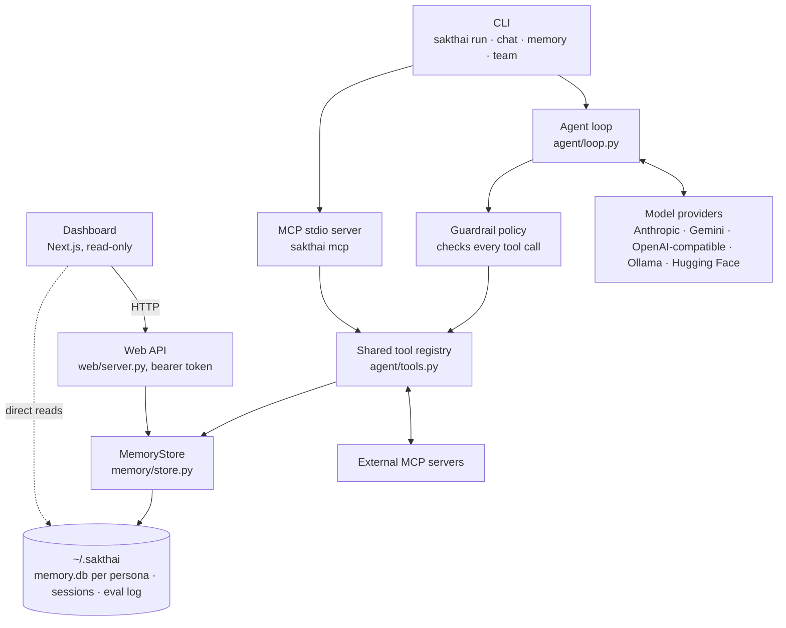

# House of Sak — Sak Family Agent

<p align="center">
  <picture>
    <source media="(prefers-color-scheme: dark)" srcset="docs/images/banner-dark.svg">
    
  </picture>
</p>

<p align="center">
  <a href="https://github.com/beer-sakthai/Sak-Family-Agent/actions/workflows/ci.yml?query=branch%3Amain"></a>
  <a href="https://github.com/beer-sakthai/Sak-Family-Agent/actions/workflows/apps.yml?query=branch%3Amain"></a>
  <a href="https://github.com/beer-sakthai/Sak-Family-Agent/actions/workflows/subprojects.yml?query=branch%3Amain"></a>
  <a href="https://github.com/beer-sakthai/Sak-Family-Agent/actions/workflows/pylint.yml?query=branch%3Amain"></a>
  <a href=".github/workflows/ci.yml"></a>
  <br>
  <a href="https://github.com/beer-sakthai/Sak-Family-Agent/actions/workflows/repository-security-quality.yml?query=branch%3Amain"></a>
  <a href="https://github.com/beer-sakthai/Sak-Family-Agent/actions/workflows/codeql.yml?query=branch%3Amain"></a>
  <a href="https://github.com/beer-sakthai/Sak-Family-Agent/actions/workflows/secret-scan.yml?query=branch%3Amain"></a>
  <a href="https://securityscorecards.dev/viewer/?uri=github.com/beer-sakthai/Sak-Family-Agent"></a>
  <br>
  
  
  
  <a href="LICENSE"></a>
</p>

> **Six personas, one shared runtime.**

House of Sak is a local-first, provider-agnostic AI agent workspace. It combines a durable SQLite memory store, a tool-using agent loop, Model Context Protocol (MCP) support, persona-specific skills, multi-agent coordination, and a web dashboard in one monorepo.

The project is built around the six-stage cycle **Dream → Hope → Care → Joy → Trust → Growth**.

## What is included

- **SakThai core agent** — a Python 3.11+ package with a provider-agnostic tool loop, retries, streaming, usage tracking, and dry-run preflight.
- **Persistent memory** — SQLite-backed facts and observations stored under `~/.sakthai`, with search, tagging, consolidation, versioned JSON snapshots ([format](data/README.md)), and sync helpers.
- **Multiple providers** — Anthropic, Google Gemini, OpenAI-compatible endpoints, Ollama, gateways, and Hugging Face inference providers.
- **MCP** — a dependency-light stdio server plus discovery and namespaced connections to external MCP servers.
- **Six personas** — SakThai, SakSee, SakJules, SakKing, SakSit, and SakTan, each with its own identity, skills, default model, and memory.
- **Team and client workflows** — declarative multi-persona pipelines and ServiceQuoteBot client workspace provisioning.
- **Dashboard** — a Next.js frontend backed by the SakThai HTTP API for personas, metrics, sessions, memory, audit data, and workflows.
- **Security and quality gates** — guardrails for tools and file access, strict typing, linting, secret scanning, CodeQL, Bandit, and automated tests.

## The six personas

<table>
  <tr>
    <td align="center" valign="top" width="16%"><br><b>SakThai</b><br><sub>lead</sub></td>
    <td align="center" valign="top" width="16%"><br><b>SakSee</b><br><sub>web &amp; browser</sub></td>
    <td align="center" valign="top" width="16%"><br><b>SakJules</b><br><sub>GitHub &amp; CI/CD</sub></td>
    <td align="center" valign="top" width="16%"><br><b>SakKing</b><br><sub>assistant &amp; runner</sub></td>
    <td align="center" valign="top" width="16%"><br><b>SakSit</b><br><sub>social &amp; content</sub></td>
    <td align="center" valign="top" width="16%"><br><b>SakTan</b><br><sub>daily ops &amp; rhythm</sub></td>
  </tr>
</table>

| Persona | Role | Default model |
|---|---|---|
| **SakThai** (lead) | Main Lead & HF Master | `deepseek-ai/DeepSeek-V4.1-Flash` |
| **SakSee** | Web / Browser Specialist | `deepseek-ai/DeepSeek-V4.1-Flash` |
| **SakJules** | Master of GitHub, CI/CD & Automation | `deepseek-ai/DeepSeek-V4.1-Flash` |
| **SakKing** | General Assistant & Runner | `Qwen/Qwen3-Coder-30B-A3B-Instruct` |
| **SakSit** | Social / Content Specialist | `deepseek-ai/DeepSeek-V4-Flash` |
| **SakTan** | Daily Ops & Rhythm | `sakthai` on a local Ollama |

`sakthai run --persona <name>` loads that persona's `SOUL.md`, skills, MCP servers and memory shard (`~/.sakthai/<name>/memory.db`), and runs on its default model unless you pass `--provider` or `--model`. The first five run through the Hugging Face router and need `HF_TOKEN`. SakTan needs no key: it expects a model named `sakthai` on Ollama at `127.0.0.1:11434` (set `OLLAMA_HOST` for another host). Each persona's settings live in `personas/<name>/config/config.yaml`.

`sakthai chat --persona <name>` (default `sakthai`) loads the same identity, skills, MCP servers, memory shard and default model. Pass `--provider` and `--model` to talk to something else, such as `--provider ollama --model sakthai` for the local Ollama model.

Each persona keeps its own memory, and `sakthai memory family` reads all six at once. Give it text, `--tag`, or both to find a note a sibling left, for example `sakthai memory family "DEPUTY CHAIN" --tag deputy-chain --limit 1`. That is how the personas pass work to each other: when SakThai runs out of charge, SakKing steps in as deputy, then SakTan, then SakSee.

## A look at the dashboard

The Next.js dashboard in [`apps/sak_agent_dashboard`](apps/sak_agent_dashboard), shown with its built-in sample data (`#overview?demo=1`). The images follow your GitHub light or dark theme.

**Overview** — run totals, the system pulse, and a card per persona.

<picture>
  <source media="(prefers-color-scheme: dark)" srcset="docs/images/dashboard-overview-dark.png">
  
</picture>

**System** — a real snapshot of this repository: personas, skills, tools, CLI commands, CI workflows and tests, the architecture, and the family.

<picture>
  <source media="(prefers-color-scheme: dark)" srcset="docs/images/dashboard-system-dark.png">
  
</picture>

## How it fits together

Every entry point shares one tool registry and one memory store. The full diagram and the layer-by-layer notes are in [`docs/architecture.md`](docs/architecture.md).



## Quick start

### Requirements

- Python **3.11 or newer**
- [`uv`](https://docs.astral.sh/uv/)
- Node.js **22 or newer** if you want to run the dashboard

### Install the Python package

```bash
cp .env.example .env
# Edit .env: ANTHROPIC_API_KEY (or another provider's key) for `sakthai run`,
# and HF_TOKEN for `chat` and the Hugging Face personas (see "The six personas" above).
uv sync --all-extras
```

The editable install exposes the `sakthai` command:

```bash
sakthai status
sakthai doctor --json
sakthai run "summarize docs/architecture.md"
sakthai run "review the latest memory" --persona sakking   # needs HF_TOKEN
sakthai chat                                               # SakThai's model, so HF_TOKEN
sakthai memory family --tag deputy-chain                   # notes from every persona's memory
sakthai mcp
```

Use `sakthai run --help` for provider, model, streaming, sandbox, skill, and persona options. The default data directory is `~/.sakthai`; set `SAKTHAI_HOME` to use another location.

### Run the dashboard

Install and start the dashboard independently:

```bash
cd apps/sak_agent_dashboard
npm ci
npm run dev
```

For the complete local setup — including the Python API on port `3001` and the dashboard on port `3000` — use:

```bash
make dashboard-dev
```

The dashboard can be validated with:

```bash
make dashboard-test
```

## Repository layout

```text
personas/sakthai/sakthai/  Canonical installable Python package
personas/<name>/           Persona overlays, skills, and configuration
apps/sak_agent_dashboard/  Next.js dashboard
services/                  Service integrations and supporting services
tests/                     Pytest test suite
docs/                      Architecture, operations, security, and user guides
scripts/                   Repository and release tooling
library/                   Curated shared skills and reference material
.github/workflows/         CI, security, evaluation, and maintenance workflows
```

See [`PLAN.md`](PLAN.md) for the project index and [`docs/architecture.md`](docs/architecture.md) for the system design.

## Development

Install the full development environment and run the main checks:

```bash
uv sync --all-extras
make test
make lint
uv run mypy personas/sakthai/sakthai
uv run bandit -c pyproject.toml -r personas/sakthai/sakthai
```

Additional repository commands:

```bash
make compose-personas                       # Build composed skill trees
make export-agent-repos                      # Export all persona snapshots
make export-agent-repo PERSONA=sakjules      # Export one persona snapshot
make contract-types                          # Regenerate dashboard API types
make system-snapshot                         # Refresh dashboard system data
make mutation                               # Run local mutation testing (slow)
uv run python scripts/diagnose_personas.py  # Check all six personas offline, no API calls
```

Tests that may call external services (Ollama, Anthropic) are marked `integration` and skip themselves when the endpoint or credential is missing, which keeps CI offline. To leave them out explicitly:

```bash
uv run pytest tests/ -m "not integration"
```

Contribution guidelines are in [`CONTRIBUTING.md`](CONTRIBUTING.md). Repository-specific development instructions are in [`AGENTS.md`](AGENTS.md).

## Documentation map

- [`docs/SAKTHAI.md`](docs/SAKTHAI.md) — agent guide and memory concepts
- [`docs/architecture.md`](docs/architecture.md) — architecture and data flow
- [`docs/capabilities.md`](docs/capabilities.md) — supported capabilities
- [`docs/OPERATING_CONTRACT.md`](docs/OPERATING_CONTRACT.md) — operating rules
- [`docs/SOUL.md`](docs/SOUL.md) — shared identity and principles
- [`SECURITY.md`](SECURITY.md) — security reporting
- [`CHANGELOG.md`](CHANGELOG.md) — release history

## Security and privacy

Do not commit API keys, refresh tokens, memory databases, or generated client data. Use `.env` for local credentials and review tool permissions before enabling shell, Telegram, Microsoft Graph, or external MCP integrations.

What the defaults enforce:

- **Every tool call passes a guardrail policy.** `run_command` is off until `SAKTHAI_SHELL_ALLOW` is set, can be limited to named programs (`git:ls`), and its child process does not inherit credential variables. `read_file` reads only the working directory, `~/.sakthai` and `SAKTHAI_READ_ALLOW`. Sensitive paths and destructive commands are refused, and secrets are redacted from tool output and logs.
- **The web API stays local.** It binds to loopback unless `SAKTHAI_WEB_ALLOW_PUBLIC` is set, and every path except `/health` needs the bearer token from `sakthai web setup`.
- **All six personas follow the same rules, and tests check them.** Each persona's `config/` pins its `npx` MCP servers to exact versions, pre-approves no dangerous commands, fails closed when the Tirith scanner is unavailable, and keeps approvals manual with cron jobs denied (`tests/test_persona_security_config.py`). Each `SOUL.md` carries the same Security Rules section (`tests/test_soul_consistency.py`), and every persona copy of the guardrails and web server must match the canonical file.
- **Secrets are scanned continuously.** gitleaks checks every pull request and every push to `main`, and the full history daily. Known historical findings are baselined by fingerprint in `.gitleaksignore`, so only a new leak fails the scan.

Past findings, with the regression test behind each fix, are in [`docs/security-hardening.md`](docs/security-hardening.md).

Security vulnerabilities should be reported according to [`SECURITY.md`](SECURITY.md), not through a public issue.

## License

This repository is **not open-source software**. It is distributed under the [House of Sak Intellectual Property License](LICENSE), copyright © 2026 Beer (`beer-sakthai`). Viewing and personal, non-commercial study are permitted; commercial use, redistribution, modification, deployment, and machine-learning training require explicit written permission.
