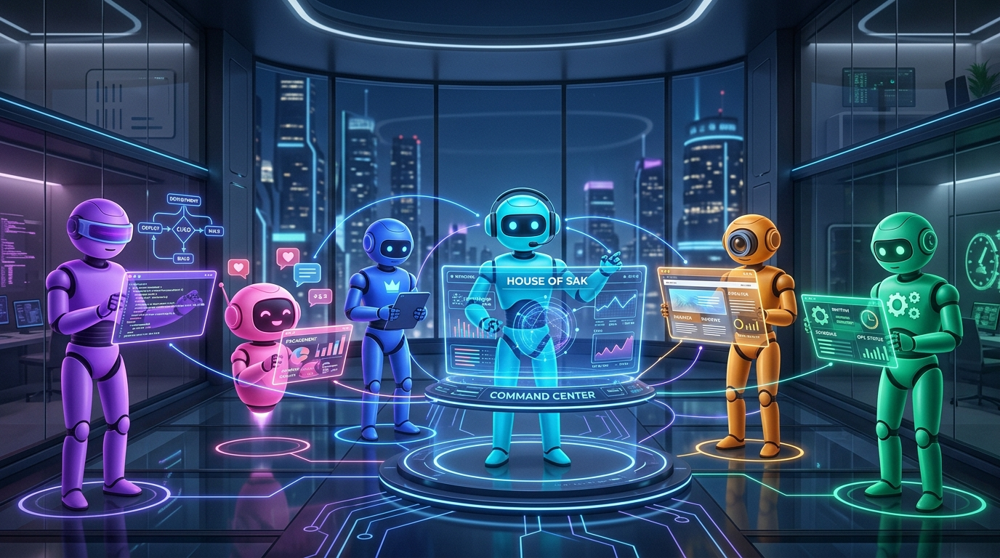
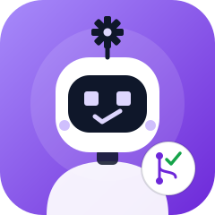
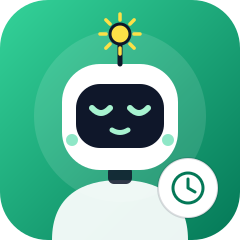
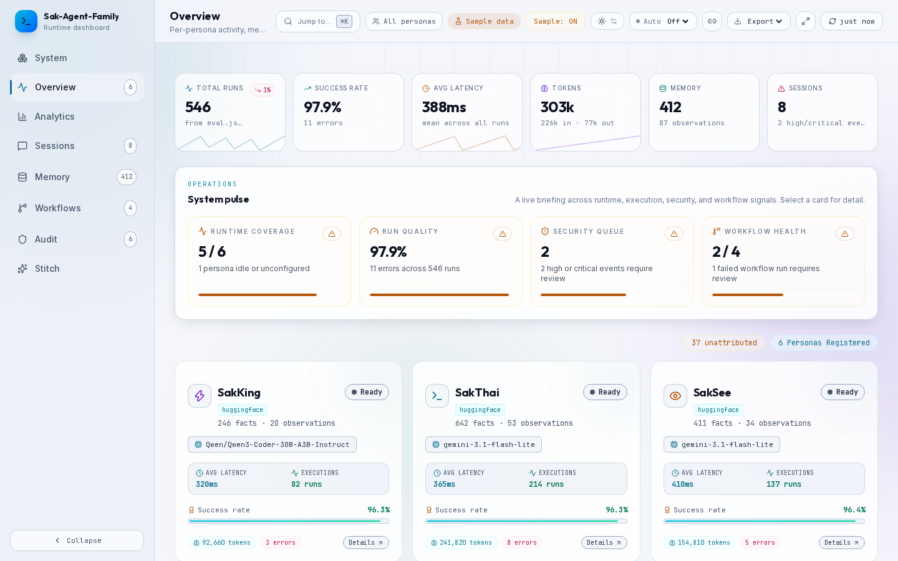
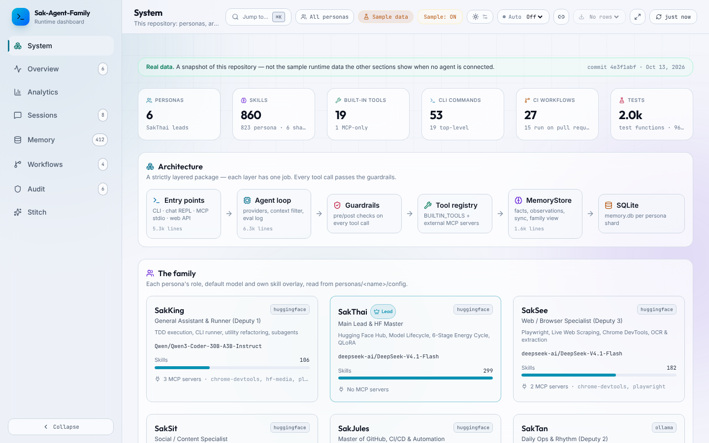
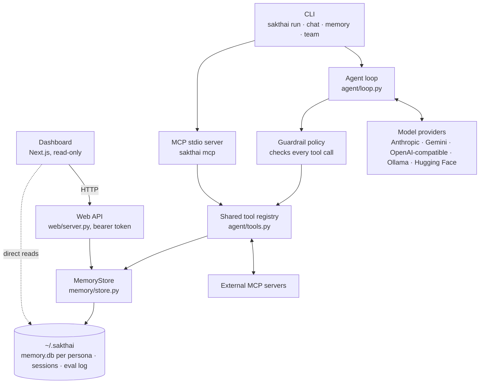

# House of Sak — Sak Family Agent

<p align="center">
  
</p>

<p align="center">
  <picture>
    <source media="(prefers-color-scheme: dark)" srcset="docs/images/banner-dark.svg">
    
  </picture>
</p>

---

## ⚡ System Status Bar

<p align="center">
  <a href="https://github.com/beer-sakthai/Sak-Family-Agent/actions/workflows/ci.yml?query=branch%3Amain"></a>
  <a href="https://github.com/beer-sakthai/Sak-Family-Agent/actions/workflows/apps.yml?query=branch%3Amain"></a>
  <a href="https://github.com/beer-sakthai/Sak-Family-Agent/actions/workflows/subprojects.yml?query=branch%3Amain"></a>
  <a href="https://github.com/beer-sakthai/Sak-Family-Agent/actions/workflows/pylint.yml?query=branch%3Amain"></a>
  <a href=".github/workflows/ci.yml"></a>
  <br>
  <a href="https://github.com/beer-sakthai/Sak-Family-Agent/actions/workflows/repository-security-quality.yml?query=branch%3Amain"></a>
  <a href="https://github.com/beer-sakthai/Sak-Family-Agent/actions/workflows/codeql.yml?query=branch%3Amain"></a>
  <a href="https://github.com/beer-sakthai/Sak-Family-Agent/actions/workflows/secret-scan.yml?query=branch%3Amain"></a>
  <a href="https://securityscorecards.dev/viewer/?uri=github.com/beer-sakthai/Sak-Family-Agent"></a>
  <br>
  
  
  
  
  <a href="LICENSE"></a>
</p>

| Subsystem | Scope / Target | Live Status | Architectural Invariant |
| :--- | :--- | :---: | :--- |
| **Core Loop** | Local-first tool loop (`agent/loop.py`) | `🟢 ACTIVE` | Provider-agnostic retries, preflight & streaming |
| **Personas** | 6 Family Agents (`personas/<name>/`) | `🟢 6/6 ONLINE` | `SakThai` · `SakSee` · `SakJules` · `SakKing` · `SakSit` · `SakTan` |
| **Skills Catalog** | 480 On-Disk Skills (461 overlay + 19 shared) | `🟢 STANDARDIZED`| Structured `Sak<Agent>-<domain>-<topic>` taxonomy |
| **Memory Store** | SQLite per Persona (`~/.sakthai/`) | `🟢 SYNCED` | Sharded persistence & multi-agent `sakthai memory family` |
| **Test Quality** | 2,811 Unit Tests across Python 3.11 & 3.12 | `🟢 PASS (≥96%)` | Enforced strict coverage floor (`--cov-fail-under=96`) |
| **Security Gates** | Guardrails, Secret Scan, CodeQL & Bandit | `🛡️ ENFORCED` | Safe execution, credential isolation & automated scanning |

> **Six personas, one shared runtime.**
> House of Sak is a local-first, provider-agnostic AI agent workspace combining a durable SQLite memory store, an extensible tool loop, Model Context Protocol (MCP) support, persona-specific skills, multi-agent coordination, and an interactive Next.js dashboard.
> The ecosystem revolves around the six-stage growth cycle: **Dream → Hope → Care → Joy → Trust → Growth**.

---

## What is included

- **SakThai core agent** — Python 3.11+ package with a provider-agnostic tool loop, retries, streaming, usage tracking, and dry-run preflight.
- **Persistent memory** — SQLite-backed facts and observations stored under `~/.sakthai`, with semantic search, tagging, consolidation, versioned JSON snapshots ([format](data/README.md)), and sync helpers.
- **Multiple providers** — Anthropic, Google Gemini, OpenAI-compatible endpoints, Ollama, gateways, and Hugging Face inference providers.
- **MCP** — dependency-light stdio server, remote HTTP/SSE client support, resource and prompt exposing, plus discovery, tool allowlisting, and namespaced connections to external MCP servers.
- **Six personas** — SakThai, SakSee, SakJules, SakKing, SakSit, and SakTan, each with its own identity, curated skills (480 on-disk skills under the searchable `Sak<Agent>-<domain>-<topic>` taxonomy), default model, and memory shard.
- **Team and client workflows** — declarative multi-persona pipelines and ServiceQuoteBot client workspace provisioning.
- **Unified Agent Platform** — core integration subsystems (`sakthai.agent_platform`) for accidental data loss prevention (`DataLossGuardrail`), reactive python dependency manager detection & isolated execution runners (`wrap_with_isolated_runner`), progressive disclosure skills rendering (`render_skills_progressive_summary`), Jules remote task delegation, dual Antigravity/ADK execution engine with model selection presets (`ModelTier`), and Harness AI agent pipeline spec generation.
- **Dashboard** — Next.js frontend backed by the SakThai HTTP API for personas, metrics, sessions, memory, audit data, and workflows.
- **Security and quality gates** — guardrails for tools and file access, strict typing, linting, secret scanning, CodeQL, Bandit, and automated tests.

---

## The Six Personas

<table>
  <tr>
    <td align="center" valign="top" width="16%"><br><b>SakThai</b><br><sub>lead</sub></td>
    <td align="center" valign="top" width="16%"><br><b>SakSee</b><br><sub>web &amp; browser</sub></td>
    <td align="center" valign="top" width="16%"><br><b>SakJules</b><br><sub>GitHub &amp; CI/CD</sub></td>
    <td align="center" valign="top" width="16%"><br><b>SakKing</b><br><sub>assistant &amp; runner</sub></td>
    <td align="center" valign="top" width="16%"><br><b>SakSit</b><br><sub>social &amp; content</sub></td>
    <td align="center" valign="top" width="16%"><br><b>SakTan</b><br><sub>daily ops &amp; rhythm</sub></td>
  </tr>
</table>

| Persona | Role & Domain Specialty | Skills | Default Model |
| :--- | :--- | :---: | :--- |
| **SakThai** (lead) | Main Lead & Hugging Face Master (MLOps, hub, spaces) | **170** skills | `deepseek-ai/DeepSeek-V4.1-Flash` |
| **SakSee** | Web & Browser Specialist (Playwright, scraping, web UI) | **105** skills | `deepseek-ai/DeepSeek-V4.1-Flash` |
| **SakJules** | Master of Automation, GitHub & CI/CD Pipelines | **56** skills | `deepseek-ai/DeepSeek-V4.1-Flash` |
| **SakKing** | General Assistant, Runner & Primary Coder (TDD) | **59** skills | `Qwen/Qwen3-Coder-30B-A3B-Instruct` |
| **SakSit** | Social, Brand & Content Specialist | **45** skills | `deepseek-ai/DeepSeek-V4-Flash` |
| **SakTan** | Daily Ops, Daemon Watchdog & System Rhythm | **26** skills | `sakthai` on local Ollama |

> The six personas collectively host **480 on-disk skills** (461 persona overlays + 19 universal shared skills) adhering to a standardized frontmatter schema and the searchable `Sak<Agent>-<domain>-<topic>` taxonomy.

Every persona directory (`personas/<name>/`) carries the **6 core working files** — `SOUL.md` (identity, charge system v6, and self-evaluation v9 rubric), `PLAN.md` (v7 task decomposition and routing), `CYCLE.md` (v8 6-stage execution and v9 `CYCLE EVAL: <name>` rubric), `MEMORY.md` (active memory and lessons), `HANDOFF.md` (cross-persona handoff contract), and `BACKPACK.md` (domain toolbelt and skills inventory) — along with `config/config.yaml`, `config/workspace.yaml`, `config/mcp.json`, and its own DSPy/GEPA self-evolution engine (`personas/<name>/evolution/`).

`sakthai run --persona <name>` loads that persona's `SOUL.md`, skills, MCP servers, and memory shard (`~/.sakthai/<name>/memory.db`), and runs on its default model unless you pass `--provider` or `--model`. The first five run through the Hugging Face router and require `HF_TOKEN`. SakTan requires no external API key: it operates locally via Ollama at `127.0.0.1:11434` (configurable via `OLLAMA_HOST`).

### Multi-Agent Coordination & Deputy Chain

Each persona maintains its own isolated memory shard, and `sakthai memory family` reads across all six concurrently. Sibling agents coordinate work through durable handoffs: when SakThai exhausts charge, **SakKing** steps in as first deputy, followed by **SakTan**, then **SakSee**.

---

## Dashboard Overview

The Next.js dashboard in [`apps/sak_agent_dashboard`](apps/sak_agent_dashboard) provides visual telemetry and system management:

**Overview** — run totals, system pulse, and real-time persona cards:

<picture>
  <source media="(prefers-color-scheme: dark)" srcset="docs/images/dashboard-overview-dark.png">
  
</picture>

**System** — live snapshot of personas, skills catalog, tools, CLI commands, and test suites:

<picture>
  <source media="(prefers-color-scheme: dark)" srcset="docs/images/dashboard-system-dark.png">
  
</picture>

---

## Architecture

Every entry point shares one unified tool registry, guardrail policy, and persistent memory store. Detailed architecture documentation is available in [`docs/architecture.md`](docs/architecture.md).



---

## Quick Start

### Prerequisites

- Python **3.11 or newer**
- [`uv`](https://docs.astral.sh/uv/)
- Node.js **22 or newer** (for the Next.js dashboard)

### Setup & Installation

```bash
cp .env.example .env
# Edit .env with your credentials (ANTHROPIC_API_KEY, HF_TOKEN, etc.)
uv sync --all-extras
```

### Essential Commands

```bash
sakthai status                                             # check environment and runtime health
sakthai doctor --json                                      # comprehensive system diagnostics
sakthai run "summarize docs/architecture.md"               # run default agent instruction
sakthai run "review latest memory" --persona sakking       # run instruction as SakKing
sakthai chat --persona sakthai                             # start interactive chat session
sakthai memory family --tag deputy-chain                   # search family-wide memory notes
sakthai eval personas                                      # verify all 6 personas contracts & rubrics
sakthai eval summary --all-personas                        # aggregate runtime evals across all shards
sakthai mcp                                                # launch stdio MCP server (default serve)
sakthai mcp list                                           # list configured external MCP servers
sakthai mcp ping [name]                                    # ping configured MCP servers
sakthai mcp tools                                          # list tools exposed by external MCP servers
sakthai platform skills                                    # progressive disclosure of available skills
sakthai platform antigravity "Inspect repo" --tier pro     # run Antigravity agent with model tier
sakthai platform export-harness --name "ReviewBot" --task "Review PR" # export Harness v1 pipeline agent spec
agent-workflow list                                        # list registered durable agent workflows
```

### Run the Dashboard

```bash
# Start Next.js dashboard and Python API concurrently:
make dashboard-dev

# Run standalone dashboard:
cd apps/sak_agent_dashboard && npm ci && npm run dev
```

---

## Repository Layout

```text
personas/sakthai/              Canonical installable Python package
personas/<name>/               Persona overlays, skills, and configuration
apps/sak_agent_dashboard/      Next.js dashboard
apps/agent_workflow_framework/ Standalone durable workflow execution framework & CLI
services/                      Service integrations and supporting services
tests/                         Pytest test suite (2,811 unit tests)
docs/                          Architecture, operations, security, and user guides
scripts/                       Repository and maintenance tooling
.github/workflows/             CI, security, evaluation, and maintenance workflows
```

---

## Development & Verification

Install dependencies and run validation checks:

```bash
uv sync --all-extras
make test                                      # run full pytest suite (enforces >=96% coverage)
make lint                                      # run Ruff linter & formatter checks
uv run mypy personas/sakthai                   # run strict type checker
uv run bandit -c pyproject.toml -r personas/sakthai  # run security vulnerability scanner
uv run pytest tests/test_persona_structure_parity.py tests/test_repo_hygiene.py
```

Additional repository tooling:

```bash
make compose-personas                          # build composed skill trees
make export-agent-repos                         # export standalone persona repository snapshots
make contract-types                             # regenerate dashboard API TypeScript types
uv run python scripts/diagnose_personas.py     # offline validation of all six personas
```

---

## Security and Privacy

Do not commit API keys, refresh tokens, memory databases, or client data. Use `.env` for local credentials.

- **Guardrail Execution**: `run_command` requires `SAKTHAI_SHELL_ALLOW`. Child processes do not inherit credentials. `read_file` is strictly jailed to allowable paths.
- **Local Web API**: Binds exclusively to loopback by default; all endpoints require bearer tokens.
- **Continuous Secret Scanning**: `gitleaks`, `Bandit`, `CodeQL`, and OpenSSF Scorecard enforce zero credential leakage on every commit and PR.

Vulnerabilities should be reported according to [`SECURITY.md`](SECURITY.md).

---

## License

This repository is **not open-source software**. It is distributed under the [House of Sak Intellectual Property License](LICENSE), copyright © 2026 Beer (`beer-sakthai`). Viewing and personal, non-commercial study are permitted; commercial use, redistribution, modification, deployment, and machine-learning training require explicit written permission.
