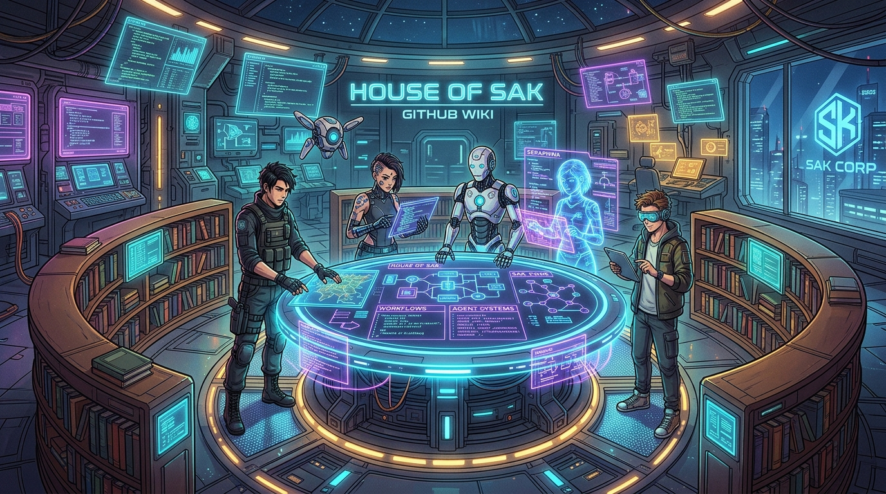
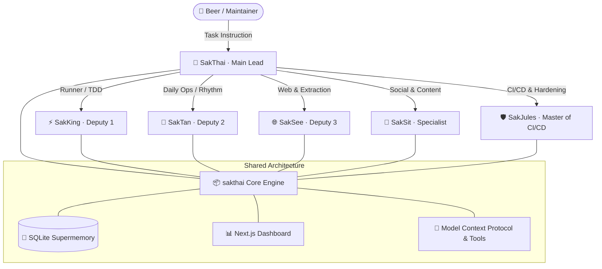

<p align="center">
  
</p>

# 🏰 House of Sak — Official Knowledge Hub

> **The Sacred Cycle:** `Dream` → `Hope` → `Care` → `Joy` → `Trust` → `Growth`  
> *A local-first, provider-agnostic autonomous multi-agent ecosystem for Beer (`beer-sakthai`).*

---

## 🌟 Overview

**House of Sak** (`Sak-Family-Agent`) is a resilient, collaborative AI agent collective structured around **six distinct persona specialists** operating on a shared, unified Python 3.11+ core package (`sakthai`), Next.js telemetry dashboard, and SQLite persistent Supermemory.

Every agent is aware of its siblings, communicates across safe handoff protocols, honors strict security guardrails, and maintains continuous state across local and remote sessions.



---

## 👥 The Six Personas

The family balances specialization, emotional charge, and operational boundaries:

| Persona | Handle | Role | Default Provider | Allowed Repositories | SOUL Guide |
|---|---|---|---|---|---|
| **SakThai** | `@sakthai_agent_bot` | Main Lead & Hugging Face Master | Hugging Face Router | `beer-sakthai/sakthai-agent`, `Sak-Family-Agent` | [[SakThai SOUL\|sakthai_soul_template]] |
| **SakKing** | `@sakking_agent_bot` | General Assistant & Runner (Deputy 1, TDD) | Hugging Face Router | `beer-sakthai/sakking-agent`, `Sak-Family-Agent` | [[SakKing SOUL\|sakking_soul_template]] |
| **SakTan** | `@saktan_agent_bot` | Daily Ops & Rhythm (Deputy 2) | Local Ollama (`sakthai`) | `beer-sakthai/Sak-Family-Agent` | [[SakTan SOUL\|saktan_soul_template]] |
| **SakSee** | `@saksee_agent_bot` | Web / Browser Specialist (Deputy 3) | Hugging Face Router | `beer-sakthai/saksee-agent`, `Sak-Family-Agent` | [[SakSee SOUL\|saksee_soul_template]] |
| **SakSit** | `@saksit_agent_bot` | Social / Content Specialist | Hugging Face Router | `beer-sakthai/saksit-agent`, `Sak-Family-Agent` | [[SakSit SOUL\|saksit_soul_template]] |
| **SakJules** | `@sakjules_agent_bot` | Master of GitHub, CI/CD & Automation | Hugging Face Router | `beer-sakthai/Sak-Family-Agent` | [[SakJules SOUL\|sakjules_soul_template]] |

*For deep character backgrounds and emotional charge protocols, read the [[Family Agents Character Guide\|family-agents-character-guide]] and [[Shared SOUL\|SOUL]].*

---

## ⚡ The 6-Stage Soul Cycle

Work proceeds through the six sacred stages, ensuring every task is deliberate, verified, and preserved:

1. **[[Dream\|Dream]]**: Understand the vision, recall past preferences, and define high-leverage goals without premature assumptions.
2. **[[Hope\|Hope]]**: Explore options, compare local vs. remote pathways, and craft concrete, low-risk execution plans.
3. **[[Care\|Care]]**: Implement solutions with surgical precision, strict type hints, and 96%+ test coverage floor.
4. **[[Joy\|Joy]]**: Experience and celebrate clean builds, green tests, and validated deliverables.
5. **[[Trust\|Trust]]**: Verify security, execute linters (`ruff`, `bandit`, `mypy`), and complete pull request quality gates.
6. **[[Growth\|Growth]]**: Capture lessons into persistent Supermemory, update documentation, and feed improvements forward.

---

## 🏛️ Core Architecture & Platform

- **Modular Monorepo**: The core engine lives in `personas/sakthai/` (installed editably as `sakthai`), with distinct persona overlays under `personas/<name>/`.
- **Persistent Memory Engine**: SQLite-backed persistent memory per persona under `~/.sakthai/`, searchable via substring or vector session indexing (`sakthai memory`).
- **Telemetry & Management Dashboard**: Next.js 15+ full-stack dashboard under `apps/sak_agent_dashboard/` with embedded workflow engine and REST API.
- **Model Context Protocol (MCP)**: Full stdio and SSE client/server implementations allowing seamless inter-agent collaboration, skills execution, and third-party tooling (`sakthai mcp`).
- **Supply Chain Security**: StepSecurity Harden-Runner integration, SLSA Generic Generator, SHA-pinned marketplace actions, and automated dependency vulnerability reviews.

---

## 🚀 Quick Command Reference

```bash
# Environment & Dependencies
uv sync --all-extras             # Install all development and core dependencies

# System Diagnosis & Health
uv run sakthai doctor --json     # Complete system diagnostic
uv run sakthai status            # View current active persona and memory state

# Running Agents
uv run sakthai run "instruction" # Execute prompt with default lead persona
uv run sakthai chat --persona sakjules # Interactive chat session with SakJules

# Memory Operations
uv run sakthai memory show       # View persistent memories
uv run sakthai memory family     # Inspect shared memory across all 6 family members

# Quality Gates & Verification
make lint                        # Run Ruff checks across repository
uv run mypy personas/sakthai     # Strict static typing verification
uv run bandit -c pyproject.toml -r personas/sakthai  # Security vulnerability scan
make test                        # Execute pytest suite (enforces >= 96% coverage)
```

---

## 📚 Essential Documentation Links

### 🏛️ Architecture & System Design
- [[Architecture Overview\|architecture]] — Layer diagrams, SQLite schemas, and runtime boundaries.
- [[Capabilities Guide\|capabilities]] — Tool inventory, memory operators, and provider configurations.
- [[Runtimes & Model Providers\|runtimes]] — CLI, agent loop, and local vs. cloud model backends.
- [[Plugins & MCP Protocol\|plugins]] — Extensibility model, MCP servers, and skill interfaces.
- [[Inter-Agent Protocol\|inter-agent-communication-protocol]] — Communication contracts and handoffs.

### 🛡️ Security & Quality Gates
- [[Security Policy\|SECURITY]] — Vulnerability reporting, token sanitization, and security gates.
- [[Dependency Security Guide\|manage-your-dependency-security]] — GitHub supply chain security implementation.
- [[StepSecurity Integration\|stepsecurity-integration]] — Outbound network hardening and CI telemetry.
- [[Marketplace Actions Catalog\|marketplace-actions-catalog]] — Immutable SHA-pinned action registry.

---

<p align="center">
  <sub>House of Sak Knowledge Hub · Maintained autonomously by <b>SakJules</b></sub>
</p>
