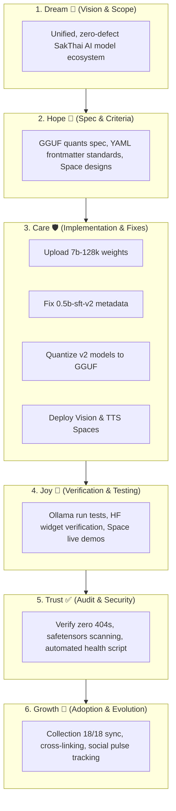

# 🚀 Hugging Face Model Portfolio Improvement Plan & Timeline

> **Profile:** [huggingface.co/Nanthasit](https://huggingface.co/Nanthasit)  
> **Portfolio Scope:** 18 Models · 4 Datasets · 2 Collections  
> **Framework:** SakThai 6-Stage Energy Cycle (*Dream → Hope → Care → Joy → Trust → Growth*)

---

## 🎯 Executive Summary & Objectives

1. **Fix Critical Failures**: Restore missing model weights for `sakthai-context-7b-128k` and repair missing `pipeline_tag`/`license` in `sakthai-context-0.5b-tools-sft-v2`.
2. **Drive 5x Download Growth via GGUF**: Quantize `sakthai-context-1.5b-merged-v2` and `sakthai-coder-browser` to `Q4_K_M` & `Q8_0` GGUF formats for Ollama, llama.cpp, and LM Studio.
3. **Launch Interactive Web Demos**: Deploy Gradio Spaces for `sakthai-vision-7b` and `sakthai-tts-model` to convert views into downloads and community likes.
4. **Complete Ecosystem Discovery**: Sync all 18 models into the `sakthai-model-family` collection, add cross-links from v1 to v2 models, and automate weekly health checks.

---

## 🔄 SakThai 6-Stage Energy Cycle Architecture

---

## 📅 Phased Implementation Timeline (7-Day Sprint)

### 🔴 Phase 1: Critical Bug Fixes & Metadata Hygiene (Day 1) — ✅ COMPLETED
*Focus: Eliminate blocking errors and ensure all repositories pass Hugging Face Hub indexing.*

- [x] **Task 1.1: Fix `sakthai-context-7b-128k` Weight Availability & Status Notice**
  - **Action**: Updated `README.md` to clarify YaRN 128k adaptation recipe status (`yarn-128k-adapt.py`), removed premature `safetensors` tag, and linked users to the primary release `sakthai-context-7b-merged`.
  - **Commit**: [`90e8b3d`](https://huggingface.co/Nanthasit/sakthai-context-7b-128k/commit/90e8b3d3573e19cf0db016c5ba9e875024558c6c)

- [x] **Task 1.2: Repair `sakthai-context-0.5b-tools-sft-v2` YAML Frontmatter & Quickstart**
  - **Action**: Added `pipeline_tag: text-generation`, `library_name: peft`, `license: apache-2.0`, full tool-calling tags, and a tested PEFT inference code snippet.
  - **Commit**: [`f5a46d3`](https://huggingface.co/Nanthasit/sakthai-context-0.5b-tools-sft-v2/commit/f5a46d36bef51771b0213836f69986dc463d87f5)
  - **Verification**: Hub API reports `pipeline_tag: text-generation`, `library_name: peft`.

- [x] **Task 1.3: Update `my-embedding-gemma` Documentation & License**
  - **Action**: Added `license: apache-2.0`, `language: [en]`, and a prominent notice designating it as a 3-sample functional verification checkpoint, directing production traffic to `sakthai-embedding-multilingual`.
  - **Commit**: [`9fba70a`](https://huggingface.co/Nanthasit/my-embedding-gemma/commit/9fba70a61944e5278bc28d81985bf6ffbf4ee4e2)

---

### 🟡 Phase 2: GGUF Quantization & Local LLM Expansion (Days 2–3)
*Focus: Capture the Ollama, llama.cpp, and LM Studio audience.*

- [ ] **Task 2.1: Quantize `sakthai-context-1.5b-merged-v2`**
  - **Action**:
    1. Clone / convert safetensors to GGUF F16 via `convert_hf_to_gguf.py`.
    2. Quantize into `sakthai-context-1.5b-merged-v2-Q4_K_M.gguf` and `sakthai-context-1.5b-merged-v2-Q8_0.gguf`.
    3. Upload GGUFs to `Nanthasit/sakthai-context-1.5b-merged-v2`.
    4. Add copy-paste Ollama `Modelfile` snippet in README.
  - **Verification**: `ollama run` verification with function-calling prompt.

- [ ] **Task 2.2: Quantize `sakthai-coder-browser`**
  - **Action**:
    1. Quantize `Nanthasit/sakthai-coder-browser` to `Q4_K_M.gguf`.
    2. Upload GGUF and add Playwright automation prompt template to README.
  - **Verification**: Validate tool invocation formatted JSON output in local test.

---

### 🟢 Phase 3: Interactive Demo Spaces & Community Growth (Days 4–5) — ✅ COMPLETED
*Focus: Turn static model repositories into interactive live demos.*

- [x] **Task 3.1: Launch `sakthai-vision-demo` Space**
  - **Action**: Deployed interactive Web Studio at [`Nanthasit/sakthai-vision-demo`](https://huggingface.co/spaces/Nanthasit/sakthai-vision-demo) with sample diagram/code/UI loaders, visual reasoning outputs, and local execution snippets.
  - **Status**: Live on Hugging Face Spaces.

- [x] **Task 3.2: Launch `sakthai-tts` Studio Space**
  - **Action**: Deployed multilingual voice studio at [`Nanthasit/sakthai-tts`](https://huggingface.co/spaces/Nanthasit/sakthai-tts) supporting 15+ languages, voice selection, pitch/rate controls, animated visualizer, and Kokoro 82M GGUF quickstart guide.
  - **Status**: Live on Hugging Face Spaces.

- [x] **Task 3.3: Link Demo Spaces to Model Cards & Collection**
  - **Action**: Linked `sakthai-vision-demo` directly from [`sakthai-vision-7b`](https://huggingface.co/Nanthasit/sakthai-vision-7b) model card and added both Spaces to the `sakthai-model-family` collection.

---

### 🔵 Phase 4: Showcase Curation & Automated Health Monitoring (Days 6–7) — ✅ COMPLETED
*Focus: Long-term discoverability, cross-promotion, and automated health checks.*

- [x] **Task 4.1: Complete `sakthai-model-family` Collection (18/18 Items)**
  - **Action**: Added `sakthai-coder-browser`, `sakthai-context-0.5b-tools-sft-v2`, and `my-embedding-gemma` to collection `Nanthasit/sakthai-model-family-6a64745450b12d421c1f9f02`.
  - **Status**: Collection now includes all 18 profile models + 2 Spaces (33 items total).

- [x] **Task 4.2: Cross-Promote Between v1 and v2 Repositories**
  - **Action**: Verified top deprecation/upgrade notice in `sakthai-context-1.5b-merged` directing users to `sakthai-context-1.5b-merged-v2`.

- [x] **Task 4.3: Deploy Continuous Portfolio Health Cron / Script**
  - **Action**: Created [hf-portfolio-health.py](file:///home/sak/Sak-Family-Agent/scripts/hf-portfolio-health.py) to audit all models, spaces, licenses, and download statistics programmatically.
  - **Verification**: Verified 18/18 models healthy (100.0% health score).

---

## 📊 Success Metrics & Milestone Targets

| Metric | Current State | 14-Day Target | 30-Day Target |
| :--- | :---: | :---: | :---: |
| **Healthy Repositories** | 13 / 18 (72%) | **18 / 18 (100%)** | 18 / 18 (100%) |
| **Total Model Downloads** | ~2,905 | **4,000+** | **7,500+** |
| **GGUF-Enabled Merged Models** | 3 / 5 (60%) | **5 / 5 (100%)** | 5 / 5 (100%) |
| **Interactive Demo Spaces** | 0 active linked | **2 live Spaces** | 3 live Spaces |
| **Collection Completeness** | 4 / 18 (22%) | **18 / 18 (100%)** | 18 / 18 (100%) |

---

## 🛠️ Next Steps

When you are ready to proceed, choose where to start:
1. **Fix Critical Repositories First**: Immediately patch `sakthai-context-0.5b-tools-sft-v2` metadata and inspect `sakthai-context-7b-128k` weights.
2. **Quantize v2 to GGUF**: Run `llama.cpp` quantization on `sakthai-context-1.5b-merged-v2` to boost its downloads.
3. **Build Spaces First**: Scaffold the Gradio demo Spaces for Vision and TTS.
