# GitHub Marketplace Actions Catalog & Security Standards

**Status:** Adopted  
**Standard:** OpenSSF Scorecard Immutable Commit SHA Pinning  
**Enforcement:** Automated tests (`tests/test_marketplace_actions.py`) & workflow permissions linter

---

## 1. Overview & Security Mandate

To prevent supply-chain attacks (such as tag mutation, compromised upstream accounts, or unexpected breaking changes), all third-party GitHub Actions utilized in the House of Sak repository must adhere to the following invariants:
1. **Commit SHA Pinning:** Every `uses:` reference must target a full 40-character commit SHA accompanied by a human-readable tag comment (e.g., `owner/repo@<sha> # <tag>`).
2. **Explicit Permissions Mapping:** Top-level and job-level permissions must be declared as explicit YAML mappings (e.g., `contents: read`). Broad scalar declarations (`read-all`, `write-all`) are rejected by repository linting.
3. **StepSecurity Harden-Runner:** Every runner instance executing third-party actions must initialize StepSecurity's `harden-runner` as its first step to enforce outbound network and file integrity.
4. **Deterministic Concurrency:** Every active workflow must declare a `concurrency:` group to avoid race conditions.

---

### 2. Forty-Five Verified Marketplace Actions

| Action Name | Upstream Repository | Tag | Immutable Commit SHA | Required Permissions | Purpose |
|---|---|---|---|---|---|
| **Create Pull Request** | [`devops-infra/action-pull-request`](https://github.com/devops-infra/action-pull-request) | `v0.5.5` | `e66e2ba93519dc63b9884a26e620e2fd0cffab2c` | `contents: write`, `pull-requests: write`, `issues: write` | Automated PR creation with template replacement & diffs |
| **Commit & Push** | [`devops-infra/action-commit-push`](https://github.com/devops-infra/action-commit-push) | `v0.9.2` | `be5ba37125c79eb0016cbd8cc385f0aa160538c5` | `contents: write` | Staging, signing, committing & pushing file changes |
| **Wiki Sync** | [`Andrew-Chen-Wang/github-wiki-action`](https://github.com/Andrew-Chen-Wang/github-wiki-action) | `v5` | `1bbb4280446f9630e8e21a18012cbacf3b0f992e` | `contents: write` | Syncs in-repo Markdown (`docs/`) to GitHub Wiki (`.wiki.git`) |
| **Branch Sync** | [`connor-baer/action-sync-branch`](https://github.com/connor-baer/action-sync-branch) | `v2` | `f5d20b6a6944c70909c187b558313dfc1d8daa48` | `contents: write`, `pull-requests: write` | Auto-syncs branches / opens catch-up PRs on merge |
| **Markdown Autodocs** | [`dineshsonachalam/markdown-autodocs`](https://github.com/dineshsonachalam/markdown-autodocs) | `v1.0.7` | `6596b4a049f087c7abe84cc7457e2c53652df810` | `contents: read` / `write` | Injects code blocks, JSON tables, and workflow artifacts into Markdown |
| **PR Comment Trigger** | [`Khan/pull-request-comment-trigger`](https://github.com/Khan/pull-request-comment-trigger) | `v1.1.0` | `edab8d9ba7759221187ef7120592a6fbfada0d18` | `pull-requests: read`, `issues: write` | Detects slash commands or keyword triggers in PR comments |
| **Deployment Action** | [`chrnorm/deployment-action`](https://github.com/chrnorm/deployment-action) | `v2.0.7` | `55729fcebec3d284f60f5bcabbd8376437d696b1` | `deployments: write` | Creates GitHub Deployments and tracks environment URLs |
| **Git PR Release** | [`bakunyo/git-pr-release-action`](https://github.com/bakunyo/git-pr-release-action) | `v1.4` | `035b7151a53745c03b85c6274ab1ae4bc734eccd` | `contents: write`, `pull-requests: write`, `issues: write` | Automated release PR aggregating merged PR summaries |
| **PR Deploy** | [`hngprojects/pr-deploy`](https://github.com/hngprojects/pr-deploy) | `V2.0.1` | `2f8b3e0dce07f0c6f7e6e80018dc52081a61b63b` | `contents: read`, `pull-requests: write` | Ephemeral containerized deployments for pull requests |
| **Continuous Benchmark** | [`benchmark-action/github-action-benchmark`](https://github.com/benchmark-action/github-action-benchmark) | `v1.22.2` | `4322e5726e6334590d251fc4f92bec0efafc45dc` | `contents: write`, `pull-requests: write` | Continuous performance metric tracking and regression alerts |
| **GitHub Release from Tag** | [`ghalactic/github-release-from-tag`](https://github.com/ghalactic/github-release-from-tag) | `v6` | `30770b91acccc8e1e2f14562d813cb30af08f1c6` | `contents: write`, `issues: write` | Automatic GitHub release creation sourced from git tags |
| **GitHub Activity Readme** | [`jamesgeorge007/github-activity-readme`](https://github.com/jamesgeorge007/github-activity-readme) | `v0.5.0` | `4aefbfa1c222d70537dc6a02f0519266aab2b1ea` | `contents: write` | Daily repository and contributor activity sync in README |
| **Renovate Bot Action** | [`renovatebot/github-action`](https://github.com/renovatebot/github-action) | `v46.3.14` | `acdd6bda8b035c99ce59d5675816af2aa65a1774` | `contents: read` | Automated self-hosted dependency upgrade automation |
| **Lint Action** | [`wearerequired/lint-action`](https://github.com/wearerequired/lint-action) | `v3.0.2` | `124229c6e2974984ba137c67a499ba28bfc33e33` | `contents: read`, `checks: write` | Automated multi-linter check and auto-fixing |
| **Create GitHub App Token** | [`actions/create-github-app-token`](https://github.com/actions/create-github-app-token) | `v3.3.0` | `64ab729a6294000f5aa4a4bc0b73d1f32bc45510` | `contents: read` | Generates short-lived installation tokens for bot automation |
| **Dependabot Auto-Merge** | [`fastify/github-action-merge-dependabot`](https://github.com/fastify/github-action-merge-dependabot) | `v3.15.0` | `73ec4cbb5e56df5591eae286972d5b2201ffe90f` | `contents: write`, `pull-requests: write` | Automated approval and merging for Dependabot PRs |
| **PR Lint Action** | [`seferov/pr-lint-action`](https://github.com/seferov/pr-lint-action) | `v2.0.0` | `cbef81c153f36262fbcd92fe97d6c6b8736d891d` | `contents: read`, `pull-requests: read` | Conventional Commits regex validation on pull request titles |
| **PR Label Checker** | [`Optimal-AI/PR-Label-Checker`](https://github.com/Optimal-AI/PR-Label-Checker) | `1.0.3` | `48d46fe6336aedcbb836ca580e86f195f9d14b01` | `contents: read`, `pull-requests: read` | Verifies required category labels on pull requests |
| **Manual Workflow Approval** | [`trstringer/manual-approval`](https://github.com/trstringer/manual-approval) | `v1.13.1` | `fa642940caf8412403569b28b2db4a1df08a83a3` | `issues: write` | Halts execution until approved by designated reviewers |
| **Step CI Action** | [`stepci/stepci`](https://github.com/stepci/stepci) | `2.8.2` | `570a42a52dcb9c7864031da79b047ffbaa268847` | `contents: read` | Automated API testing and performance verification |
| **Workflow Dispatch** | [`benc-uk/workflow-dispatch`](https://github.com/benc-uk/workflow-dispatch) | `v1.3.3` | `d004979be141727c7a17c28f603e2facc40d0855` | `actions: write`, `contents: read` | Dispatches secondary workflows programmatically |
| **Repo File Sync** | [`BetaHuhn/repo-file-sync-action`](https://github.com/BetaHuhn/repo-file-sync-action) | `v1.21.1` | `8b92be3375cf1d1b0cd579af488a9255572e4619` | `contents: write`, `pull-requests: write` | Synchronizes config/governance files across multiple repositories |
| **Trigger Workflow and Wait** | [`convictional/trigger-workflow-and-wait`](https://github.com/convictional/trigger-workflow-and-wait) | `v1.6.5` | `f69fa9eedd3c62a599220f4d5745230e237904be` | `actions: write`, `contents: read` | Triggers a workflow and blocks until completion status |
| **Workflow Conclusion** | [`technote-space/workflow-conclusion-action`](https://github.com/technote-space/workflow-conclusion-action) | `v3.0.3` | `45ce8e0eb155657ab8ccf346ade734257fd196a5` | `actions: read`, `contents: read` | Aggregates and determines conclusions of upstream jobs |
| **Actions Version Updater** | [`saadmk11/github-actions-version-updater`](https://github.com/saadmk11/github-actions-version-updater) | `v1.0.3` | `764bee6cd2905c6c91624f35332f1472fa736c23` | `contents: write`, `pull-requests: write` | Automated scanner updating action versions across workflows |
| **Runner Disk Cleaner** | [`rokibhasansagar/slimhub_actions`](https://github.com/rokibhasansagar/slimhub_actions) | `v25.42.5` | `5560c2d964bc240edfc5a0855b4b2c8261a29f29` | `contents: read` | Strips unnecessary runner software to maximize build disk headroom |
| **Workflow Dispatch & Wait** | [`the-actions-org/workflow-dispatch`](https://github.com/the-actions-org/workflow-dispatch) | `v4.0.0` | `3133c5d135c7dbe4be4f9793872b6ef331b53bc7` | `actions: write`, `contents: read` | Dispatches workflows with input payload and waits for conclusion |
| **Workflow Queue** | [`ahmadnassri/action-workflow-queue`](https://github.com/ahmadnassri/action-workflow-queue) | `v1.2.0` | `542658b3a8270cac81ae15d401b0d974732808ac` | `actions: read`, `contents: read` | Serializes and queues concurrent workflow executions |
| **Workflow Sync** | [`varunsridharan/action-github-workflow-sync`](https://github.com/varunsridharan/action-github-workflow-sync) | `3.5` | `3c60cce5ee8e615a7c68ac75fc14893dcac62d49` | `contents: write`, `pull-requests: write` | Synchronizes reusable workflows across ecosystem repositories |
| **Auto Cancel Redundant** | [`technote-space/auto-cancel-redundant-workflow`](https://github.com/technote-space/auto-cancel-redundant-workflow) | `v1.7.5` | `7d35aba30420fc2368f8aeed50371e99e7fa3239` | `actions: write`, `contents: read` | Automatically cancels redundant prior workflow runs |
| **Workflow Run Wait** | [`ahmadnassri/action-workflow-run-wait`](https://github.com/ahmadnassri/action-workflow-run-wait) | `v1.4.4` | `2aa3d9e1a12ecaaa9908e368eaf2123bb084323e` | `actions: read`, `contents: read` | Waits for concurrent or preceding workflow runs to complete |
| **GitFlow Lifecycle** | [`hoangvvo/gitflow-workflow-action`](https://github.com/hoangvvo/gitflow-workflow-action) | `0.3.8` | `a8dcd721fe5390b7f837873d5af2497980890a7e` | `contents: write`, `pull-requests: write` | Automates GitFlow branching, releases, and hotfix merges |
| **Setup GitHub Licensed** | [`github/setup-licensed`](https://github.com/github/setup-licensed) | `v1.3.1` | `be11bcbb82e3140b6cf260e647c3efeeca8fcefd` | `contents: read` | Installs and configures official licensed cache and tooling |
| **Workflow Immortality** | [`PhrozenByte/gh-workflow-immortality`](https://github.com/PhrozenByte/gh-workflow-immortality) | `v1` | `39378c27dcacbc17e6fbf83057d1fc40c574000d` | `contents: write` | Prevents automated scheduled workflow disabling from repository inactivity |
| **Actions Usage Audit** | [`fergusmacd/github-actions-usage`](https://github.com/fergusmacd/github-actions-usage) | `v0.9.2` | `86eef42173b5fe9778e33326468f51cc5a34348c` | `actions: read`, `contents: read` | Audits billable GitHub Actions runner minutes across the organization |
| **Workflow Status Indicator** | [`martialonline/workflow-status`](https://github.com/martialonline/workflow-status) | `v4.2` | `326830cacf79872efe767e15031f58d1ea0508c4` | `contents: read` | Generates dynamic status summaries and workflow badges |
| **Dispatch Workflow Method** | [`lasith-kg/dispatch-workflow`](https://github.com/lasith-kg/dispatch-workflow) | `v3.0.0` | `2597e9a3d222d7959052dea1c009560bbeb495e4` | `actions: write`, `contents: read` | Flexible repository_dispatch and workflow_dispatch cross-repo dispatcher |
| **Checkbox Workflow Action** | [`wadackel/checkbox-workflow-action`](https://github.com/wadackel/checkbox-workflow-action) | `v1.1.0` | `39a84e680429bb174302beed9f222e06972cecf9` | `issues: read`, `pull-requests: read` | Triggers CI steps upon checking checkboxes in PR bodies or comments |
| **Simple Comment PR** | [`NejcZdovc/comment-pr`](https://github.com/NejcZdovc/comment-pr) | `v2.1.0` | `a423635d183a8259308e80593c96fecf31539c26` | `pull-requests: write`, `contents: read` | Publishes formatted markdown updates directly to pull requests |
| **Wait for Workflow** | [`ArcticLampyrid/action-wait-for-workflow`](https://github.com/ArcticLampyrid/action-wait-for-workflow) | `v1.3.0` | `ff297b23789206858260877c4b83026d90c6db8c` | `actions: read`, `contents: read` | Polls and halts until target named workflow run reaches completion |
| **Git Flow Action** | [`kvendingoldo/git-flow-action`](https://github.com/kvendingoldo/git-flow-action) | `v2.16.0` | `ca756ba150c376eb9bf35e3ff3ed591913bb7f11` | `contents: write` | Automates GitFlow release branches, tags, and GitHub releases |
| **Gemini Actions** | [`dortort/gemini-actions`](https://github.com/dortort/gemini-actions) | `v0.1.0` | `c7ce09711c46a567055a16a762c0c99fdf181aeb` | `contents: read` | Meta-package and dispatcher for Google Gemini AI repository automation |
| **CI Dokumentor** | [`hoverkraft-tech/ci-dokumentor`](https://github.com/hoverkraft-tech/ci-dokumentor) | `0.6.1` | `93a10eb9c637d6b06ef394f12d60189b192b87c2` | `contents: read` | Automated generation of comprehensive CI/CD workflow documentation |
| **Code Review by Gemini AI** | [`rubensflinco/gemini-code-review-action`](https://github.com/rubensflinco/gemini-code-review-action) | `1.0.6` | `eff35325520e8afcd9ed86618920a4804925c05f` | `contents: read`, `pull-requests: write` | Automated pull request code reviews and diff chunk analysis via Gemini API |
| **Gemini Review Bot** | [`jgunnink/gemini-review-bot`](https://github.com/jgunnink/gemini-review-bot) | `v1.5.0` | `a1912666a1c394f0f7b51cb0910d02d54c1a93f7` | `contents: read`, `pull-requests: write` | Interactive PR code reviews, inline thread commentary, and diff analysis |

---

## 3. Workflow Implementations & Usage

```mermaid
graph TD
    Trigger[PR / Issue / Push / Tag / Schedule / Dispatch] --> Runner[StepSecurity Harden-Runner]
    Runner --> Checkout[Actions Checkout @ SHA]
    Checkout --> ActionChoice{Trigger Type}
    ActionChoice -->|Push to main| WikiSync[Andrew-Chen-Wang/github-wiki-action]
    ActionChoice -->|PR Comment| CommentTrigger[Khan/pull-request-comment-trigger]
    ActionChoice -->|Doc Sync| Autodocs[dineshsonachalam/markdown-autodocs]
    ActionChoice -->|Branch Sync| BranchSync[connor-baer/action-sync-branch]
    ActionChoice -->|Deploy Event| DeployAction[chrnorm/deployment-action]
    ActionChoice -->|Scheduled Hygiene| MaintenancePR[devops-infra/action-commit-push + action-pull-request]
    ActionChoice -->|Release PR| GitPRRelease[bakunyo/git-pr-release-action]
    ActionChoice -->|Container Deploy| PRDeploy[hngprojects/pr-deploy]
    ActionChoice -->|Benchmark Run| Benchmark[benchmark-action/github-action-benchmark]
    ActionChoice -->|Tag Push v*| TagRelease[ghalactic/github-release-from-tag]
    ActionChoice -->|Daily Schedule| ActivityReadme[jamesgeorge007/github-activity-readme]
    ActionChoice -->|Nightly Dependency| RenovateBot[renovatebot/github-action]
    ActionChoice -->|Quality Lint| MultiLint[wearerequired/lint-action]
    ActionChoice -->|Bot Authentication| AppToken[actions/create-github-app-token]
    ActionChoice -->|Dependabot PR| DependabotMerge[fastify/github-action-merge-dependabot]
    ActionChoice -->|PR Title Lint| PRLint[seferov/pr-lint-action]
    ActionChoice -->|Label Verification| PRLabelChecker[Optimal-AI/PR-Label-Checker]
    ActionChoice -->|Manual Approval Gate| ApprovalGate[trstringer/manual-approval]
    ActionChoice -->|API Testing| StepCI[stepci/stepci]
    ActionChoice -->|Dispatch Workflow| DispatchAction[benc-uk/workflow-dispatch]
    ActionChoice -->|Repo File Sync| FileSync[BetaHuhn/repo-file-sync-action]
    ActionChoice -->|Trigger & Wait| TriggerWait[convictional/trigger-workflow-and-wait]
    ActionChoice -->|Job Conclusion| ConclusionAction[technote-space/workflow-conclusion-action]
    ActionChoice -->|Actions Updater| ActionsUpdater[saadmk11/github-actions-version-updater]
    ActionChoice -->|Disk Space Cleaning| SlimHub[rokibhasansagar/slimhub_actions]
    ActionChoice -->|Dispatch & Wait| DispatchWait[the-actions-org/workflow-dispatch]
    ActionChoice -->|Workflow Queue| QueueAction[ahmadnassri/action-workflow-queue]
    ActionChoice -->|Workflow Sync| WfSync[varunsridharan/action-github-workflow-sync]
    ActionChoice -->|Cancel Redundant| AutoCancel[technote-space/auto-cancel-redundant-workflow]
    ActionChoice -->|Wait for Run| RunWait[ahmadnassri/action-workflow-run-wait]
    ActionChoice -->|GitFlow Lifecycle| GitFlow[hoangvvo/gitflow-workflow-action]
    ActionChoice -->|License Audit| Licensed[github/setup-licensed]
    ActionChoice -->|Keepalive Immortality| Immortality[PhrozenByte/gh-workflow-immortality]
    ActionChoice -->|Usage Audit| UsageAudit[fergusmacd/github-actions-usage]
    ActionChoice -->|Status Indicator| StatusIndicator[martialonline/workflow-status]
    ActionChoice -->|Custom Dispatch| CustomDispatch[lasith-kg/dispatch-workflow]
    ActionChoice -->|Checkbox Gate| CheckboxGate[wadackel/checkbox-workflow-action]
    ActionChoice -->|Comment on PR| CommentPR[NejcZdovc/comment-pr]
    ActionChoice -->|Wait for Workflow| WaitForWf[ArcticLampyrid/action-wait-for-workflow]
    ActionChoice -->|Git Flow Runner| GitFlowRunner[kvendingoldo/git-flow-action]
    ActionChoice -->|Gemini Actions| GeminiActions[dortort/gemini-actions]
    ActionChoice -->|CI Dokumentor| CIDokumentor[hoverkraft-tech/ci-dokumentor]
    ActionChoice -->|Gemini AI Review| GeminiAICodeReview[rubensflinco/gemini-code-review-action]
    ActionChoice -->|Gemini Review Bot| GeminiReviewBot[jgunnink/gemini-review-bot]
```



### 3.1 Wiki Sync Workflow ([`.github/workflows/wiki-sync.yml`](../.github/workflows/wiki-sync.yml))
Synchronizes documentation from `docs/` to GitHub Wiki on push to `main`:

```yaml
- name: Deploy Documentation to Wiki
  uses: Andrew-Chen-Wang/github-wiki-action@1bbb4280446f9630e8e21a18012cbacf3b0f992e # v5
  with:
    path: docs
    strategy: clone
```

### 3.2 PR Comment Trigger Workflow ([`.github/workflows/pr-comment-trigger.yml`](../.github/workflows/pr-comment-trigger.yml))
Detects slash commands (e.g., `@deploy`, `/benchmark`, `/preview`, `/test`) on pull requests:

```yaml
- name: Check for deploy trigger
  uses: Khan/pull-request-comment-trigger@edab8d9ba7759221187ef7120592a6fbfada0d18 # v1.1.0
  id: check-deploy
  with:
    trigger: '@deploy'
    reaction: rocket
  env:
    GITHUB_TOKEN: ${{ github.token }}
```

### 3.3 Markdown Autodocs Workflow ([`.github/workflows/autodocs.yml`](../.github/workflows/autodocs.yml))
Updates documentation tables and code blocks automatically:

```yaml
- name: Markdown Autodocs
  uses: dineshsonachalam/markdown-autodocs@6596b4a049f087c7abe84cc7457e2c53652df810 # v1.0.7
  with:
    output_file_paths: '["README.md"]'
```

### 3.4 Reusable Deployment Workflow ([`.github/workflows/reusable-deployment.yml`](../.github/workflows/reusable-deployment.yml))
Creates GitHub environment deployments and connects status tracking:

```yaml
- name: Create Deployment Record
  uses: chrnorm/deployment-action@55729fcebec3d284f60f5bcabbd8376437d696b1 # v2.0.7
  id: deployment
  with:
    token: ${{ github.token }}
    environment: ${{ inputs.environment }}
    environment-url: ${{ inputs.environment_url }}
```

### 3.5 Branch Sync Workflow ([`.github/workflows/branch-sync.yml`](../.github/workflows/branch-sync.yml))
Synchronizes branches across staging or downstream environments:

```yaml
- name: Synchronize Branch
  uses: connor-baer/action-sync-branch@f5d20b6a6944c70909c187b558313dfc1d8daa48 # v2
  with:
    branch: ${{ inputs.target_branch }}
    token: ${{ github.token }}
    force: false
```

### 3.6 Automated Maintenance PR Workflow ([`.github/workflows/automated-pr-maintenance.yml`](../.github/workflows/automated-pr-maintenance.yml))
Performs automated hygiene commits and opens structured Pull Requests:

```yaml
- name: Commit and push changes
  uses: devops-infra/action-commit-push@be5ba37125c79eb0016cbd8cc385f0aa160538c5 # v0.9.2
  with:
    github_token: ${{ github.token }}
    commit_prefix: "[automation]"
    commit_message: ${{ inputs.commit_message }}
    target_branch: ${{ inputs.branch_name }}

- name: Open Pull Request
  uses: devops-infra/action-pull-request@e66e2ba93519dc63b9884a26e620e2fd0cffab2c # v0.5.5
  with:
    github_token: ${{ github.token }}
    source_branch: ${{ inputs.branch_name }}
    target_branch: main
    title: ${{ inputs.pr_title }}
    template: .github/PULL_REQUEST_TEMPLATE.md
    label: automation,maintenance
```

### 3.7 Git PR Release Workflow ([`.github/workflows/git-pr-release.yml`](../.github/workflows/git-pr-release.yml))
Aggregates merged pull requests into a release candidate pull request:

```yaml
- name: Generate Release Pull Request
  uses: bakunyo/git-pr-release-action@035b7151a53745c03b85c6274ab1ae4bc734eccd # v1.4
  env:
    GITHUB_TOKEN: ${{ github.token }}
    GIT_PR_RELEASE_BRANCH_PRODUCTION: ${{ inputs.base_branch }}
    GIT_PR_RELEASE_BRANCH_STAGING: ${{ inputs.head_branch }}
```

### 3.8 Reusable PR Deploy Workflow ([`.github/workflows/reusable-pr-deploy.yml`](../.github/workflows/reusable-pr-deploy.yml))
Spins up containerized PR preview environments on remote Docker hosts:

```yaml
- name: Deploy Pull Request Container
  uses: hngprojects/pr-deploy@2f8b3e0dce07f0c6f7e6e80018dc52081a61b63b # V2.0.1
  with:
    context: ${{ inputs.docker_context }}
    server_port: ${{ inputs.server_port }}
  env:
    SERVER_HOST: ${{ secrets.SERVER_HOST }}
    SERVER_USERNAME: ${{ secrets.SERVER_USERNAME }}
    SERVER_PASSWORD: ${{ secrets.SERVER_PASSWORD }}
```

### 3.9 Continuous Benchmark Workflow ([`.github/workflows/continuous-benchmark.yml`](../.github/workflows/continuous-benchmark.yml))
Monitors execution performance and tracks metrics across commits:

```yaml
- name: Store and track benchmark results
  uses: benchmark-action/github-action-benchmark@4322e5726e6334590d251fc4f92bec0efafc45dc # v1.22.2
  with:
    name: SakThai Core Benchmarks
    tool: 'pytest'
    output-file-path: output.json
    github-token: ${{ github.token }}
    auto-push: false
    comment-on-alert: true
    fail-on-alert: false
```

### 3.10 Release from Tag Workflow ([`.github/workflows/release-from-tag.yml`](../.github/workflows/release-from-tag.yml))
Creates GitHub Releases automatically upon pushing SemVer `v*` tags:

```yaml
- name: Create GitHub Release
  uses: ghalactic/github-release-from-tag@30770b91acccc8e1e2f14562d813cb30af08f1c6 # v6
  with:
    generateReleaseNotes: true
  env:
    GITHUB_TOKEN: ${{ github.token }}
```

### 3.11 Activity in Readme Workflow ([`.github/workflows/activity-readme.yml`](../.github/workflows/activity-readme.yml))
Periodically synchronizes recent public repository activity into the README:

```yaml
- name: Update Activity Section
  uses: jamesgeorge007/github-activity-readme@4aefbfa1c222d70537dc6a02f0519266aab2b1ea # v0.5.0
  env:
    GITHUB_TOKEN: ${{ github.token }}
  with:
    COMMIT_MSG: "chore(docs): update recent activity section [skip ci]"
    MAX_LINES: 5
```

### 3.12 Renovate Bot Workflow ([`.github/workflows/renovate.yml`](../.github/workflows/renovate.yml))
Self-hosted Renovate runner checking dependencies with dry-run support:

```yaml
- name: Run Renovate
  uses: renovatebot/github-action@acdd6bda8b035c99ce59d5675816af2aa65a1774 # v46.3.14
  with:
    configurationFile: .github/renovate.json5
    token: ${{ secrets.RENOVATE_TOKEN || github.token }}
  env:
    LOG_LEVEL: info
    RENOVATE_DRY_RUN: ${{ inputs.dry_run || 'full' }}
```

### 3.13 Multi-Linter Action Workflow ([`.github/workflows/lint-check.yml`](../.github/workflows/lint-check.yml))
Runs linters and formatters with automatic annotations and optional fixes:

```yaml
- name: Run Lint Action
  uses: wearerequired/lint-action@124229c6e2974984ba137c67a499ba28bfc33e33 # v3.0.2
  with:
    github_token: ${{ github.token }}
    ruff: true
    auto_fix: ${{ inputs.auto_fix || false }}
```

### 3.14 Reusable GitHub App Token Generator ([`.github/workflows/reusable-app-token.yml`](../.github/workflows/reusable-app-token.yml))
Exchanges app credentials for short-lived bot installation access tokens:

```yaml
- name: Generate GitHub App Token
  uses: actions/create-github-app-token@64ab729a6294000f5aa4a4bc0b73d1f32bc45510 # v3.3.0
  id: app-token
  with:
    app-id: ${{ secrets.APP_ID }}
    private-key: ${{ secrets.PRIVATE_KEY }}
    owner: ${{ inputs.owner || github.repository_owner }}
```

### 3.15 Dependabot Auto-Merge Workflow ([`.github/workflows/dependabot-auto-merge.yml`](../.github/workflows/dependabot-auto-merge.yml))
Automatically evaluates, approves, and merges eligible Dependabot pull requests based on SemVer policies and un-spoofable actor verification:

```yaml
- name: Auto-Merge Dependabot PR
  uses: fastify/github-action-merge-dependabot@73ec4cbb5e56df5591eae286972d5b2201ffe90f # v3.15.0
  with:
    github-token: ${{ secrets.GITHUB_TOKEN }}
    target: ${{ inputs.target || 'any' }}
    pr-number: ${{ inputs.pr_number || '' }}
    merge-method: squash
```

### 3.16 PR Lint Action Workflow ([`.github/workflows/pr-lint.yml`](../.github/workflows/pr-lint.yml))
Enforces Conventional Commits title structure on incoming pull requests:

```yaml
- name: Verify PR Title Conventional Commits
  uses: seferov/pr-lint-action@cbef81c153f36262fbcd92fe97d6c6b8736d891d # v2.0.0
  with:
    title-regex: '^(feat|fix|docs|style|refactor|perf|test|build|ci|chore|revert|init)(\([a-zA-Z0-9_\-\/]+\))?: .+'
    error-message: 'PR title must follow Conventional Commits format (e.g., "feat: add feature", "fix(core): fix issue").'
```

### 3.17 PR Label Checker Workflow ([`.github/workflows/pr-label-checker.yml`](../.github/workflows/pr-label-checker.yml))
Automated workflow checking for mandatory classification labels on pull requests:

```yaml
- name: Check PR Labels
  uses: Optimal-AI/PR-Label-Checker@48d46fe6336aedcbb836ca580e86f195f9d14b01 # 1.0.3
```

### 3.18 Manual Workflow Approval Gate ([`.github/workflows/reusable-manual-approval-gate.yml`](../.github/workflows/reusable-manual-approval-gate.yml))
Enforces human-in-the-loop verification on critical pipelines:

```yaml
- name: Wait for manual approval
  uses: trstringer/manual-approval@fa642940caf8412403569b28b2db4a1df08a83a3 # v1.13.1
  with:
    secret: ${{ secrets.GITHUB_TOKEN }}
    approvers: ${{ inputs.approvers }}
    minimum-approvals: 1
```

### 3.19 Step CI API Testing ([`.github/workflows/step-ci.yml`](../.github/workflows/step-ci.yml))
Performs declarative HTTP/REST integration testing with Step CI:

```yaml
- name: Run Step CI
  uses: stepci/stepci@570a42a52dcb9c7864031da79b047ffbaa268847 # 2.8.2
  with:
    workflow: .stepci/smoke-test.yml
```

### 3.20 Reusable Workflow Dispatch ([`.github/workflows/reusable-workflow-dispatch.yml`](../.github/workflows/reusable-workflow-dispatch.yml))
Dispatches dependent downstream workflows programmatically:

```yaml
- name: Dispatch target workflow
  uses: benc-uk/workflow-dispatch@d004979be141727c7a17c28f603e2facc40d0855 # v1.3.3
  with:
    workflow: ${{ inputs.target_workflow }}
    token: ${{ github.token }}
```

### 3.21 Repo File Sync Workflow ([`.github/workflows/repo-file-sync.yml`](../.github/workflows/repo-file-sync.yml))
Synchronizes configuration and governance templates across repositories:

```yaml
- name: Run Repo File Sync
  uses: BetaHuhn/repo-file-sync-action@8b92be3375cf1d1b0cd579af488a9255572e4619 # v1.21.1
  with:
    GH_PAT: ${{ github.token }}
```

### 3.22 Reusable Trigger Workflow and Wait ([`.github/workflows/reusable-trigger-workflow-wait.yml`](../.github/workflows/reusable-trigger-workflow-wait.yml))
Triggers workflows and polls for final status conclusion:

```yaml
- name: Trigger remote workflow
  uses: convictional/trigger-workflow-and-wait@f69fa9eedd3c62a599220f4d5745230e237904be # v1.6.5
  with:
    owner: beer-sakthai
    repo: Sak-Family-Agent
    github_token: ${{ github.token }}
    workflow_file_name: ${{ inputs.workflow_file }}
```

### 3.23 Workflow Conclusion Evaluator ([`.github/workflows/workflow-conclusion.yml`](../.github/workflows/workflow-conclusion.yml))
Aggregates predecessor status outcomes across multiple asynchronous matrix jobs:

```yaml
- name: Evaluate conclusions
  uses: technote-space/workflow-conclusion-action@45ce8e0eb155657ab8ccf346ade734257fd196a5 # v3.0.3
```

### 3.24 Actions Version Updater ([`.github/workflows/actions-version-updater.yml`](../.github/workflows/actions-version-updater.yml))
Automated periodic scanner to discover and propose action updates:

```yaml
- name: Run GitHub Actions Version Updater
  uses: saadmk11/github-actions-version-updater@764bee6cd2905c6c91624f35332f1472fa736c23 # v1.0.3
  with:
    token: ${{ github.token }}
```

### 3.25 Runner Disk Space Cleaner ([`.github/workflows/runner-disk-cleaner.yml`](../.github/workflows/runner-disk-cleaner.yml))
Reclaims ephemeral disk space before executing large ML, model, or container builds:

```yaml
- name: Clean runner environment
  uses: rokibhasansagar/slimhub_actions@5560c2d964bc240edfc5a0855b4b2c8261a29f29 # v25.42.5
```

### 3.26 Reusable Workflow Dispatch & Wait ([`.github/workflows/reusable-workflow-dispatch-wait.yml`](../.github/workflows/reusable-workflow-dispatch-wait.yml))
Triggers a workflow dispatch event and waits for conclusion:

```yaml
- name: Trigger and wait
  uses: the-actions-org/workflow-dispatch@3133c5d135c7dbe4be4f9793872b6ef331b53bc7 # v4.0.0
  with:
    workflow: ${{ inputs.target_workflow }}
    token: ${{ github.token }}
```

### 3.27 Workflow Queue Serializer ([`.github/workflows/workflow-queue.yml`](../.github/workflows/workflow-queue.yml))
Guarantees strictly serialized execution across concurrent workflow dispatch events:

```yaml
- name: Queue Execution
  uses: ahmadnassri/action-workflow-queue@542658b3a8270cac81ae15d401b0d974732808ac # v1.2.0
  with:
    queue-name: global-deploy-queue
    timeout: 600
```

### 3.28 GitHub Workflow Sync ([`.github/workflows/github-workflow-sync.yml`](../.github/workflows/github-workflow-sync.yml))
Synchronizes GitHub Actions workflow files across repositories:

```yaml
- name: Sync workflows
  uses: varunsridharan/action-github-workflow-sync@3c60cce5ee8e615a7c68ac75fc14893dcac62d49 # 3.5
  with:
    GITHUB_TOKEN: ${{ github.token }}
    REPOSITORIES: beer-sakthai/Sak-Family-Agent
    WORKFLOW_FILES: lint-check.yml
```

### 3.29 Auto Cancel Redundant Workflows ([`.github/workflows/auto-cancel-redundant.yml`](../.github/workflows/auto-cancel-redundant.yml))
Automatically cancels outdated in-flight runs when newer commits arrive:

```yaml
- name: Cancel redundant workflow runs
  uses: technote-space/auto-cancel-redundant-workflow@7d35aba30420fc2368f8aeed50371e99e7fa3239 # v1.7.5
  with:
    GITHUB_TOKEN: ${{ github.token }}
```

### 3.30 Workflow Run Wait ([`.github/workflows/workflow-run-wait.yml`](../.github/workflows/workflow-run-wait.yml))
Waits for previous in-flight workflow runs to complete:

```yaml
- name: Wait for in-flight runs
  uses: ahmadnassri/action-workflow-run-wait@2aa3d9e1a12ecaaa9908e368eaf2123bb084323e # v1.4.4
  with:
    delay: 10
    timeout: 600
```

### 3.31 GitFlow Lifecycle Automation ([`.github/workflows/gitflow-lifecycle.yml`](../.github/workflows/gitflow-lifecycle.yml))
Automates GitFlow branching, release tags, and hotfix merges:

```yaml
- name: Run GitFlow Workflow Action
  uses: hoangvvo/gitflow-workflow-action@a8dcd721fe5390b7f837873d5af2497980890a7e # 0.3.8
  with:
    develop_branch: main
    main_branch: main
```

### 3.32 Setup GitHub Licensed ([`.github/workflows/licensed-audit.yml`](../.github/workflows/licensed-audit.yml))
Installs and configures official GitHub Licensed dependency audit tools:

```yaml
- name: Setup GitHub Licensed
  uses: github/setup-licensed@be11bcbb82e3140b6cf260e647c3efeeca8fcefd # v1.3.1
  with:
    version: '4.4.1'
```

### 3.33 Workflow Immortality Keepalive ([`.github/workflows/workflow-immortality.yml`](../.github/workflows/workflow-immortality.yml))
Prevents scheduled GitHub Actions from being disabled due to 60 days of inactivity:

```yaml
- name: Keep Workflows Active
  uses: PhrozenByte/gh-workflow-immortality@39378c27dcacbc17e6fbf83057d1fc40c574000d # v1
  with:
    secret: ${{ github.token }}
```

### 3.34 Actions Usage Audit ([`.github/workflows/actions-usage-audit.yml`](../.github/workflows/actions-usage-audit.yml))
Audits billable GitHub Actions runner minutes across the organization:

```yaml
- name: Audit Workflow Usage
  uses: fergusmacd/github-actions-usage@86eef42173b5fe9778e33326468f51cc5a34348c # v0.9.2
  with:
    organisation: beer-sakthai
    gitHubAPIKey: ${{ github.token }}
```

### 3.35 Workflow Status Indicator ([`.github/workflows/workflow-status-indicator.yml`](../.github/workflows/workflow-status-indicator.yml))
Generates dynamic status summaries and workflow conclusion indicators:

```yaml
- name: Output Status Indicator
  uses: martialonline/workflow-status@326830cacf79872efe767e15031f58d1ea0508c4 # v4.2
```

### 3.36 Reusable Dispatch Method ([`.github/workflows/reusable-dispatch-method.yml`](../.github/workflows/reusable-dispatch-method.yml))
Dispatches cross-repository workflows using configurable dispatch methods:

```yaml
- name: Trigger Dispatch
  uses: lasith-kg/dispatch-workflow@2597e9a3d222d7959052dea1c009560bbeb495e4 # v3.0.0
  with:
    dispatch-method: workflow_dispatch
    owner: beer-sakthai
    repo: ${{ inputs.target_repo }}
    token: ${{ github.token }}
    workflow: lint-check.yml
```

### 3.37 Checkbox Workflow Trigger ([`.github/workflows/checkbox-trigger.yml`](../.github/workflows/checkbox-trigger.yml))
Triggers steps based on checkbox states in issues or pull requests:

```yaml
- name: Checkbox Action
  uses: wadackel/checkbox-workflow-action@39a84e680429bb174302beed9f222e06972cecf9 # v1.1.0
  with:
    id: test-checkbox
    number: 1
```

### 3.38 Reusable Comment PR Helper ([`.github/workflows/reusable-comment-pr.yml`](../.github/workflows/reusable-comment-pr.yml))
Publishes formatted markdown updates directly to pull requests:

```yaml
- name: Comment on PR
  uses: NejcZdovc/comment-pr@a423635d183a8259308e80593c96fecf31539c26 # v2.1.0
  with:
    file: ''
    message: ${{ inputs.comment_body }}
```

### 3.39 Wait for Workflow ([`.github/workflows/wait-for-workflow.yml`](../.github/workflows/wait-for-workflow.yml))
Polls and halts until the target named workflow completes:

```yaml
- name: Wait for target workflow
  uses: ArcticLampyrid/action-wait-for-workflow@ff297b23789206858260877c4b83026d90c6db8c # v1.3.0
  with:
    workflow: lint-check.yml
    token: ${{ github.token }}
```

### 3.40 Git Flow Action ([`.github/workflows/git-flow-action.yml`](../.github/workflows/git-flow-action.yml))
Executes GitFlow release branching and tagging operations:

```yaml
- name: Run Git Flow Action
  uses: kvendingoldo/git-flow-action@ca756ba150c376eb9bf35e3ff3ed591913bb7f11 # v2.16.0
  with:
    enable_git_push: ${{ inputs.enable_git_push || 'false' }}
    log_level: ${{ inputs.log_level || 'INFO' }}
    github_token: ${{ secrets.GITHUB_TOKEN }}
```

### 3.41 Gemini Actions Dispatcher ([`.github/workflows/gemini-actions.yml`](../.github/workflows/gemini-actions.yml))
Meta-package and dispatcher for repository tasks automated by Google Gemini AI:

```yaml
- name: Execute Gemini Actions Dispatcher
  uses: dortort/gemini-actions@c7ce09711c46a567055a16a762c0c99fdf181aeb # v0.1.0
  with:
    action: ${{ inputs.action_mode || 'info' }}
```

### 3.42 CI Dokumentor Workflow ([`.github/workflows/ci-dokumentor.yml`](../.github/workflows/ci-dokumentor.yml))
Generates comprehensive documentation for CI/CD workflow manifests:

```yaml
- name: Document CI Workflows
  uses: hoverkraft-tech/ci-dokumentor@93a10eb9c637d6b06ef394f12d60189b192b87c2 # 0.6.1
  with:
    source: ${{ inputs.source_workflow || '.github/workflows/ci.yml' }}
    dry-run: ${{ inputs.dry_run || 'true' }}
    github-token: ${{ secrets.GITHUB_TOKEN }}
```

### 3.43 Code Review by Gemini AI ([`.github/workflows/gemini-code-review-action.yml`](../.github/workflows/gemini-code-review-action.yml))
Reviews pull requests and provides automated diff chunk analysis using the Gemini API:

```yaml
- name: Run Gemini AI Code Review
  if: steps.check_secret.outputs.has_key == 'true'
  uses: rubensflinco/gemini-code-review-action@eff35325520e8afcd9ed86618920a4804925c05f # 1.0.6
  with:
    gemini_api_key: ${{ secrets.GEMINI_API_KEY }}
    github_token: ${{ secrets.GITHUB_TOKEN }}
    github_repository: ${{ github.repository }}
    github_pull_request_number: ${{ inputs.pull_request_number || '1' }}
    git_commit_hash: ${{ github.sha }}
    model: "gemini-3.8-flash"
    pull_request_diff: "dry-run-diff"
```

### 3.44 Gemini Review Bot ([`.github/workflows/gemini-review-bot.yml`](../.github/workflows/gemini-review-bot.yml))
Provides interactive PR code reviews, inline thread commentary, and diff analysis:

```yaml
- name: Execute Gemini Review Bot
  if: steps.check_secret.outputs.has_key == 'true'
  uses: jgunnink/gemini-review-bot@a1912666a1c394f0f7b51cb0910d02d54c1a93f7 # v1.5.0
  with:
    gemini_api_key: ${{ secrets.GEMINI_API_KEY }}
    github_token: ${{ secrets.GITHUB_TOKEN }}
    instructions: ${{ inputs.instructions || '' }}
```

---

## 4. Threat Modeling & Supply Chain Defense

1. **Tag Mutation Resistance:** Even if an upstream author re-tags or an attacker force-pushes a malicious payload to an existing release tag, the pinned 40-character SHA prevents execution of altered code.
2. **Least Privilege Enforcement:** Every workflow declares minimal permissions per job. No workflow uses repository-wide `write-all` permissions.
3. **Egress Network Policy:** StepSecurity Harden-Runner restricts runner DNS and IP outbound traffic, preventing token exfiltration.
4. **CI Invariant Guardrails:** The test suite in `tests/test_marketplace_actions.py` validates on every build that all action references match their approved commit SHAs and follow concurrency policies.
