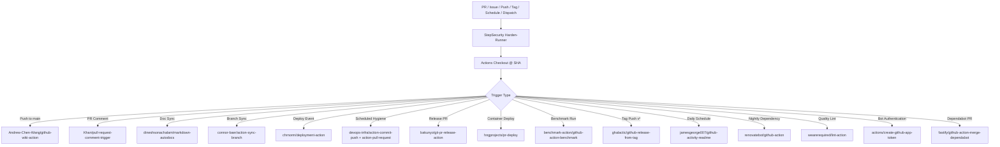

# GitHub Marketplace Actions Catalog & Security Standards

**Status:** Adopted  
**Standard:** OpenSSF Scorecard Immutable Commit SHA Pinning  
**Enforcement:** Automated tests (`tests/test_marketplace_actions.py`) & workflow permissions linter

---

## 1. Overview & Security Mandate

To prevent supply-chain attacks (such as tag mutation, compromised upstream accounts, or unexpected breaking changes), all third-party GitHub Actions utilized in the House of Sak repository must adhere to the following invariants:
1. **Commit SHA Pinning:** Every `uses:` reference must target a full 40-character commit SHA accompanied by a human-readable tag comment (e.g., `owner/repo@<sha> # <tag>`).
2. **Explicit Permissions Mapping:** Top-level and job-level permissions must be declared as explicit YAML mappings (e.g., `contents: read`). Broad scalar declarations (`read-all`, `write-all`) are rejected by repository linting.
3. **StepSecurity Harden-Runner:** Every runner instance executing third-party actions must initialize StepSecurity's `harden-runner` as its first step to enforce outbound network and file integrity.
4. **Deterministic Concurrency:** Every active workflow must declare a `concurrency:` group to avoid race conditions.

---

## 2. Sixteen Verified Marketplace Actions

| Action Name | Upstream Repository | Tag | Immutable Commit SHA | Required Permissions | Purpose |
|---|---|---|---|---|---|
| **Create Pull Request** | [`devops-infra/action-pull-request`](https://github.com/devops-infra/action-pull-request) | `v0.5.5` | `e66e2ba93519dc63b9884a26e620e2fd0cffab2c` | `contents: write`, `pull-requests: write`, `issues: write` | Automated PR creation with template replacement & diffs |
| **Commit & Push** | [`devops-infra/action-commit-push`](https://github.com/devops-infra/action-commit-push) | `v0.9.2` | `be5ba37125c79eb0016cbd8cc385f0aa160538c5` | `contents: write` | Staging, signing, committing & pushing file changes |
| **Wiki Sync** | [`Andrew-Chen-Wang/github-wiki-action`](https://github.com/Andrew-Chen-Wang/github-wiki-action) | `v5` | `1bbb4280446f9630e8e21a18012cbacf3b0f992e` | `contents: write` | Syncs in-repo Markdown (`docs/`) to GitHub Wiki (`.wiki.git`) |
| **Branch Sync** | [`connor-baer/action-sync-branch`](https://github.com/connor-baer/action-sync-branch) | `v2` | `f5d20b6a6944c70909c187b558313dfc1d8daa48` | `contents: write`, `pull-requests: write` | Auto-syncs branches / opens catch-up PRs on merge |
| **Markdown Autodocs** | [`dineshsonachalam/markdown-autodocs`](https://github.com/dineshsonachalam/markdown-autodocs) | `v1.0.7` | `6596b4a049f087c7abe84cc7457e2c53652df810` | `contents: read` / `write` | Injects code blocks, JSON tables, and workflow artifacts into Markdown |
| **PR Comment Trigger** | [`Khan/pull-request-comment-trigger`](https://github.com/Khan/pull-request-comment-trigger) | `v1.1.0` | `edab8d9ba7759221187ef7120592a6fbfada0d18` | `pull-requests: read`, `issues: write` | Detects slash commands or keyword triggers in PR comments |
| **Deployment Action** | [`chrnorm/deployment-action`](https://github.com/chrnorm/deployment-action) | `v2.0.7` | `55729fcebec3d284f60f5bcabbd8376437d696b1` | `deployments: write` | Creates GitHub Deployments and tracks environment URLs |
| **Git PR Release** | [`bakunyo/git-pr-release-action`](https://github.com/bakunyo/git-pr-release-action) | `v1.4` | `035b7151a53745c03b85c6274ab1ae4bc734eccd` | `contents: write`, `pull-requests: write`, `issues: write` | Automated release PR aggregating merged PR summaries |
| **PR Deploy** | [`hngprojects/pr-deploy`](https://github.com/hngprojects/pr-deploy) | `V2.0.1` | `2f8b3e0dce07f0c6f7e6e80018dc52081a61b63b` | `contents: read`, `pull-requests: write` | Ephemeral containerized deployments for pull requests |
| **Continuous Benchmark** | [`benchmark-action/github-action-benchmark`](https://github.com/benchmark-action/github-action-benchmark) | `v1.22.2` | `4322e5726e6334590d251fc4f92bec0efafc45dc` | `contents: write`, `pull-requests: write` | Continuous performance metric tracking and regression alerts |
| **GitHub Release from Tag** | [`ghalactic/github-release-from-tag`](https://github.com/ghalactic/github-release-from-tag) | `v6` | `30770b91acccc8e1e2f14562d813cb30af08f1c6` | `contents: write`, `issues: write` | Automatic GitHub release creation sourced from git tags |
| **GitHub Activity Readme** | [`jamesgeorge007/github-activity-readme`](https://github.com/jamesgeorge007/github-activity-readme) | `v0.5.0` | `4aefbfa1c222d70537dc6a02f0519266aab2b1ea` | `contents: write` | Daily repository and contributor activity sync in README |
| **Renovate Bot Action** | [`renovatebot/github-action`](https://github.com/renovatebot/github-action) | `v46.3.14` | `acdd6bda8b035c99ce59d5675816af2aa65a1774` | `contents: read` | Automated self-hosted dependency upgrade automation |
| **Lint Action** | [`wearerequired/lint-action`](https://github.com/wearerequired/lint-action) | `v3.0.2` | `124229c6e2974984ba137c67a499ba28bfc33e33` | `contents: read`, `checks: write` | Automated multi-linter check and auto-fixing |
| **Create GitHub App Token** | [`actions/create-github-app-token`](https://github.com/actions/create-github-app-token) | `v3.3.0` | `64ab729a6294000f5aa4a4bc0b73d1f32bc45510` | `contents: read` | Generates short-lived installation tokens for bot automation |
| **Dependabot Auto-Merge** | [`fastify/github-action-merge-dependabot`](https://github.com/fastify/github-action-merge-dependabot) | `v3.15.0` | `73ec4cbb5e56df5591eae286972d5b2201ffe90f` | `contents: write`, `pull-requests: write` | Automated approval and merging for Dependabot PRs |

---

## 3. Workflow Implementations & Usage



### 3.1 Wiki Sync Workflow ([`.github/workflows/wiki-sync.yml`](../.github/workflows/wiki-sync.yml))
Synchronizes documentation from `docs/` to GitHub Wiki on push to `main`:

```yaml
- name: Deploy Documentation to Wiki
  uses: Andrew-Chen-Wang/github-wiki-action@1bbb4280446f9630e8e21a18012cbacf3b0f992e # v5
  with:
    path: docs
    strategy: clone
```

### 3.2 PR Comment Trigger Workflow ([`.github/workflows/pr-comment-trigger.yml`](../.github/workflows/pr-comment-trigger.yml))
Detects slash commands (e.g., `@deploy`, `/benchmark`, `/preview`, `/test`) on pull requests:

```yaml
- name: Check for deploy trigger
  uses: Khan/pull-request-comment-trigger@edab8d9ba7759221187ef7120592a6fbfada0d18 # v1.1.0
  id: check-deploy
  with:
    trigger: '@deploy'
    reaction: rocket
  env:
    GITHUB_TOKEN: ${{ github.token }}
```

### 3.3 Markdown Autodocs Workflow ([`.github/workflows/autodocs.yml`](../.github/workflows/autodocs.yml))
Updates documentation tables and code blocks automatically:

```yaml
- name: Markdown Autodocs
  uses: dineshsonachalam/markdown-autodocs@6596b4a049f087c7abe84cc7457e2c53652df810 # v1.0.7
  with:
    output_file_paths: '["README.md"]'
```

### 3.4 Reusable Deployment Workflow ([`.github/workflows/reusable-deployment.yml`](../.github/workflows/reusable-deployment.yml))
Creates GitHub environment deployments and connects status tracking:

```yaml
- name: Create Deployment Record
  uses: chrnorm/deployment-action@55729fcebec3d284f60f5bcabbd8376437d696b1 # v2.0.7
  id: deployment
  with:
    token: ${{ github.token }}
    environment: ${{ inputs.environment }}
    environment-url: ${{ inputs.environment_url }}
```

### 3.5 Branch Sync Workflow ([`.github/workflows/branch-sync.yml`](../.github/workflows/branch-sync.yml))
Synchronizes branches across staging or downstream environments:

```yaml
- name: Synchronize Branch
  uses: connor-baer/action-sync-branch@f5d20b6a6944c70909c187b558313dfc1d8daa48 # v2
  with:
    branch: ${{ inputs.target_branch }}
    token: ${{ github.token }}
    force: false
```

### 3.6 Automated Maintenance PR Workflow ([`.github/workflows/automated-pr-maintenance.yml`](../.github/workflows/automated-pr-maintenance.yml))
Performs automated hygiene commits and opens structured Pull Requests:

```yaml
- name: Commit and push changes
  uses: devops-infra/action-commit-push@be5ba37125c79eb0016cbd8cc385f0aa160538c5 # v0.9.2
  with:
    github_token: ${{ github.token }}
    commit_prefix: "[automation]"
    commit_message: ${{ inputs.commit_message }}
    target_branch: ${{ inputs.branch_name }}

- name: Open Pull Request
  uses: devops-infra/action-pull-request@e66e2ba93519dc63b9884a26e620e2fd0cffab2c # v0.5.5
  with:
    github_token: ${{ github.token }}
    source_branch: ${{ inputs.branch_name }}
    target_branch: main
    title: ${{ inputs.pr_title }}
    template: .github/PULL_REQUEST_TEMPLATE.md
    label: automation,maintenance
```

### 3.7 Git PR Release Workflow ([`.github/workflows/git-pr-release.yml`](../.github/workflows/git-pr-release.yml))
Aggregates merged pull requests into a release candidate pull request:

```yaml
- name: Generate Release Pull Request
  uses: bakunyo/git-pr-release-action@035b7151a53745c03b85c6274ab1ae4bc734eccd # v1.4
  env:
    GITHUB_TOKEN: ${{ github.token }}
    GIT_PR_RELEASE_BRANCH_PRODUCTION: ${{ inputs.base_branch }}
    GIT_PR_RELEASE_BRANCH_STAGING: ${{ inputs.head_branch }}
```

### 3.8 Reusable PR Deploy Workflow ([`.github/workflows/reusable-pr-deploy.yml`](../.github/workflows/reusable-pr-deploy.yml))
Spins up containerized PR preview environments on remote Docker hosts:

```yaml
- name: Deploy Pull Request Container
  uses: hngprojects/pr-deploy@2f8b3e0dce07f0c6f7e6e80018dc52081a61b63b # V2.0.1
  with:
    context: ${{ inputs.docker_context }}
    server_port: ${{ inputs.server_port }}
  env:
    SERVER_HOST: ${{ secrets.SERVER_HOST }}
    SERVER_USERNAME: ${{ secrets.SERVER_USERNAME }}
    SERVER_PASSWORD: ${{ secrets.SERVER_PASSWORD }}
```

### 3.9 Continuous Benchmark Workflow ([`.github/workflows/continuous-benchmark.yml`](../.github/workflows/continuous-benchmark.yml))
Monitors execution performance and tracks metrics across commits:

```yaml
- name: Store and track benchmark results
  uses: benchmark-action/github-action-benchmark@4322e5726e6334590d251fc4f92bec0efafc45dc # v1.22.2
  with:
    name: SakThai Core Benchmarks
    tool: 'pytest'
    output-file-path: output.json
    github-token: ${{ github.token }}
    auto-push: false
    comment-on-alert: true
    fail-on-alert: false
```

### 3.10 Release from Tag Workflow ([`.github/workflows/release-from-tag.yml`](../.github/workflows/release-from-tag.yml))
Creates GitHub Releases automatically upon pushing SemVer `v*` tags:

```yaml
- name: Create GitHub Release
  uses: ghalactic/github-release-from-tag@30770b91acccc8e1e2f14562d813cb30af08f1c6 # v6
  with:
    generateReleaseNotes: true
  env:
    GITHUB_TOKEN: ${{ github.token }}
```

### 3.11 Activity in Readme Workflow ([`.github/workflows/activity-readme.yml`](../.github/workflows/activity-readme.yml))
Periodically synchronizes recent public repository activity into the README:

```yaml
- name: Update Activity Section
  uses: jamesgeorge007/github-activity-readme@4aefbfa1c222d70537dc6a02f0519266aab2b1ea # v0.5.0
  env:
    GITHUB_TOKEN: ${{ github.token }}
  with:
    COMMIT_MSG: "chore(docs): update recent activity section [skip ci]"
    MAX_LINES: 5
```

### 3.12 Renovate Bot Workflow ([`.github/workflows/renovate.yml`](../.github/workflows/renovate.yml))
Self-hosted Renovate runner checking dependencies with dry-run support:

```yaml
- name: Run Renovate
  uses: renovatebot/github-action@acdd6bda8b035c99ce59d5675816af2aa65a1774 # v46.3.14
  with:
    configurationFile: .github/renovate.json5
    token: ${{ secrets.RENOVATE_TOKEN || github.token }}
  env:
    LOG_LEVEL: info
    RENOVATE_DRY_RUN: ${{ inputs.dry_run || 'full' }}
```

### 3.13 Multi-Linter Action Workflow ([`.github/workflows/lint-check.yml`](../.github/workflows/lint-check.yml))
Runs linters and formatters with automatic annotations and optional fixes:

```yaml
- name: Run Lint Action
  uses: wearerequired/lint-action@124229c6e2974984ba137c67a499ba28bfc33e33 # v3.0.2
  with:
    github_token: ${{ github.token }}
    ruff: true
    auto_fix: ${{ inputs.auto_fix || false }}
```

### 3.14 Reusable GitHub App Token Generator ([`.github/workflows/reusable-app-token.yml`](../.github/workflows/reusable-app-token.yml))
Exchanges app credentials for short-lived bot installation access tokens:

```yaml
- name: Generate GitHub App Token
  uses: actions/create-github-app-token@64ab729a6294000f5aa4a4bc0b73d1f32bc45510 # v3.3.0
  id: app-token
  with:
    app-id: ${{ secrets.APP_ID }}
    private-key: ${{ secrets.PRIVATE_KEY }}
    owner: ${{ inputs.owner || github.repository_owner }}
```

### 3.15 Dependabot Auto-Merge Workflow ([`.github/workflows/dependabot-auto-merge.yml`](../.github/workflows/dependabot-auto-merge.yml))
Automatically evaluates, approves, and merges eligible Dependabot pull requests based on SemVer policies and un-spoofable actor verification:

```yaml
- name: Auto-Merge Dependabot PR
  uses: fastify/github-action-merge-dependabot@73ec4cbb5e56df5591eae286972d5b2201ffe90f # v3.15.0
  with:
    github-token: ${{ secrets.GITHUB_TOKEN }}
    target: ${{ inputs.target || 'any' }}
    pr-number: ${{ inputs.pr_number || '' }}
    merge-method: squash
```

---

## 4. Threat Modeling & Supply Chain Defense

1. **Tag Mutation Resistance:** Even if an upstream author re-tags or an attacker force-pushes a malicious payload to an existing release tag, the pinned 40-character SHA prevents execution of altered code.
2. **Least Privilege Enforcement:** Every workflow declares minimal permissions per job. No workflow uses repository-wide `write-all` permissions.
3. **Egress Network Policy:** StepSecurity Harden-Runner restricts runner DNS and IP outbound traffic, preventing token exfiltration.
4. **CI Invariant Guardrails:** The test suite in `tests/test_marketplace_actions.py` validates on every build that all action references match their approved commit SHAs and follow concurrency policies.
