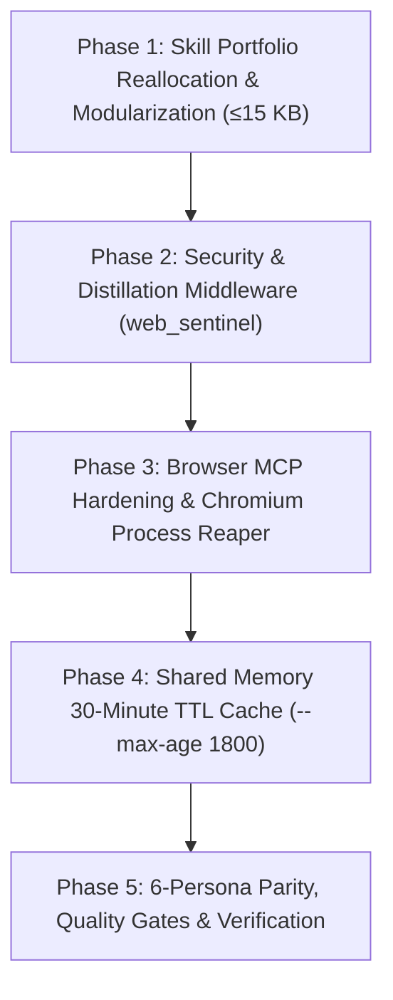

# SakSee 👁️ Web & Browser Specialist Fleet Enhancement Plan

> **Goal**: Sharpen SakSee as the dedicated Web, Browser, and DOM Specialist of the House of Sak by reallocating non-browser skills, modularizing oversized skills (<15 KB), implementing zero-cost HTML-to-Markdown distillation with automated prompt-injection wrapping, hardening browser MCP process hygiene, and introducing native 30-minute memory TTL filtering (`--max-age 1800`).
>
> **Methodology**: `superpowers-unified` (TDD, Iron Laws, strict verification before completion).
>
> **Parity Invariant**: Preserve 51-item structural parity across all 6 personas and maintain the repository's $\ge 96.0\%$ test coverage floor.

---

## Architecture & Phase Breakdown

---

### Phase 1: Skill Portfolio Reallocation & Modularization (<15 KB Invariant)

- [x] 2026-11-26 **Task 1.1: Reallocate 11 Non-Browser Skills to Sibling Personas**
  - **Targets**:
    - To **SakThai** (`personas/sakthai/skills/`): `SakSee-research-paper-writing` (100.8 KB), `SakSee-weights-and-biases`, `SakSee-bonsai-27b-1bit`, `SakSee-serving-llms-vllm`, `SakSee-llm-wiki` &rarr; rename prefix to `SakThai-`.
    - To **SakSit** (`personas/saksit/skills/`): `SakSee-songwriting-and-ai-music`, `SakSee-songsee`, `SakSee-humanizer` &rarr; rename prefix to `SakSit-`.
    - To **SakKing** (`personas/sakking/skills/`): `SakSee-openhue`, `SakSee-imessage`, `SakSee-powerpoint` (with 39 schemas), `SakSee-petdex` &rarr; rename prefix to `SakKing-`.
  - **Verification**: `python3 scripts/diagnose_personas.py` and `uv run pytest tests/test_skills.py`.

- [x] 2026-11-26 **Task 1.2: Modularize & Compress 6 Oversized Skills (< 15 KB)**
  - **Targets**: `SakSee-business-landing-page`, `SakSee-claude-design`, `SakSee-comfyui`, `SakSee-convert-web-app`, `SakSee-p5js`, `SakSee-transformers-js`.
  - **Action**: Extract bulky inline templates, shader strings, and JSON graphs into `templates/` / `assets/` subfolders; streamline `SKILL.md` to actionable procedures $\le 12\text{ KB}$.
  - **Verification**: Run size validator ensuring 0 skills exceed 15 KB.

- [x] 2026-11-26 **Task 1.3: Update Persona Documentation & Workspace Declarations**
  - **Targets**: `personas/saksee/BACKPACK.md`, `personas/saksee/HANDOFF.md`, `personas/saksee/config/workspace.yaml`, and updated sibling files.
  - **Verification**: `uv run pytest tests/test_skills_organization_parity.py`.

---

### Phase 2: Security & Distillation Middleware (`web_sentinel`)

- [x] 2026-11-26 **Task 2.1: Write Failing Tests for HTML Distillation & Injection Boundary (RED)**
  - **Targets**: `tests/test_web_sentinel.py`
  - **Criteria**: Test that raw HTML with script tags, navigation boilerplate, and prompts is distilled to semantic Markdown and enclosed in `<untrusted_web_content source="<url>">...</untrusted_web_content>`.
  - **Verification**: Test fails with `ImportError` or `AssertionError`.

- [x] 2026-11-26 **Task 2.2: Implement HTML Distillation & Sanitization (GREEN)**
  - **Targets**: `personas/sakthai/agent/web_distill.py` and `personas/saksee/extensions/web_sentinel/`
  - **Action**: Zero-dependency or lightweight regex/HTML parser extracting main article text, stripping scripts/styles/SVGs, and applying boundary tags.
  - **Verification**: `uv run pytest tests/test_web_sentinel.py` passes cleanly.

---

### Phase 3: Browser MCP Hardening & Chromium Process Hygiene

- [x] 2026-11-26 **Task 3.1: Prune Unused MCP Servers**
  - **Targets**: `personas/saksee/config/mcp.json`
  - **Action**: Remove `microsoft365` MCP server from SakSee.
  - **Verification**: `python3 -c "import json; assert 'microsoft365' not in json.load(open('personas/saksee/config/mcp.json'))['mcpServers']"`.

- [x] 2026-11-26 **Task 3.2: Write Failing Tests for Process Reaper (RED)**
  - **Targets**: `tests/test_browser_reaper.py`
  - **Criteria**: Test timeout enforcement (15s default), process reaping of orphaned browser PIDs, and cleanup of ephemeral tempdirs.
  - **Verification**: Test fails with `AssertionError`.

- [x] 2026-11-26 **Task 3.3: Implement Chromium Process Reaper & Resource Guard (GREEN)**
  - **Targets**: `personas/saksee/extensions/web_sentinel/reaper.py`
  - **Action**: Process supervisor verifying `--disable-dev-shm-usage`, `--no-sandbox`, and termination of zombie browser processes.
  - **Verification**: `uv run pytest tests/test_browser_reaper.py` passes cleanly.

---

### Phase 4: Shared Memory 30-Minute TTL Cache (`--max-age`)

- [x] 2026-11-26 **Task 4.1: Write Failing Tests for Cache TTL Filtering (RED)**
  - **Targets**: `tests/test_memory_ttl.py`
  - **Criteria**: Querying with `--max-age 1800` excludes observations older than 30 minutes; fresh observations remain accessible.
  - **Verification**: Test fails.

- [x] 2026-11-26 **Task 4.2: Implement Native `--max-age` in Store & Family Views (GREEN)**
  - **Targets**: `personas/sakthai/memory/merged.py`, `personas/sakthai/memory/store.py`, `personas/sakthai/cli/memory.py`
  - **Action**: Add `max_age_seconds: int | None = None` filtering based on `created_at` timestamp.
  - **Verification**: `uv run pytest tests/test_memory_ttl.py` passes cleanly.

---

### Phase 5: 6-Persona Parity, Quality Gates & Verification

- [x] 2026-11-26 **Task 5.1: Synchronize Core Package Updates Across All 6 Personas**
  - **Targets**: Synchronize modified core files across `personas/sakthai/`, `personas/saksee/`, `personas/sakking/`, `personas/saksit/`, `personas/sakjules/`, `personas/saktan/`.
  - **Verification**: `uv run pytest tests/test_persona_structure_parity.py` passes 100%.

- [x] 2026-11-26 **Task 5.2: End-to-End Quality Gate & Lint Suite**
  - **Commands**:
    - `uv run pytest tests/` (4,219 tests passing, coverage 96.01% >= 96.0%)
    - `make lint` / `uv run ruff check .` (0 errors)
    - `uv run bandit -c pyproject.toml -r personas/sakthai` (0 issues)
    - `uv run mypy personas/sakthai` (0 issues)
  - **Verification**: 0 failures, 0 lint warnings, 0 security issues. All quality gates 100% verified.
