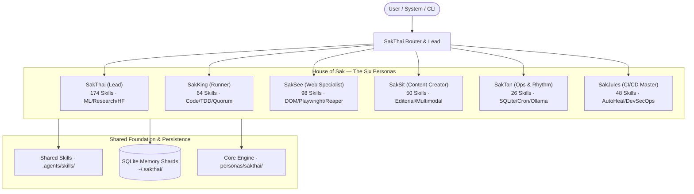

# Personas

Six core agent personas — **sakthai**, **sakking**, **saksee**, **saksit**,
**saktan**, and **sakjules** — each formerly had its own `*-skills`
repository.

Today, they collectively host **460 specialized skills** in their overlays
(counted as skill directories and files on disk — see the per-persona counts in the
layout below), plus 3 shared skills in `personas/shared/skills/` (and mirrored in `.agents/skills/`). Most of that content
lives directly within each persona's own `skills/` folder (its overlay); a
small number of files that are byte-identical across **all six** personas
live once under `personas/shared/skills/` instead. This allows each agent to
maintain a perfectly tailored skill tree while securely sharing the same
monorepo base.

The dedicated business scaffold for quote generation and lead capture
workflows, **servicequotebot**, lives under `services/servicequotebot/`.

## Architecture & Multi-Agent Routing



## Layout

```text
personas/
├── sakthai/            # Main Lead — HF master, ML, code, research (174 skills)
│   ├── SOUL.md         # Identity, charge system (v6), self-evaluation (v9)
│   ├── PLAN.md         # Task decomposition & routing protocol (v7)
│   ├── CYCLE.md        # 6-stage growth cycle & v9 self-eval rubric
│   ├── MEMORY.md       # Active memory & durable learnings
│   ├── HANDOFF.md      # Cross-persona handoff contract
│   ├── BACKPACK.md     # Domain toolbelt & skills inventory
│   ├── config/         # Persona config (config.yaml, workspace.yaml, mcp.json, …)
│   ├── skills/         # Contains the 174 skills mapped to SakThai
│   ├── evolution/      # Persona-owned self-evolution pipeline (DSPy + GEPA)
│   └── evolve_agent.sh # Persona self-evolution runner
├── sakking/            # Contains the 64 skills mapped to SakKing + self-evolution
├── saktan/             # Contains the 26 skills mapped to SakTan + self-evolution
├── saksit/             # Contains the 50 skills mapped to SakSit + self-evolution
├── sakjules/           # Contains the 48 skills mapped to SakJules + self-evolution
└── saksee/             # Contains the 98 skills mapped to SakSee + self-evolution
```

## Agent Self-Evolution & 5-Pillar Evaluation Framework

Each of the six personas hosts its own self-evolution module and evaluates across 5 core dimensions:
1. **5-Pillar Composite Fleet Audit (`sakthai eval audit`)**: Evaluates all six personas across Soul Alignment, Skill Ecosystem Health, Memory Store Integrity, Concentric Safety Compliance, and Composite scoring with letter grades (S/A/B/C/F).
2. **Working Files & v9 Self-Evaluation Rubric (`sakthai eval personas`)**: Verifies all 6 working files (`SOUL.md`, `PLAN.md`, `CYCLE.md`, `MEMORY.md`, `HANDOFF.md`, `BACKPACK.md`), the 100-point `CYCLE EVAL: <persona>` v9 rubric in `SOUL.md` and `CYCLE.md`, mandatory reply intro line, model/provider configuration, and primary skills.
3. **Dynamic Tool Evaluation & Benchmark Telemetry (`sakthai eval tools --bench`)**: Sandboxed execution, per-tool latency/jitter profiling, error trace capture, and qualitative model feedback.
4. **Unified Graders & Evaluation Benchmarks (`sakthai eval bench`)**: Formal tri-modal grading architecture (`CodeGrader`, `ModelGrader`) executing task batches with structured rubrics.
5. **Identity & Soul-Following Benchmark (`evaluation_tasks/soul_following.yaml`)**: Evaluates each persona's `SOUL.md` intro-line adherence across all six Sak Family personas via `evaluation_tasks/utils.py` and `evaluation_tasks/soul_following_dataset.jsonl`.
6. **Runtime MLOps & Per-Persona Telemetry (`sakthai eval summary`)**: Tracks latency, token usage, and error rates per persona across `~/.sakthai/eval.jsonl` and sharded `~/.sakthai/<persona>/eval.jsonl` logs (`sakthai eval summary --persona <name>` or `--all-personas`).
7. **DSPy + GEPA Skill & Tool Self-Evolution (`personas/<name>/evolution/`)**:
   - `evolution/`: Prompt, skill, and tool mutation modules (`CompositeFitness` + `ConstraintValidator`).
   - `evolve_agent.sh`: CLI runner defaulting to the hosting persona.
   - `tests/`: Self-evolution constraint and fitness unit tests.
8. **Gemini 4 Neon & Free-Tier Quota Sentinel (`sakthai.agent.quota`, `sakthai quota status`)**: Supports **Gemini 4 Neon** (`gemini-4-neon`) as the flagship Google Gemini model, paired with a hybrid in-memory sliding window rate limiter backed by SQLite persistence (`~/.sakthai/quota_sentinel.db`), Pacific Time midnight resets, automatic 3-tier free-tier cascading (`gemini-4-hydrogen` → `gemini-3.5-flash-lite` → `gemini-decision-1` under `GEMINI_FREE_ONLY=true`), and zero-cost protection.
9. **Interactive TUI & Risk Permission Gates (`sak chat --tui`)**: Full-screen Textual interface with two-phase tool execution transparency (`tool_call_start` and `tool_call` with elapsed duration), live widget updates, and `ConfirmModalScreen` risk permission gates (`[y]es / [n]o / [a]lways`) for high-risk operations.
10. **Memory Shard Studio & Gateway SSE Streaming**: Persona SQLite memory shards (`~/.sakthai/<persona>/memory.db`) inspected via `/v1/memory/shards`, filtered via `/v1/memory/facts`, and tested via prompt injection simulator (`/v1/memory/preview`) with DataLossGuardrail security. Verified across 4,558 pytest tests (240 files) + 24 dashboard suites (586 vitest tests).
11. **CLI Output Contract & Vibrant Rainbow UI (`sak.cli/v1`)**: Standard `--json` envelope adhering to `https://schemas.sakthai.family/v1/cli-envelope.json`, standard exit codes (0/1/2/3/130), quiet mode (`-q`), no-color flag (`--no-color`), and 6-stop chromatic rainbow UI in interactive TTY mode.
12. **Daily Dependabot Cadence**: Daily automated dependency vulnerability scanning (`interval: "daily"`) across `uv`, `npm`, `github-actions`, and `docker` ecosystems.

## Composition rule

A persona's full skill tree is `personas/shared/skills/` (laid down first)
plus that persona's own `skills/` directory (copied on top). On any path
collision, the persona's own **overlay wins** — the same "later wins"
precedence the agent's tool registry uses (`ToolRegistry.with_tools()`).

`personas/shared/skills/` only contains files that are byte-identical across
**all six** personas — currently 3 skills (`Sak-auto-cycle-loop`,
`Sak-dogfood`, `Sak-yuanbao`).
This is intentionally conservative: `compose()` applies `shared/skills/` to
every persona unconditionally, so promoting a file there is only safe if
every persona already has that exact content — otherwise it would add
content to personas that never had it. Most of the apparent overlap between
personas (including everything in `sakking`'s `SakXxx-`-prefixed rollup,
which deliberately aggregates the other five personas' skills — SakKing
"owns all skills" per `docs/SOUL.md`, while SakThai is the family's Lead &
Orchestrator) is only a **partial** match (2–5 personas, or one persona plus
sakking's copy of it),
so it stays in each persona's own overlay rather than being deduped.

Skill folder/frontmatter names follow the convention enforced by
`sakthai skills validate --naming`: shared skills get a `Sak-` prefix,
persona-owned skills get `Sak<Name>-` (e.g. `SakThai-`, `SakSit-`). Applied
across all layers via `scripts/rename_skills.py --apply` on 2026-07-07; 31
pre-existing name collisions (a differently-prefixed duplicate with
different content already occupying the target name) were deliberately left
unrenamed pending a human decision on which content wins.

To materialise a persona's full tree (e.g. for a runtime that expects one
directory):

```bash
python scripts/compose_persona.py sakthai --out /tmp/sakthai-skills
```

The composed tree is byte-for-byte identical to the persona's
pre-consolidation `skills/` directory. `compose_persona.py --check EXPECTED`
verifies a composed tree against a snapshot.

## How to add or change a skill

Place or edit the skill directly under the respective `personas/<name>/skills/` folder so it is picked up by that specific agent at runtime.

## Runtime artifacts

`.hub/`, `.curator_state`, `.usage.json`, and `.bundled_manifest` under a
persona's `skills/` are regenerated caches/state, not authored content. They are
git-ignored going forward (see root `.gitignore`); existing snapshots are kept
so each persona still round-trips exactly.

## Standalone exports

When you need a separate repo for one persona, use the export helper from the
source workspace:

```bash
python scripts/export_agent_repo.py sakjules --out build/agent-repos/sakjules
```

That export keeps the shared core plus the selected persona overlay and profile,
so the standalone repo can own its own skills, tools, and runtime settings.
