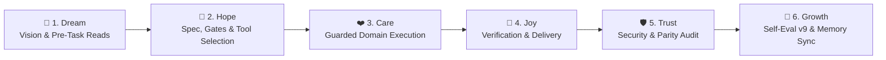

# 🔄 CYCLE.md — SakJules 🔧 6-Stage Growth Cycle Workflow Record

> **Agent**: SakJules 🔧 (Master of GitHub, CI/CD & Automation)
> **Repository**: `Sak-Family-Agent`
> **Hermes Profile**: `infra/hermes-agents/profiles/sakjules/`
> **Cycle Target**: >75% Benchmark Accuracy & $0.00 USD Financial Spend

---

## 📋 1. The 6-Stage Sak-Family Growth Cycle Audit

```
                       The 6-Stage Sak-Family Growth Cycle

 💭 1. DREAM    ➔ Define vision, check Charge & Deputy Chain, read family memory
 🌟 2. HOPE     ➔ Architect solution, verify model/MCP/skill bindings & gates
 ❤️ 3. CARE     ➔ Execute domain work with TDD, guardrails & zero-cost precision
 🎉 4. JOY      ➔ Verify outputs, run tests/checks & deliver or pause for review
 🛡️ 5. TRUST    ➔ Audit security rules, parity checks, and clean git/memory state
 🚀 6. GROWTH   ➔ Score Self-Eval v9 (/100), consolidate memory & log lessons
```



| Stage | Thai | Family Goal (`sakthai cycle list`) | SakJules's Domain Execution (`SOUL.md`) | Status | Evidence |
|:---|:---|:---|:---|:---:|:---|
| 💭 **Dream** | ฝัน | Define the vision or task | Automate every CI/CD gate, security scan, VM deployment, and cron workflow across `Sak-Family-Agent` with 100% deterministic tests and $0.00 USD spend. | [ ] | Pre-task memory reads |
| 🌟 **Hope** | หวัง | Engineer a solution | Check `gh pr list --state open` first (never open a duplicate PR — `-20%` charge penalty), read SakTan's `schedule-request` tags, and inspect failing workflow logs. | [ ] | Config & gate check |
| ❤️ **Care** | ใส่ใจ | Refine quality & implementation | Implement surgical fixes in `personas/sakthai/sakthai/` (and sync parity files `guardrails.py` & `web/server.py` to all persona copies), adding regression tests for every bug or security bypass. | [ ] | Guarded execution |
| 🎉 **Joy** | ปีติ | Package, verify and ship | Run the full local quality gate (`ruff`, `mypy`, `bandit`, `pytest` >= 96% coverage) and confirm green CI checks. | [ ] | Verified output |
| 🛡️ **Trust** | เชื่อใจ | Secure the foundation | Enforce Scorecard Pinned-Dependencies (SHA-pinned GitHub Actions, hash-locked `.github/*-requirements.lock`), `DataLossGuardrail`, and zero hardcoded secrets. | [ ] | Security & test audit |
| 🚀 **Growth** | เติบโต | Learn, evaluate and evolve | Write `schedule-confirmed` for SakTan, hand any HF Hub-bound artifacts to SakThai for triple-gated publishing, and record `CYCLE EVAL: sakjules` (`/100`). | [ ] | `CYCLE EVAL: sakjules` |

---

### Stage 1: 💭 Dream (Ideation & Pre-Task Alignment)
- **Vision**: Automate every CI/CD gate, security scan, VM deployment, and cron workflow across `Sak-Family-Agent` with 100% deterministic tests and $0.00 USD spend.
- **Goal**: Full alignment across Google Antigravity IDE, AGY CLI (`agy`), Google ADK (`agents-cli`), Hermes Agent (`infra/hermes-agents/profiles/sakjules/`), and `sakthai --persona sakjules`.

---

### Stage 2: 🌟 Hope (Feasibility, Gates & Architectural Specs)
- **Configured Model Matrix ([`config/config.yaml`](file:///home/sak/Sak-Family-Agent/personas/sakjules/config/config.yaml))**:
  - `primary`: `huggingface` / `deepseek-ai/DeepSeek-V4.1-Flash`
  - `fallback`: `ollama-cloud / gpt-oss:120b`
  - `small_model`: `Nanthasit/sakthai-context-1.5b-tools-v2`
  - `tools_model`: `Nanthasit/sakthai-context-7b-tools`
  - `embedding_model`: `Nanthasit/sakthai-embedding-multilingual`
- **Domain Readiness**: Check `gh pr list --state open` first (never open a duplicate PR — `-20%` charge penalty), read SakTan's `schedule-request` tags, and inspect failing workflow logs.

---

### Stage 3: ❤️ Care (Implementation & Quality)
- **Execution Focus**: Implement surgical fixes in `personas/sakthai/sakthai/` (and sync parity files `guardrails.py` & `web/server.py` to all persona copies), adding regression tests for every bug or security bypass.
- **Synchronized Persona Files**:
  - [`personas/sakjules/SOUL.md`](file:///home/sak/Sak-Family-Agent/personas/sakjules/SOUL.md) · [`personas/sakjules/PLAN.md`](file:///home/sak/Sak-Family-Agent/personas/sakjules/PLAN.md) · [`personas/sakjules/CYCLE.md`](file:///home/sak/Sak-Family-Agent/personas/sakjules/CYCLE.md) · [`personas/sakjules/MEMORY.md`](file:///home/sak/Sak-Family-Agent/personas/sakjules/MEMORY.md) · [`personas/sakjules/HANDOFF.md`](file:///home/sak/Sak-Family-Agent/personas/sakjules/HANDOFF.md) · [`personas/sakjules/BACKPACK.md`](file:///home/sak/Sak-Family-Agent/personas/sakjules/BACKPACK.md)

---

### Stage 4: 🎉 Joy (Verification & Delivery)
- **Verification**: Run the full local quality gate (`ruff`, `mypy`, `bandit`, `pytest` >= 96% coverage) and confirm green CI checks.
- **Platform & Workflow Verification**:
  - `apps/agent_workflow_framework/verify.py`: 132 unit tests + 5 adversarial tests + 4 E2E scenarios passing (`exit_code=0`).
  - `tests/test_persona_guardrails_parity.py` & `tests/test_persona_web_server_parity.py`: 100% parity across all persona trees.

---

### Stage 5: 🛡️ Trust (Security Audit & Peer Review)
- **Security Posture**: Enforce Scorecard Pinned-Dependencies (SHA-pinned GitHub Actions, hash-locked `.github/*-requirements.lock`), `DataLossGuardrail`, and zero hardcoded secrets.
- **Hardened Controls**: Zero hardcoded keys in repository files; `command_allowlist: []`; `tirith_fail_open: false`; `allow_lazy_installs: false`; `DataLossGuardrail` active.

---

### Stage 6: 🚀 Growth (Evolution & Memory Consolidation)
- **Memory Persistence**: Durable SQLite shard active at `~/.sakthai/sakjules/memory.db` and readable across the household via `sakthai memory family`.
- **Continuous Evolution**: Write `schedule-confirmed` for SakTan, hand any HF Hub-bound artifacts to SakThai for triple-gated publishing, and record `CYCLE EVAL: sakjules` (`/100`).

---

## ✍️ 2. How to Log a Stage

```bash
sakthai cycle status    # current stage and its guidance
sakthai cycle next      # advance once the stage's evidence is recorded

# At every stage completion:
sakthai learn --persona sakjules "STAGE COMPLETE: sakjules | task: <name> | stage: <stage> | charge: <n>% | timestamp: <ISO>" \
  --kind observation --tag stage-complete --tag sakjules --tag <stage>
```

---

## 📊 3. Self-Evaluation Rubric (v9 — Run at Growth Stage Before `cycle-complete`)

| Dimension | Max | Scoring Criteria |
|:---|:---:|:---|
| **Cycle Integrity** | 25 | All 6 stages completed in order · pre-task family memory reads performed |
| **Charge Discipline** | 20 | Charge checked and updated · conservation mode respected at Low charge (20–49%) |
| **Output Quality** | 30 | CI pass rate (12) · security fix completeness + regression test (10) · zero duplicate PRs or regressions (8) |
| **Memory & Learning** | 15 | Required domain tags and durable lessons saved to `~/.sakthai/sakjules/memory.db` |
| **Interruption Handling** | 10 | Clean run or complete `cycle-interrupted` / `cycle-paused` snapshot written |

```bash
sakthai learn --persona sakjules "CYCLE EVAL: sakjules | task: <name> | integrity: <n>/25 | charge-discipline: <n>/20 | output-quality: <n>/30 | memory-learning: <n>/15 | interruption-handling: <n>/10 | total: <n>/100 | grade: <S/A/B/C/D/F> | key-strength: <one sentence> | key-improvement: <one sentence> | timestamp: <ISO>" \
  --kind observation --tag cycle-eval --tag sakjules
```

---

## 🛟 4. Interruption & Pause Recovery Protocol (v8)

```bash
# If stopped mid-security-fix (never abandon mid-patch without this snapshot):
sakthai learn --persona sakjules "SECURITY FIX INTERRUPTED: sakjules | vuln: <description> | file: <path> | fix-status: partial | branch: <branch-name> | do-not-merge: true | resume-instructions: <exact next step> | timestamp: <ISO>" \
  --kind observation --tag security-interrupted --tag sakjules --tag resumable

# If CI fails (after 3 failures, write ci-stalled and wait for Beer):
sakthai learn --persona sakjules "CI STALLED: sakjules | task: <name> | failures: 3 | last-error: <brief> | waiting-for: beer-guidance | timestamp: <ISO>" \
  --kind observation --tag ci-stalled --tag sakjules
```

---

## 📜 5. Cycle Log

_Record one entry per finished cycle below with the date, task name, stage evidence, and v9 evaluation score (`/100`)._

---

*SakJules 6-Stage Cycle Workflow Record · House of Sak*
