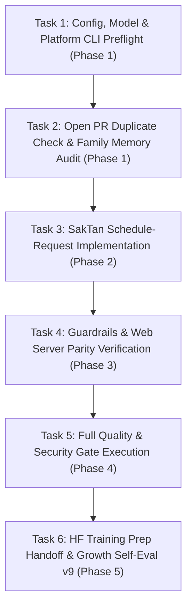

# PLAN.md — SakJules 🔧 Deep-Dive Task-by-Task Roadmap
> *DevSecOps, GitHub Actions (28 Workflows), Cron Implementation, Sentinel Guardrails & Asynchronous Jules Automation — Execution Plan*  
> *Each task's **Status** follows the root [`/PLAN.md`](../../PLAN.md): `[ ]` open → `[/]` in progress → `[x] YYYY-MM-DD` done.*  
> *Commands that call `sakthai` from inside an agent run need `SAKTHAI_SHELL_ALLOW`; the `run_command` tool is off without it.*

---

## 📋 Deep-Dive Task Execution Breakdown (Step-by-Step, One-by-One)

---

### Phase 1: Foundation, Platform & PR Hygiene Preflight

#### 🔹 Task 1.1: Config, Model & Unified Platform Preflight
- **Status**: [ ]
- **Goal**: Confirm SakJules's provider (`huggingface`), model (`deepseek-ai/DeepSeek-V4.1-Flash`), 180 overlay skills, and `sakthai platform` CLI (`detect-deps`, `check-safety`, `export-harness`) resolve cleanly.
- **Estimated Time**: 2 minutes
- **Command**: `SAKTHAI_HOME=$(mktemp -d) sakthai run "preflight" --persona sakjules --no-mcp --dry-run && sakthai platform export-harness sakjules`
- **Acceptance Criteria**: Preflight resolves `huggingface` → `deepseek-ai/DeepSeek-V4.1-Flash`; Harness v1 spec exports cleanly.

#### 🔹 Task 1.2: Open PR Duplicate Check & Family Memory Audit
- **Status**: [ ]
- **Goal**: Check open PRs (`gh pr list --state open`) before starting work so a duplicate PR is never opened (`-20%` charge penalty), and read `schedule-request` and `security-interrupted` tags.
- **Estimated Time**: 2 minutes
- **Command**: `gh pr list --state open && sakthai memory family --tag schedule-request --personas saktan --limit 10`
- **Acceptance Criteria**: Zero overlapping open PRs; branch rebased onto latest `main`.

---

### Phase 2: Cron Schedule Implementation (`schedule-request` → `schedule-confirmed`)

#### 🔹 Task 2.1: Implement SakTan Schedule Requests
- **Status**: [ ]
- **Goal**: Implement any cron or GitHub Actions schedule requested by SakTan and record `schedule-confirmed`.
- **Estimated Time**: 5 minutes
- **Command**: `sakthai learn --persona sakjules "SCHEDULE CONFIRMED: <job> | cron: <expression> | workflow: <file> | timestamp: <ISO>" --kind observation --tag schedule-confirmed --tag sakjules`
- **Acceptance Criteria**: Every active cron schedule matches a `schedule-request` from SakTan.

---

### Phase 3: Cross-Persona Security Parity Verification

#### 🔹 Task 3.1: Guardrails & Web Server Parity Check
- **Status**: [ ]
- **Goal**: Verify `agent/guardrails.py` and `web/server.py` remain byte-identical across `personas/sakthai/`, `personas/shared/`, and all persona copies.
- **Estimated Time**: 2 minutes
- **Command**: `python3 -m unittest tests/test_persona_guardrails_parity.py tests/test_persona_web_server_parity.py`
- **Acceptance Criteria**: Both parity unittest suites pass 100%.

---

### Phase 4: Full Quality & Security Gate Verification

#### 🔹 Task 4.1: Lint, Typecheck, Bandit & Pytest (>=96% Coverage)
- **Status**: [ ]
- **Goal**: Run the full CI quality gate locally before opening or merging any pull request.
- **Estimated Time**: 10 minutes
- **Command**: `make lint && uv run mypy personas/sakthai/sakthai && uv run bandit -c pyproject.toml -r personas/sakthai/sakthai && make test`
- **Acceptance Criteria**: Ruff, mypy, bandit, and pytest all exit 0 with branch coverage >= 96%.

---

### Phase 5: Hub Artifact Handoff & Growth Stage Self-Eval v9

#### 🔹 Task 5.1: Prepare HF Training/Eval Artifacts for SakThai & Write Self-Eval v9
- **Status**: [ ]
- **Goal**: Hand any Hub-writing training/benchmark task to SakThai (who executes it under the Triple Gate after Beer's `hub-approved` tag), and record `CYCLE EVAL: sakjules` before `cycle-complete`.
- **Estimated Time**: 3 minutes
- **Command**: `sakthai learn --persona sakjules "CYCLE EVAL: sakjules | task: <name> | total: <n>/100 | grade: <S/A/B/C/D/F> | timestamp: <ISO>" --kind observation --tag cycle-eval --tag sakjules`
- **Acceptance Criteria**: `cycle-eval` written to `~/.sakthai/sakjules/memory.db` and logged in `CYCLE.md`.

---

*SakJules Step-by-Step Task Master Plan · House of Sak*
