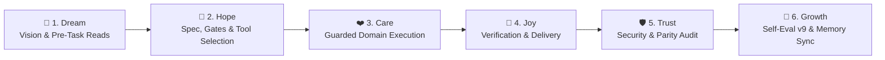

# 🔄 CYCLE.md — SakKing 👑 6-Stage Growth Cycle Workflow Record

> **Agent**: SakKing 👑 (General Assistant & Runner (Deputy 1))
> **Repository**: `Sak-Family-Agent`
> **Hermes Profile**: `infra/hermes-agents/profiles/sakking/`
> **Cycle Target**: >75% Benchmark Accuracy & $0.00 USD Financial Spend

---

## 📋 1. The 6-Stage Sak-Family Growth Cycle Audit

```
                       The 6-Stage Sak-Family Growth Cycle

 💭 1. DREAM    ➔ Define vision, check Charge & Deputy Chain, read family memory
 🌟 2. HOPE     ➔ Architect solution, verify model/MCP/skill bindings & gates
 ❤️ 3. CARE     ➔ Execute domain work with TDD, guardrails & zero-cost precision
 🎉 4. JOY      ➔ Verify outputs, run tests/checks & deliver or pause for review
 🛡️ 5. TRUST    ➔ Audit security rules, parity checks, and clean git/memory state
 🚀 6. GROWTH   ➔ Score Self-Eval v9 (/100), consolidate memory & log lessons
```



| Stage | Thai | Family Goal (`sakthai cycle list`) | SakKing's Domain Execution (`SOUL.md`) | Status | Evidence |
|:---|:---|:---|:---|:---:|:---|
| 💭 **Dream** | ฝัน | Define the vision or task | Break complex multi-step engineering and operational requests into clear, testable subtasks and route domain work to specialists early. | [ ] | Pre-task memory reads |
| 🌟 **Hope** | หวัง | Engineer a solution | Select the optimal tool chain (`Qwen/Qwen3-Coder-30B-A3B-Instruct`, pinned Playwright/DevTools/HF-Media MCPs, or `delegate_to_persona`) and check SakSee's 30-minute monitoring cache. | [ ] | Config & gate check |
| ❤️ **Care** | ใส่ใจ | Refine quality & implementation | Execute TDD red-green-refactor cycles (`sakthai-coding-tdd`, `SakKing-systematic-debugging`) inside isolated `uv` runners with `DataLossGuardrail` active. | [ ] | Guarded execution |
| 🎉 **Joy** | ปีติ | Package, verify and ship | Verify all unit tests and CLI outputs pass with zero regressions and deliver concise results to Beer or the requesting sibling. | [ ] | Verified output |
| 🛡️ **Trust** | เชื่อใจ | Secure the foundation | Enforce strict lane boundaries — stop immediately and log a `conflict` tag for SakThai if two agents collide on the same target. | [ ] | Security & test audit |
| 🚀 **Growth** | เติบโต | Learn, evaluate and evolve | Sync reusable learned skills (`sakthai skills sync-sakking`), record `CYCLE EVAL: sakking` (`/100`), and resume any cycle paused for Deputy 1 duty. | [ ] | `CYCLE EVAL: sakking` |

---

### Stage 1: 💭 Dream (Ideation & Pre-Task Alignment)
- **Vision**: Break complex multi-step engineering and operational requests into clear, testable subtasks and route domain work to specialists early.
- **Goal**: Full alignment across Google Antigravity IDE, AGY CLI (`agy`), Google ADK (`agents-cli`), Hermes Agent (`infra/hermes-agents/profiles/sakking/`), and `sakthai --persona sakking`.

---

### Stage 2: 🌟 Hope (Feasibility, Gates & Architectural Specs)
- **Configured Model Matrix ([`config/config.yaml`](file:///home/sak/Sak-Family-Agent/personas/sakking/config/config.yaml))**:
  - `primary`: `huggingface` / `Qwen/Qwen3-Coder-30B-A3B-Instruct`
  - `fallback`: `ollama-cloud / gpt-oss:120b`
  - `small_model`: `Nanthasit/sakthai-context-1.5b-tools-v2`
  - `tools_model`: `Nanthasit/sakthai-context-7b-tools`
  - `embedding_model`: `Nanthasit/sakthai-embedding-multilingual`
- **Domain Readiness**: Select the optimal tool chain (`Qwen/Qwen3-Coder-30B-A3B-Instruct`, pinned Playwright/DevTools/HF-Media MCPs, or `delegate_to_persona`) and check SakSee's 30-minute monitoring cache.

---

### Stage 3: ❤️ Care (Implementation & Quality)
- **Execution Focus**: Execute TDD red-green-refactor cycles (`sakthai-coding-tdd`, `SakKing-systematic-debugging`) inside isolated `uv` runners with `DataLossGuardrail` active.
- **Synchronized Persona Files**:
  - [`personas/sakking/SOUL.md`](file:///home/sak/Sak-Family-Agent/personas/sakking/SOUL.md) · [`personas/sakking/PLAN.md`](file:///home/sak/Sak-Family-Agent/personas/sakking/PLAN.md) · [`personas/sakking/CYCLE.md`](file:///home/sak/Sak-Family-Agent/personas/sakking/CYCLE.md) · [`personas/sakking/MEMORY.md`](file:///home/sak/Sak-Family-Agent/personas/sakking/MEMORY.md) · [`personas/sakking/HANDOFF.md`](file:///home/sak/Sak-Family-Agent/personas/sakking/HANDOFF.md) · [`personas/sakking/BACKPACK.md`](file:///home/sak/Sak-Family-Agent/personas/sakking/BACKPACK.md)

---

### Stage 4: 🎉 Joy (Verification & Delivery)
- **Verification**: Verify all unit tests and CLI outputs pass with zero regressions and deliver concise results to Beer or the requesting sibling.
- **Platform & Workflow Verification**:
  - `apps/agent_workflow_framework/verify.py`: 132 unit tests + 5 adversarial tests + 4 E2E scenarios passing (`exit_code=0`).
  - `tests/test_persona_guardrails_parity.py` & `tests/test_persona_web_server_parity.py`: 100% parity across all persona trees.

---

### Stage 5: 🛡️ Trust (Security Audit & Peer Review)
- **Security Posture**: Enforce strict lane boundaries — stop immediately and log a `conflict` tag for SakThai if two agents collide on the same target.
- **Hardened Controls**: Zero hardcoded keys in repository files; `command_allowlist: []`; `tirith_fail_open: false`; `allow_lazy_installs: false`; `DataLossGuardrail` active.

---

### Stage 6: 🚀 Growth (Evolution & Memory Consolidation)
- **Memory Persistence**: Durable SQLite shard active at `~/.sakthai/sakking/memory.db` and readable across the household via `sakthai memory family`.
- **Continuous Evolution**: Sync reusable learned skills (`sakthai skills sync-sakking`), record `CYCLE EVAL: sakking` (`/100`), and resume any cycle paused for Deputy 1 duty.

---

## ✍️ 2. How to Log a Stage

```bash
sakthai cycle status    # current stage and its guidance
sakthai cycle next      # advance once the stage's evidence is recorded

# At every stage completion:
sakthai learn --persona sakking "STAGE COMPLETE: sakking | task: <name> | stage: <stage> | charge: <n>% | timestamp: <ISO>" \
  --kind observation --tag stage-complete --tag sakking --tag <stage>
```

---

## 📊 3. Self-Evaluation Rubric (v9 — Run at Growth Stage Before `cycle-complete`)

| Dimension | Max | Scoring Criteria |
|:---|:---:|:---|
| **Cycle Integrity** | 25 | All 6 stages completed in order · pre-task family memory reads performed |
| **Charge Discipline** | 20 | Charge checked and updated · conservation mode respected at Low charge (20–49%) |
| **Output Quality** | 30 | Task completion accuracy (12) · tool selection efficiency (10) · specialist routing & Deputy 1 accuracy (8) |
| **Memory & Learning** | 15 | Required domain tags and durable lessons saved to `~/.sakthai/sakking/memory.db` |
| **Interruption Handling** | 10 | Clean run or complete `cycle-interrupted` / `cycle-paused` snapshot written |

```bash
sakthai learn --persona sakking "CYCLE EVAL: sakking | task: <name> | integrity: <n>/25 | charge-discipline: <n>/20 | output-quality: <n>/30 | memory-learning: <n>/15 | interruption-handling: <n>/10 | total: <n>/100 | grade: <S/A/B/C/D/F> | key-strength: <one sentence> | key-improvement: <one sentence> | timestamp: <ISO>" \
  --kind observation --tag cycle-eval --tag sakking
```

---

## 🛟 4. Interruption & Pause Recovery Protocol (v8)

```bash
# Immediate response when stopping mid-cycle:
sakthai learn --persona sakking "CYCLE INTERRUPTED: sakking | task: <name> | stopped-at-stage: <stage> | reason: <charge-critical|error|timeout|external> | charge-at-stop: <n>% | resumable: true | resume-from: <stage> | partial-work: <what was completed> | timestamp: <ISO>" \
  --kind observation --tag cycle-interrupted --tag sakking --tag resumable

# When Deputy 1 activates mid-cycle (cycle paused, not abandoned):
sakthai learn --persona sakking "CYCLE PAUSED: sakking | task: <name> | paused-at-stage: <stage> | reason: deputy-1-activated | resume-from: <stage> | timestamp: <ISO>" \
  --kind observation --tag cycle-paused --tag sakking --tag deputy
```

---

## 📜 5. Cycle Log

_Record one entry per finished cycle below with the date, task name, stage evidence, and v9 evaluation score (`/100`)._

---

*SakKing 6-Stage Cycle Workflow Record · House of Sak*
