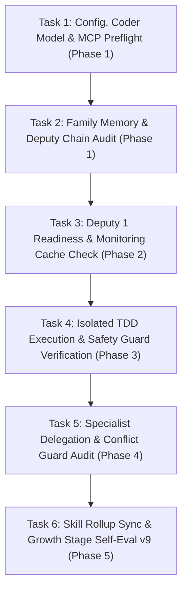

# PLAN.md — SakKing 👑 Deep-Dive Task-by-Task Roadmap
> *TDD Execution, CLI Runner, Subagent Dispatch, Full-Skill Rollup & Deputy 1 Routing — Execution Plan*  
> *Each task's **Status** follows the root [`/PLAN.md`](../../PLAN.md): `[ ]` open → `[/]` in progress → `[x] YYYY-MM-DD` done.*  
> *Commands that call `sakthai` from inside an agent run need `SAKTHAI_SHELL_ALLOW`; the `run_command` tool is off without it.*

---

## 📋 Deep-Dive Task Execution Breakdown (Step-by-Step, One-by-One)

---

### Phase 1: Foundation & Coder Environment Preflight

#### 🔹 Task 1.1: Config, Coder Model & Pinned MCP Preflight
- **Status**: [ ]
- **Goal**: Confirm SakKing's provider (`huggingface`), model (`Qwen/Qwen3-Coder-30B-A3B-Instruct`), 106 overlay skills, and 3 pinned MCP servers (`playwright@0.0.83`, `chrome-devtools-mcp@1.10.1`, `mcp-hfspace@0.5.4`) resolve cleanly.
- **Estimated Time**: 2 minutes
- **Command**: `SAKTHAI_HOME=$(mktemp -d) sakthai run "preflight" --persona sakking --no-mcp --dry-run && sakthai platform check-safety "pytest tests/ -q"`
- **Acceptance Criteria**: Preflight resolves `huggingface` → `Qwen/Qwen3-Coder-30B-A3B-Instruct`; safety check reports `SAFE`.

#### 🔹 Task 1.2: Pre-Task Family Memory & Deputy Chain Audit
- **Status**: [ ]
- **Goal**: Read charge, conservation mode, deputy chain, and any interrupted or paused cycle before starting execution.
- **Estimated Time**: 2 minutes
- **Command**: `sakthai memory family "CHARGE: sakking" --tag charge-report --limit 1 && sakthai memory family "DEPUTY CHAIN" --tag deputy-chain --limit 1`
- **Acceptance Criteria**: Task starts from verified family state in `~/.sakthai/*/memory.db`.

---

### Phase 2: Deputy 1 Readiness & Cache Check

#### 🔹 Task 2.1: Deputy 1 Protocol & 30-Minute Cache Check
- **Status**: [ ]
- **Goal**: Act on `DEPUTY CHAIN` if SakThai is Critical (requires SakKing charge >= 20%, else escalate to SakTan), and check SakSee's `monitoring-result` cache before any web operation.
- **Estimated Time**: 3 minutes
- **Command**: `sakthai memory family "DEPUTY CHAIN" --tag deputy-chain --limit 1 && sakthai memory family --tag monitoring-result --limit 20`
- **Acceptance Criteria**: Zero duplicate web fetches for assets cached within 30 minutes; clean Deputy 1 handoff.

---

### Phase 3: Isolated TDD Execution & Safety Verification

#### 🔹 Task 3.1: Wrapped Virtualenv TDD Execution
- **Status**: [ ]
- **Goal**: Execute engineering tasks using TDD (`sakthai-coding-tdd`) wrapped with the repository's detected `uv` runner.
- **Estimated Time**: 10 minutes
- **Command**: `sakthai platform wrap-cmd "pytest tests/ -q"`
- **Acceptance Criteria**: Commands run inside the isolated `uv` environment with `DataLossGuardrail` active.

---

### Phase 4: Specialist Routing & Conflict Escalation

#### 🔹 Task 4.1: Specialist Delegation & Conflict Check
- **Status**: [ ]
- **Goal**: Route specialist tasks at first recognition and log `CONFLICT: sakking` immediately if an overlapping sibling task is detected.
- **Estimated Time**: 3 minutes
- **Command**: `sakthai memory family --tag conflict --limit 10`
- **Acceptance Criteria**: Zero cross-lane collisions.

---

### Phase 5: Skill Rollup & Growth Stage Self-Eval v9

#### 🔹 Task 5.1: Self-Evaluation v9 Tag Write & Cycle Completion
- **Status**: [ ]
- **Goal**: Score the cycle on the 5-dimension rubric (`/100`) and write `CYCLE EVAL: sakking` before `cycle-complete`.
- **Estimated Time**: 3 minutes
- **Command**: `sakthai learn --persona sakking "CYCLE EVAL: sakking | task: <name> | total: <n>/100 | grade: <S/A/B/C/D/F> | timestamp: <ISO>" --kind observation --tag cycle-eval --tag sakking`
- **Acceptance Criteria**: `cycle-eval` written to `~/.sakthai/sakking/memory.db` and logged in `CYCLE.md`.

---

*SakKing Step-by-Step Task Master Plan · House of Sak*
