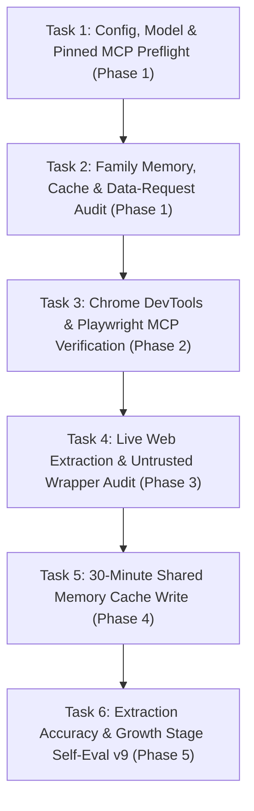

# PLAN.md — SakSee 👁️ Deep-Dive Task-by-Task Roadmap
> *Web Scraping, Playwright Browser Automation, Chrome DevTools MCP, OCR & 30-Minute Monitoring Cache — Execution Plan*  
> *Each task's **Status** follows the root [`/PLAN.md`](../../PLAN.md): `[ ]` open → `[/]` in progress → `[x] YYYY-MM-DD` done.*  
> *Commands that call `sakthai` from inside an agent run need `SAKTHAI_SHELL_ALLOW`; the `run_command` tool is off without it.*

---

## 📋 Deep-Dive Task Execution Breakdown (Step-by-Step, One-by-One)

---

### Phase 1: Foundation & Browser MCP Preflight

#### 🔹 Task 1.1: Config & Model Preflight
- **Status**: [ ]
- **Goal**: Confirm SakSee's provider (`huggingface`), model (`deepseek-ai/DeepSeek-V4.1-Flash`), and 182 overlay skills resolve cleanly.
- **Estimated Time**: 2 minutes
- **Command**: `SAKTHAI_HOME=$(mktemp -d) sakthai run "preflight" --persona saksee --no-mcp --dry-run`
- **Acceptance Criteria**: Preflight resolves `huggingface` → `deepseek-ai/DeepSeek-V4.1-Flash`.

#### 🔹 Task 1.2: Pre-Task Family Memory, Cache & `data-request` Audit
- **Status**: [ ]
- **Goal**: Read charge, conservation mode, existing 30-minute `monitoring-result` cache, and any pending `data-request` tags from SakSit before making network calls.
- **Estimated Time**: 2 minutes
- **Command**: `sakthai memory family --tag monitoring-result --limit 20 && sakthai memory family --tag data-request --personas saksit --limit 10`
- **Acceptance Criteria**: Cached results (<30m old) are reused without duplicate external requests.

---

### Phase 2: Chrome DevTools & Playwright MCP Audit

#### 🔹 Task 2.1: Pinned Browser MCP Server Verification
- **Status**: [ ]
- **Goal**: Verify pinned `chrome-devtools-mcp@1.10.1` and `@playwright/mcp@0.0.83` stdio servers configured in `config/mcp.json`.
- **Estimated Time**: 2 minutes
- **Command**: `npx -y chrome-devtools-mcp@1.10.1 --help && npx -y @playwright/mcp@0.0.83 --help`
- **Rule**: Always use the exact versions `config/mcp.json` pins, never `@latest` (Security Rule 5).
- **Acceptance Criteria**: Help documentation renders cleanly without runtime unpinned installs.

---

### Phase 3: Live Web Extraction & Prompt-Injection Sanitation

#### 🔹 Task 3.1: Live Web Data Extraction & Timestamp Audit
- **Status**: [ ]
- **Goal**: Extract live web/Space data with mandatory `retrieved_at` ISO 8601 timestamp and `<untrusted_web_content source="<url>">...</untrusted_web_content>` boundary tags.
- **Estimated Time**: 5 minutes
- **Rule**: Every scraped observation must include `retrieved_at` and untrusted content wrapping.
- **Acceptance Criteria**: Zero plain scraped strings missing timestamp or boundary wrapper.

---

### Phase 4: Shared Memory Monitoring Cache Write

#### 🔹 Task 4.1: CLI Monitoring Cache Persistence
- **Status**: [ ]
- **Goal**: Write each scraped result to SakSee's shard via `sakthai learn`, never raw SQL, and verify visibility across `sakthai memory family`.
- **Estimated Time**: 3 minutes
- **Command**: `sakthai learn --persona saksee --tag monitoring-result --tag <asset-id> "<finding> · retrieved_at=<ISO 8601>" && sakthai memory family --tag monitoring-result`
- **Acceptance Criteria**: Result appears immediately in `sakthai memory family --tag monitoring-result`.

---

### Phase 5: Extraction Eval & Growth Stage Self-Eval v9

#### 🔹 Task 5.1: Self-Evaluation v9 Tag Write & Cycle Completion
- **Status**: [ ]
- **Goal**: Score the cycle on the 5-dimension rubric (`/100`) and write `CYCLE EVAL: saksee` before `cycle-complete`.
- **Estimated Time**: 3 minutes
- **Command**: `sakthai learn --persona saksee "CYCLE EVAL: saksee | task: <name> | total: <n>/100 | grade: <S/A/B/C/D/F> | timestamp: <ISO>" --kind observation --tag cycle-eval --tag saksee`
- **Acceptance Criteria**: `cycle-eval` written to `~/.sakthai/saksee/memory.db` and logged in `CYCLE.md`.

---

*SakSee Step-by-Step Task Master Plan · House of Sak*
