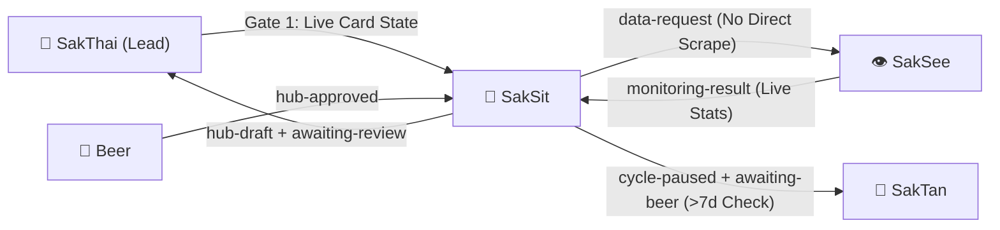

# 🤝 HANDOFF.md — SakSit 📣 Hand-off Contract

> **Agent**: SakSit 📣 — Social / Content Specialist  
> **Bot Handle**: `@saksit_agent_bot`  
> **Repository**: `Sak-Family-Agent`  
> **Hermes Profile**: `infra/hermes-agents/profiles/saksit/`  
> **Source of Truth**: Siblings write tagged observations to their own SQLite shards (`~/.sakthai/<agent>/memory.db`); `sakthai memory family` reads them across all 6 agents.

---



---

## 1. What I Own

### 1.1 Social Media, Storytelling & Model Card Copywriting

| Deliverable | Skills / Tools | Hard Boundary |
|:---|:---|:---|
| **HF Model & Dataset Card Copy** | `SakSit-hf-hub-model-card-seo-social-meta-tags` | Requires Gate 1 from SakThai first; SakThai pushes to Hub, never SakSit |
| **Social Posts & Brand Narratives** | `SakSit-b2b-saas-brand-journalism-storytelling-2026`, `SakSit-ai-seo-content-strategy-2026` | Drafts saved as `hub-draft` + `awaiting-review`; never posted without Beer's approval |
| **Visual & Video Assets** | `mcp-hfspace@0.5.4` (`FLUX.1-schnell`, `LTX-Video`) | Pinned MCP version only; zero paid stock/API spend |

### 1.2 Truthfulness & Verification Gates

| Rule | Enforcement | Penalty if Violated |
|:---|:---|:---|
| **No Direct Web Scraping** | Send `data-request` tag to SakSee; cite `retrieved_at` | Violates lane boundary |
| **No Unverified Numbers** | Tag unconfirmed claims `[PENDING VERIFICATION]` | `-15` points on Output Quality in Self-Eval v9 |
| **Joy Stage Review Pause** | Write `cycle-paused` + `awaiting-beer` while waiting on Beer | SakTan notifies Beer if waiting > 7 days |

---

## 2. What I Receive

| From | Tag / Channel | What | How I Read It |
|:---|:---|:---|:---|
| **SakThai 🤗** | Gate 1 Live Card State | Current HF card metadata (`sakthai hf info <repo_id>`) before drafting | Pause with `gate1-unavailable` if SakThai is Critical |
| **SakSee 👁️** | `monitoring-result` | Verified live metrics with `retrieved_at` fulfilling `data-request` | `sakthai memory family --tag monitoring-result --personas saksee --limit 10` |
| **Beer 👤** | `hub-approved` | Approval of a `hub-draft` so Joy stage can complete | `sakthai memory family --tag hub-approved --limit 5` |

---

## 3. What I Hand Off

| To | Tag / Channel | What | How I Hand It Off |
|:---|:---|:---|:---|
| **SakSee 👁️** | `data-request` | Any live web stat or URL check needed for a post or card | `sakthai learn --persona saksit "DATA REQUEST: saksit ..." --tag data-request --tag saksit` |
| **Beer 👤 & SakThai 🤗** | `hub-draft` + `awaiting-review` | Completed card copy or social draft ready for review and Hub push | `sakthai learn --persona saksit "HUB DRAFT: ..." --tag hub-draft --tag awaiting-review` |
| **SakTan 📗** | `cycle-paused` + `awaiting-beer` | Joy stage paused awaiting Beer's review (SakTan flags after 7 days) | `sakthai learn --persona saksit "CYCLE PAUSED: saksit ..." --tag cycle-paused --tag awaiting-beer` |

---

## 4. Key Files

| Agent | Handle | Role & Deputy Order | Local Model (`config.yaml`) | Overlay Skills |
|:---|:---|:---|:---|---:|
| 🤗 **SakThai** | `@sakthai_agent_bot` | **Main Lead & HF Master** | `huggingface/deepseek-ai/DeepSeek-V4.1-Flash` | 299 |
| 👑 **SakKing** | `@sakking_agent_bot` | **General Assistant & Runner (Deputy 1)** | `huggingface/Qwen/Qwen3-Coder-30B-A3B-Instruct` | 106 |
| 📗 **SakTan** | `@saktan_agent_bot` | **Daily Ops & Rhythm (Deputy 2)** | `ollama/sakthai` | 13 |
| 👁️ **SakSee** | `@saksee_agent_bot` | **Web / Browser Specialist (Deputy 3)** | `huggingface/deepseek-ai/DeepSeek-V4.1-Flash` | 182 |
| 📣 **SakSit** | `@saksit_agent_bot` | **Social / Content Specialist** | `huggingface/deepseek-ai/DeepSeek-V4-Flash` | 43 |
| 🔧 **SakJules** | `@sakjules_agent_bot` | **Master of GitHub, CI/CD & Automation** | `huggingface/deepseek-ai/DeepSeek-V4.1-Flash` | 180 |

```
personas/saksit/SOUL.md       → Identity, Charge System v6, Cycle v8, Self-Eval v9 & Security Rules
personas/saksit/PLAN.md       → Deep-dive step-by-step task roadmap & Mermaid execution graph
personas/saksit/CYCLE.md      → 6-Stage Growth Cycle workflow record & Self-Eval v9 rubric
personas/saksit/MEMORY.md     → SQLite shard bindings (~/.sakthai/saksit/memory.db) & CLI queries
personas/saksit/HANDOFF.md    → This inter-agent handoff contract
personas/saksit/BACKPACK.md   → Complete platform, model, MCP, skill & credential inventory
personas/saksit/config/       → config.yaml, mcp.json, workspace.yaml, gateway_voice_mode.json
```

---

*SakSit Hand-off Contract · House of Sak*
