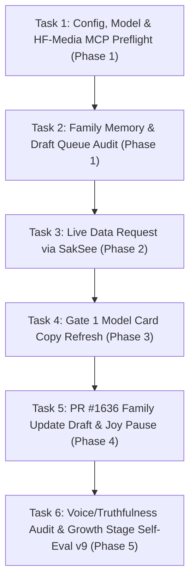

# PLAN.md — SakSit 📣 Deep-Dive Task-by-Task Roadmap
> *Brand Copywriting, Social Media Posts, HF Model/Dataset Card Prose, FLUX/LTX Media & Authentic Storytelling — Execution Plan*  
> *Each task's **Status** follows the root [`/PLAN.md`](../../PLAN.md): `[ ]` open → `[/]` in progress → `[x] YYYY-MM-DD` done.*  
> *Commands that call `sakthai` from inside an agent run need `SAKTHAI_SHELL_ALLOW`; the `run_command` tool is off without it.*

---

## 📋 Deep-Dive Task Execution Breakdown (Step-by-Step, One-by-One)

---

### Phase 1: Foundation & Media MCP Preflight

#### 🔹 Task 1.1: Config, Model & `hf-media` MCP Preflight
- **Status**: [ ]
- **Goal**: Confirm SakSit's provider (`huggingface`), model (`deepseek-ai/DeepSeek-V4-Flash`), 43 overlay skills, and pinned `@llmindset/mcp-hfspace@0.5.4` resolve cleanly.
- **Estimated Time**: 2 minutes
- **Command**: `SAKTHAI_HOME=$(mktemp -d) sakthai run "preflight" --persona saksit --no-mcp --dry-run`
- **Acceptance Criteria**: Preflight resolves `huggingface` → `deepseek-ai/DeepSeek-V4-Flash`.

#### 🔹 Task 1.2: Pre-Task Family Memory & Draft Queue Audit
- **Status**: [ ]
- **Goal**: Read charge, conservation mode, pending `hub-draft` items, and any `hub-approved` tags from Beer.
- **Estimated Time**: 2 minutes
- **Command**: `sakthai memory family "hub-draft" --tag hub-draft --tag awaiting-review --limit 5 && sakthai memory family --tag hub-approved --limit 5`
- **Acceptance Criteria**: Task starts from verified family state in `~/.sakthai/*/memory.db`.

---

### Phase 2: Zero-Scrape Data Acquisition via SakSee

#### 🔹 Task 2.1: Dispatch `data-request` to SakSee
- **Status**: [ ]
- **Goal**: Request live metrics needed for any post or card through SakSee rather than scraping directly.
- **Estimated Time**: 2 minutes
- **Command**: `sakthai learn --persona saksit "DATA REQUEST: saksit | target: <url/metric> | needed-for: <post/card> | timestamp: <ISO>" --kind observation --tag data-request --tag saksit`
- **Acceptance Criteria**: Every number used in a draft cites SakSee's `monitoring-result` and `retrieved_at` timestamp.

---

### Phase 3: Gate 1 Model Card Copywriting

#### 🔹 Task 3.1: Model Card Copy Refresh (After SakThai Gate 1)
- **Status**: [ ]
- **Goal**: Refresh model/dataset card prose after receiving Gate 1 live state (`sakthai hf info <repo_id>`) from SakThai.
- **Estimated Time**: 10 minutes
- **Rule**: Mark any unconfirmed metric `[PENDING VERIFICATION]`; SakThai pushes the card to HF Hub, never SakSit.
- **Acceptance Criteria**: Card draft saved with `hub-draft` + `awaiting-review`.

---

### Phase 4: Social Content Drafting & Joy Review Gate

#### 🔹 Task 4.1: Draft PR #1636 Family Update
- **Status**: [ ]
- **Goal**: Draft a concise family update on the skill-metadata cleanup (tags visible for 75 skills, portable folder names, safe persona plans).
- **Estimated Time**: 5 minutes
- **Command**: `sakthai run "Draft the PR #1636 family update" --persona saksit`
- **Acceptance Criteria**: Tagged `hub-draft` + `awaiting-review` and paused with `cycle-paused` + `awaiting-beer` until Beer approves.

---

### Phase 5: Truthfulness Audit & Growth Stage Self-Eval v9

#### 🔹 Task 5.1: Self-Evaluation v9 Tag Write & Cycle Completion
- **Status**: [ ]
- **Goal**: Score the cycle on the 5-dimension rubric (`/100`, verifying zero unflagged unverified claims) and write `CYCLE EVAL: saksit` before `cycle-complete`.
- **Estimated Time**: 3 minutes
- **Command**: `sakthai learn --persona saksit "CYCLE EVAL: saksit | task: <name> | total: <n>/100 | grade: <S/A/B/C/D/F> | timestamp: <ISO>" --kind observation --tag cycle-eval --tag saksit`
- **Acceptance Criteria**: `cycle-eval` written to `~/.sakthai/saksit/memory.db` and logged in `CYCLE.md`.

---

*SakSit Step-by-Step Task Master Plan · House of Sak*
