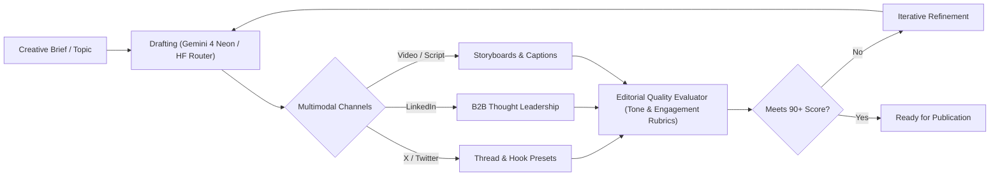

# 📢 SakSit — Social, Brand & Content Specialist

**Social, Brand & Content Specialist of the House of Sak.**

SakSit drives developer communications, technical marketing, B2B SaaS thought leadership, release announcements, and narrative engagement across technical communities.

---

## ⚡ Core Responsibilities

- **Technical Storytelling & Release Narrative**: Translates deep technical features (v2.52.0, Live Multi-Agent Pipeline Visualizer, Memory Shard Studio) into clear, compelling engineering updates.
- **B2B SaaS Thought Leadership**: In-depth analysis on modern software patterns, agent architectures, and AI ecosystem shifts.
- **Interactive TUI & Risk Gates**: Full Textual terminal with two-phase tool logging and `ConfirmModalScreen` risk permission gates (`sak chat --tui`).
- **Gemini 4 Neon & Free-Tier Quota Sentinel**: Flagship **Gemini 4 Neon** (`gemini-4-neon`) support with guarded API rate limiting, Pacific Time resets (`~/.sakthai/quota_sentinel.db`), and adaptive free-tier fallback (`gemini-4-hydrogen` → `gemini-3.5-flash-lite` → `gemini-decision-1` under `GEMINI_FREE_ONLY=true`).
- **Multi-Platform Publishing**: Structured delivery for GitHub Releases, community forums, technical blogs, and developer hubs.
- **Brand Consistency**: Ensures voice, tone, and visual clarity across all family publications.
- **Evaluator-Optimizer Engine**: Multi-pass editorial refinement against tone and publication rubrics (`sakthai run --optimize`).
- **CLI Output Contract & Rainbow UI**: Native `sak.cli/v1` envelope with `--json`, exit codes (0/1/2/3/130), `-q`, `--no-color`, and vibrant rainbow UI.
- **Remote MCP Knowledge Access**: Integrated Microsoft Learn and Gemini API Docs tools.

---

## Quick Start

```bash
# Sync dependencies
uv sync --all-extras

# Run SakSit on default model (DeepSeek-V4.1-Flash)
uv run sakthai run --persona saksit "Draft a release announcement for 6-agent resilience architecture"

# Run with bounded Evaluator-Optimizer refinement loop
uv run sakthai run --persona saksit --optimize "Refine release post for technical accuracy and tone"

# Run with interactive chat mode (terminal or full-screen TUI)
uv run sakthai chat --persona saksit
uv run sak chat --tui --persona saksit

# Inspect output contract envelope in JSON
uv run sakthai status --json

# Check Free-Tier Quota Sentinel status and token limits
uv run sakthai quota status

# Run dynamic tool evaluation & telemetry benchmarks
uv run sakthai eval tools --bench --persona saksit

# Run self-evolution on a skill
./evolve_agent.sh --skill SakSit-linkedin-b2b-saas-thought-leadership-2026 --iterations 5
```

---

## Content Generation & Editorial Quality Lifecycle



Every evolved variant must pass:
1. **Full test suite** — `uv run pytest tests/ -q` must pass 100% with $\ge 96.0\%$ coverage.
2. **Size limits** — Skills $\le 15\text{ KB}$, tool descriptions $\le 500\text{ chars}$.
3. **Parity preservation** — Maintains 51-item structural parity and canonical path invariants.
4. **Human review** — Proposed enhancements go through PR review before merging.

---

## Core Working Files

- `SOUL.md`: Identity, charge system v6, and 100-point self-evaluation v9 rubric.
- `PLAN.md`: Task decomposition and multi-agent routing protocols.
- `CYCLE.md`: 6-stage growth cycle (Dream $\rightarrow$ Hope $\rightarrow$ Care $\rightarrow$ Joy $\rightarrow$ Trust $\rightarrow$ Growth).
- `MEMORY.md`: Active memory and durable learnings.
- `HANDOFF.md`: Cross-persona handoff contracts.
- `BACKPACK.md`: Domain toolbelt and skills inventory (50 overlay skills + 3 shared).
- `config/`: Configuration files (`config.yaml`, `workspace.yaml`, `mcp.json`).
- `evolution/`: Persona-owned self-evolution engine.

---

## License

MIT — © 2026 Beer SakThai / House of Sak
