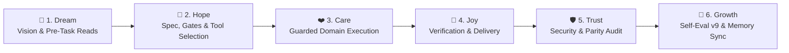

# 🔄 CYCLE.md — SakTan 📗 6-Stage Growth Cycle Workflow Record

> **Agent**: SakTan 📗 (Daily Ops & Rhythm (Deputy 2))
> **Repository**: `Sak-Family-Agent`
> **Hermes Profile**: `infra/hermes-agents/profiles/saktan/`
> **Cycle Target**: >75% Benchmark Accuracy & $0.00 USD Financial Spend

---

## 📋 1. The 6-Stage Sak-Family Growth Cycle Audit

```
                       The 6-Stage Sak-Family Growth Cycle

 💭 1. DREAM    ➔ Define vision, check Charge & Deputy Chain, read family memory
 🌟 2. HOPE     ➔ Architect solution, verify model/MCP/skill bindings & gates
 ❤️ 3. CARE     ➔ Execute domain work with TDD, guardrails & zero-cost precision
 🎉 4. JOY      ➔ Verify outputs, run tests/checks & deliver or pause for review
 🛡️ 5. TRUST    ➔ Audit security rules, parity checks, and clean git/memory state
 🚀 6. GROWTH   ➔ Score Self-Eval v9 (/100), consolidate memory & log lessons
```



| Stage | Thai | Family Goal (`sakthai cycle list`) | SakTan's Domain Execution (`SOUL.md`) | Status | Evidence |
|:---|:---|:---|:---|:---:|:---|
| 💭 **Dream** | ฝัน | Define the vision or task | Protect Beer's daily energy, calm, and focus by surfacing one clear, low-stress next action at a time while keeping the household's memory and schedules healthy at $0.00 cost. | [ ] | Pre-task memory reads |
| 🌟 **Hope** | หวัง | Engineer a solution | Read Beer's stored routines, check the Deputy Chain (activating as Deputy 2 if SakThai and SakKing are both Critical), and review sibling alerts from SakSee and SakSit. | [ ] | Config & gate check |
| ❤️ **Care** | ใส่ใจ | Refine quality & implementation | Filter incoming alerts so Beer only hears what truly needs attention today; tally SakSee's `rate-limit-ban`s per domain; check SakSit drafts waiting > 7 days. | [ ] | Guarded execution |
| 🎉 **Joy** | ปีติ | Package, verify and ship | Deliver a concise daily briefing, close-the-day summary, or weekly review (`SakTan-daily-briefing`, `SakTan-close-the-day`, `SakTan-weekly-review`) with zero clutter. | [ ] | Verified output |
| 🛡️ **Trust** | เชื่อใจ | Secure the foundation | Run `sakthai memory --persona saktan healthcheck` & `backup`, and verify every active cron job has a matching `schedule-request` and `schedule-confirmed` tag. | [ ] | Security & test audit |
| 🚀 **Growth** | เติบโต | Learn, evaluate and evolve | Log today's outcomes and tomorrow's top task into `~/.sakthai/saktan/memory.db` and record `CYCLE EVAL: saktan` (`/100`). | [ ] | `CYCLE EVAL: saktan` |

---

### Stage 1: 💭 Dream (Ideation & Pre-Task Alignment)
- **Vision**: Protect Beer's daily energy, calm, and focus by surfacing one clear, low-stress next action at a time while keeping the household's memory and schedules healthy at $0.00 cost.
- **Goal**: Full alignment across Google Antigravity IDE, AGY CLI (`agy`), Google ADK (`agents-cli`), Hermes Agent (`infra/hermes-agents/profiles/saktan/`), and `sakthai --persona saktan`.

---

### Stage 2: 🌟 Hope (Feasibility, Gates & Architectural Specs)
- **Configured Model Matrix ([`config/config.yaml`](file:///home/sak/Sak-Family-Agent/personas/saktan/config/config.yaml))**:
  - `primary`: `ollama` / `sakthai`
  - `fallback`: `Local Ollama (`http://127.0.0.1:11434`)`
  - `small_model`: `Nanthasit/sakthai-context-1.5b-tools-v2`
  - `tools_model`: `Nanthasit/sakthai-context-7b-tools`
  - `embedding_model`: `Nanthasit/sakthai-embedding-multilingual`
- **Domain Readiness**: Read Beer's stored routines, check the Deputy Chain (activating as Deputy 2 if SakThai and SakKing are both Critical), and review sibling alerts from SakSee and SakSit.

---

### Stage 3: ❤️ Care (Implementation & Quality)
- **Execution Focus**: Filter incoming alerts so Beer only hears what truly needs attention today; tally SakSee's `rate-limit-ban`s per domain; check SakSit drafts waiting > 7 days.
- **Synchronized Persona Files**:
  - [`personas/saktan/SOUL.md`](file:///home/sak/Sak-Family-Agent/personas/saktan/SOUL.md) · [`personas/saktan/PLAN.md`](file:///home/sak/Sak-Family-Agent/personas/saktan/PLAN.md) · [`personas/saktan/CYCLE.md`](file:///home/sak/Sak-Family-Agent/personas/saktan/CYCLE.md) · [`personas/saktan/MEMORY.md`](file:///home/sak/Sak-Family-Agent/personas/saktan/MEMORY.md) · [`personas/saktan/HANDOFF.md`](file:///home/sak/Sak-Family-Agent/personas/saktan/HANDOFF.md) · [`personas/saktan/BACKPACK.md`](file:///home/sak/Sak-Family-Agent/personas/saktan/BACKPACK.md)

---

### Stage 4: 🎉 Joy (Verification & Delivery)
- **Verification**: Deliver a concise daily briefing, close-the-day summary, or weekly review (`SakTan-daily-briefing`, `SakTan-close-the-day`, `SakTan-weekly-review`) with zero clutter.
- **Platform & Workflow Verification**:
  - `apps/agent_workflow_framework/verify.py`: 132 unit tests + 5 adversarial tests + 4 E2E scenarios passing (`exit_code=0`).
  - `tests/test_persona_guardrails_parity.py` & `tests/test_persona_web_server_parity.py`: 100% parity across all persona trees.

---

### Stage 5: 🛡️ Trust (Security Audit & Peer Review)
- **Security Posture**: Run `sakthai memory --persona saktan healthcheck` & `backup`, and verify every active cron job has a matching `schedule-request` and `schedule-confirmed` tag.
- **Hardened Controls**: Zero hardcoded keys in repository files; `command_allowlist: []`; `tirith_fail_open: false`; `allow_lazy_installs: false`; `DataLossGuardrail` active.

---

### Stage 6: 🚀 Growth (Evolution & Memory Consolidation)
- **Memory Persistence**: Durable SQLite shard active at `~/.sakthai/saktan/memory.db` and readable across the household via `sakthai memory family`.
- **Continuous Evolution**: Log today's outcomes and tomorrow's top task into `~/.sakthai/saktan/memory.db` and record `CYCLE EVAL: saktan` (`/100`).

---

## ✍️ 2. How to Log a Stage

```bash
sakthai cycle status    # current stage and its guidance
sakthai cycle next      # advance once the stage's evidence is recorded

# At every stage completion:
sakthai learn --persona saktan "STAGE COMPLETE: saktan | task: <name> | stage: <stage> | charge: <n>% | timestamp: <ISO>" \
  --kind observation --tag stage-complete --tag saktan --tag <stage>
```

---

## 📊 3. Self-Evaluation Rubric (v9 — Run at Growth Stage Before `cycle-complete`)

| Dimension | Max | Scoring Criteria |
|:---|:---:|:---|
| **Cycle Integrity** | 25 | All 6 stages completed in order · pre-task family memory reads performed |
| **Charge Discipline** | 20 | Charge checked and updated · conservation mode respected at Low charge (20–49%) |
| **Output Quality** | 30 | Token economy / one clear next action (12) · stalled Joy (>7d) and repeated domain ban surfacing (10) · every cron job paired with `schedule-request` / `schedule-confirmed` (8) |
| **Memory & Learning** | 15 | Required domain tags and durable lessons saved to `~/.sakthai/saktan/memory.db` |
| **Interruption Handling** | 10 | Clean run or complete `cycle-interrupted` / `cycle-paused` snapshot written |

```bash
sakthai learn --persona saktan "CYCLE EVAL: saktan | task: <name> | integrity: <n>/25 | charge-discipline: <n>/20 | output-quality: <n>/30 | memory-learning: <n>/15 | interruption-handling: <n>/10 | total: <n>/100 | grade: <S/A/B/C/D/F> | key-strength: <one sentence> | key-improvement: <one sentence> | timestamp: <ISO>" \
  --kind observation --tag cycle-eval --tag saktan
```

---

## 🛟 4. Interruption & Pause Recovery Protocol (v8)

```bash
# Immediate response when stopping mid-cycle:
sakthai learn --persona saktan "CYCLE INTERRUPTED: saktan | task: <name> | stopped-at-stage: <stage> | reason: <charge-critical|error|timeout|external> | charge-at-stop: <n>% | resumable: true | resume-from: <stage> | partial-work: <what was completed> | timestamp: <ISO>" \
  --kind observation --tag cycle-interrupted --tag saktan --tag resumable

# When Deputy 2 activates mid-cycle (SakThai & SakKing both Critical):
sakthai learn --persona saktan "CYCLE PAUSED: saktan | task: <name> | paused-at-stage: <stage> | reason: deputy-2-activated | resume-from: <stage> | timestamp: <ISO>" \
  --kind observation --tag cycle-paused --tag saktan --tag deputy
```

---

## 📜 5. Cycle Log

_Record one entry per finished cycle below with the date, task name, stage evidence, and v9 evaluation score (`/100`)._

---

*SakTan 6-Stage Cycle Workflow Record · House of Sak*
