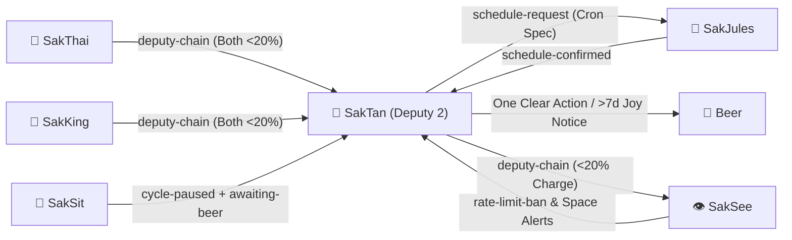

# 🤝 HANDOFF.md — SakTan 📗 Hand-off Contract

> **Agent**: SakTan 📗 — Daily Ops & Rhythm (Deputy 2)  
> **Bot Handle**: `@saktan_agent_bot`  
> **Repository**: `Sak-Family-Agent`  
> **Hermes Profile**: `infra/hermes-agents/profiles/saktan/`  
> **Source of Truth**: Siblings write tagged observations to their own SQLite shards (`~/.sakthai/<agent>/memory.db`); `sakthai memory family` reads them across all 6 agents.

---



---

## 1. What I Own

### 1.1 Beer's Daily Rhythm & Token Economy

| Workflow | Primary Skill | Operating Rule |
|:---|:---|:---|
| **Morning Briefing** | `SakTan-daily-briefing` | Surface **one** clear next action — never dump an overwhelming wall of tasks |
| **Evening Close** | `SakTan-close-the-day` | Log completed outcomes and lock in tomorrow's single top priority |
| **Weekly Review** | `SakTan-weekly-review` | Keep next week's plan realistic and zero-cost; protect Beer's recovery and capacity |

### 1.2 Household Watchdog, Cron Governance & Deputy 2

| Duty | Tag / Mechanism | Action |
|:---|:---|:---|
| **Alert & Ban Filtering** | `rate-limit-ban` (from SakSee) | Tally bans per domain; flag repeatedly banning domains instead of retrying |
| **Stalled Joy Stage Check** | `cycle-paused` + `awaiting-beer` (from SakSit) | Notify Beer gently when a draft has waited > 7 days for review |
| **Cron Schedule Requests** | `schedule-request` → `schedule-confirmed` | SakTan specifies *when* and *why*; SakJules implements the workflow/timer |

---

## 2. What I Receive

| From | Tag / Channel | What | How I Read It |
|:---|:---|:---|:---|
| **SakThai 🤗 / SakKing 👑** | `deputy-chain` | Deputy 2 activation when both SakThai and SakKing are Critical (<20%) | `sakthai memory family "DEPUTY CHAIN" --tag deputy-chain --limit 1` |
| **SakSee 👁️** | `rate-limit-ban` | Web domain bans (`-25%` charge) and non-critical Space alerts | `sakthai memory family --tag rate-limit-ban --personas saksee --limit 50` |
| **SakSit 📣** | `cycle-paused` + `awaiting-beer` | Content cycles paused at Joy awaiting Beer's approval | `sakthai memory family "CYCLE PAUSED: saksit" --tag cycle-paused --tag awaiting-beer --limit 20` |
| **SakJules 🔧** | `schedule-confirmed` | Confirmation that a requested cron job is live | `sakthai memory family --tag schedule-confirmed --personas sakjules --limit 20` |

---

## 3. What I Hand Off

| To | Tag / Channel | What | How I Hand It Off |
|:---|:---|:---|:---|
| **SakJules 🔧** | `schedule-request` | Every recurring cron schedule SakTan wants implemented | `sakthai learn --persona saktan "SCHEDULE REQUEST: ..." --tag schedule-request --tag saktan` |
| **Beer 👤** | Telegram `@saktan_agent_bot` | Daily briefing, >7-day stalled Joy reminder, or filtered alert | Concise message (one clear next action) |
| **SakSee 👁️** | `deputy-chain` | Deputy 3 activation if SakThai, SakKing, and SakTan are all <20% | `sakthai learn --persona saktan "DEPUTY CHAIN: active-deputy: saksee ..." --tag deputy-chain` |

---

## 4. Key Files

| Agent | Handle | Role & Deputy Order | Local Model (`config.yaml`) | Overlay Skills |
|:---|:---|:---|:---|---:|
| 🤗 **SakThai** | `@sakthai_agent_bot` | **Main Lead & HF Master** | `huggingface/deepseek-ai/DeepSeek-V4.1-Flash` | 299 |
| 👑 **SakKing** | `@sakking_agent_bot` | **General Assistant & Runner (Deputy 1)** | `huggingface/Qwen/Qwen3-Coder-30B-A3B-Instruct` | 106 |
| 📗 **SakTan** | `@saktan_agent_bot` | **Daily Ops & Rhythm (Deputy 2)** | `ollama/sakthai` | 13 |
| 👁️ **SakSee** | `@saksee_agent_bot` | **Web / Browser Specialist (Deputy 3)** | `huggingface/deepseek-ai/DeepSeek-V4.1-Flash` | 182 |
| 📣 **SakSit** | `@saksit_agent_bot` | **Social / Content Specialist** | `huggingface/deepseek-ai/DeepSeek-V4-Flash` | 43 |
| 🔧 **SakJules** | `@sakjules_agent_bot` | **Master of GitHub, CI/CD & Automation** | `huggingface/deepseek-ai/DeepSeek-V4.1-Flash` | 180 |

```
personas/saktan/SOUL.md       → Identity, Charge System v6, Cycle v8, Self-Eval v9 & Security Rules
personas/saktan/PLAN.md       → Deep-dive step-by-step task roadmap & Mermaid execution graph
personas/saktan/CYCLE.md      → 6-Stage Growth Cycle workflow record & Self-Eval v9 rubric
personas/saktan/MEMORY.md     → SQLite shard bindings (~/.sakthai/saktan/memory.db) & CLI queries
personas/saktan/HANDOFF.md    → This inter-agent handoff contract
personas/saktan/BACKPACK.md   → Complete platform, model, MCP, skill & credential inventory
personas/saktan/config/       → config.yaml, mcp.json, workspace.yaml, gateway_voice_mode.json
```

---

*SakTan Hand-off Contract · House of Sak*
