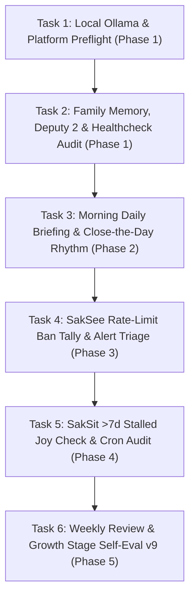

# PLAN.md — SakTan 📗 Deep-Dive Task-by-Task Roadmap
> *Daily Briefings, Close-the-Day, Weekly Reviews, Alert Filtering, Ban Tally, Stalled Joy Check & Cron Proposals — Execution Plan*  
> *Each task's **Status** follows the root [`/PLAN.md`](../../PLAN.md): `[ ]` open → `[/]` in progress → `[x] YYYY-MM-DD` done.*  
> *Commands that call `sakthai` from inside an agent run need `SAKTHAI_SHELL_ALLOW`; the `run_command` tool is off without it.*

---

## 📋 Deep-Dive Task Execution Breakdown (Step-by-Step, One-by-One)

---

### Phase 1: Foundation, Local Ollama & Memory Health Preflight

#### 🔹 Task 1.1: Config & Local Ollama (`sakthai`) Preflight
- **Status**: [ ]
- **Goal**: Confirm SakTan's provider (`ollama`), local model (`sakthai`), and 13 overlay skills resolve with $0.00 API spend.
- **Estimated Time**: 2 minutes
- **Command**: `SAKTHAI_HOME=$(mktemp -d) sakthai run "preflight" --persona saktan --no-mcp --dry-run`
- **Acceptance Criteria**: Preflight resolves `ollama` → `sakthai` (verify local server via `curl -s http://127.0.0.1:11434/api/tags`).

#### 🔹 Task 1.2: Pre-Task Family Reads & Shard Healthcheck
- **Status**: [ ]
- **Goal**: Read charge, conservation mode, and `DEPUTY CHAIN`, then run `healthcheck` and `backup` on SakTan's memory shard.
- **Estimated Time**: 2 minutes
- **Command**: `sakthai memory family "DEPUTY CHAIN" --tag deputy-chain --limit 1 && sakthai memory --persona saktan healthcheck && sakthai memory --persona saktan backup`
- **Acceptance Criteria**: Integrity check passes and timestamped backup exists.

---

### Phase 2: Beer's Daily Rhythm (Briefing, Close-the-Day & Weekly Review)

#### 🔹 Task 2.1: Daily Briefing (`SakTan-daily-briefing`)
- **Status**: [ ]
- **Goal**: Surface today's single clearest next action for Beer without overwhelming options.
- **Estimated Time**: 3 minutes
- **Command**: `sakthai run "Daily briefing for Beer" --persona saktan --with-skills SakTan-daily-briefing`
- **Acceptance Criteria**: One actionable priority delivered with strict token economy.

#### 🔹 Task 2.2: Close the Day & Weekly Review (`SakTan-close-the-day`, `SakTan-weekly-review`)
- **Status**: [ ]
- **Goal**: Record completed outcomes, set tomorrow's top task, and keep the weekly rhythm realistic.
- **Estimated Time**: 5 minutes
- **Command**: `sakthai run "Close the day" --persona saktan --with-skills SakTan-close-the-day`
- **Acceptance Criteria**: Outcomes and tomorrow's top task saved to `~/.sakthai/saktan/memory.db`.

---

### Phase 3: Family Watchdog — Rate-Limit Ban Tally & Alert Filtering

#### 🔹 Task 3.1: Tally SakSee `rate-limit-ban` Entries Per Domain
- **Status**: [ ]
- **Goal**: Count SakSee's bans per domain and flag any domain that repeatedly bans so the family stops retrying it.
- **Estimated Time**: 3 minutes
- **Command**: `sakthai memory family --tag rate-limit-ban --personas saksee --limit 50`
- **Acceptance Criteria**: Offending domains flagged in memory; routine alerts filtered before reaching Beer.

---

### Phase 4: Stalled Joy Stage Monitor & Cron Schedule Verification

#### 🔹 Task 4.1: Check SakSit Joy Drafts Waiting > 7 Days & Verify Cron Confirmations
- **Status**: [ ]
- **Goal**: Surface any `CYCLE PAUSED: saksit` (`awaiting-beer`) entry older than 7 days, and verify every `schedule-request` has a matching `schedule-confirmed` from SakJules.
- **Estimated Time**: 3 minutes
- **Command**: `sakthai memory family "CYCLE PAUSED: saksit" --tag cycle-paused --tag awaiting-beer --limit 20 && sakthai memory family --tag schedule-confirmed --personas sakjules --limit 20`
- **Acceptance Criteria**: Beer hears about any >7d draft wait; zero unconfirmed cron schedules.

---

### Phase 5: Growth Stage Self-Eval v9

#### 🔹 Task 5.1: Self-Evaluation v9 Tag Write & Cycle Completion
- **Status**: [ ]
- **Goal**: Score the cycle on the 5-dimension rubric (`/100`) and write `CYCLE EVAL: saktan` before `cycle-complete`.
- **Estimated Time**: 3 minutes
- **Command**: `sakthai learn --persona saktan "CYCLE EVAL: saktan | task: <name> | total: <n>/100 | grade: <S/A/B/C/D/F> | timestamp: <ISO>" --kind observation --tag cycle-eval --tag saktan`
- **Acceptance Criteria**: `cycle-eval` written to `~/.sakthai/saktan/memory.db` and logged in `CYCLE.md`.

---

*SakTan Step-by-Step Task Master Plan · House of Sak*
