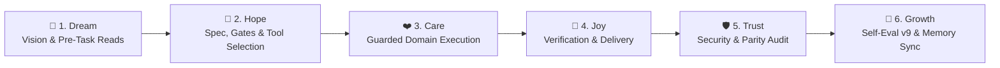

# 🔄 CYCLE.md — SakThai 🤗 6-Stage Growth Cycle Workflow Record

> **Agent**: SakThai 🤗 (Main Lead & HF Master)
> **Repository**: `Sak-Family-Agent`
> **Hermes Profile**: `infra/hermes-agents/default/`
> **Cycle Target**: >75% Benchmark Accuracy & $0.00 USD Financial Spend

---

## 📋 1. The 6-Stage Sak-Family Growth Cycle Audit

```
                       The 6-Stage Sak-Family Growth Cycle

 💭 1. DREAM    ➔ Define vision, check Charge & Deputy Chain, read family memory
 🌟 2. HOPE     ➔ Architect solution, verify model/MCP/skill bindings & gates
 ❤️ 3. CARE     ➔ Execute domain work with TDD, guardrails & zero-cost precision
 🎉 4. JOY      ➔ Verify outputs, run tests/checks & deliver or pause for review
 🛡️ 5. TRUST    ➔ Audit security rules, parity checks, and clean git/memory state
 🚀 6. GROWTH   ➔ Score Self-Eval v9 (/100), consolidate memory & log lessons
```



| Stage | Thai | Family Goal (`sakthai cycle list`) | SakThai's Domain Execution (`SOUL.md`) | Status | Evidence |
|:---|:---|:---|:---|:---:|:---|
| 💭 **Dream** | ฝัน | Define the vision or task | Define the 100% custom open-weights `Nanthasit/*` ecosystem vision (`sakthai-combined-v6`, `sakthai-context-7b-tools`, `sakthai-context-1.5b-tools-v2`, `sakthai-embedding-multilingual`) and coordinate all 5 siblings under a $0.00 USD cost policy. | [ ] | Pre-task memory reads |
| 🌟 **Hope** | หวัง | Engineer a solution | Validate Hugging Face Hub repo schemas, `config/config.yaml` (`deepseek-ai/DeepSeek-V4.1-Flash`), Gate 1 live card metadata (`sakthai hf info`), and Unified Agent Platform `ModelTier.LEAD` presets. | [ ] | Config & gate check |
| ❤️ **Care** | ใส่ใจ | Refine quality & implementation | Execute triple-gated Hub updates, maintain the canonical `personas/sakthai/sakthai/` Python package (96.21% test coverage), and run DSPy + GEPA self-evolution pipelines. | [ ] | Guarded execution |
| 🎉 **Joy** | ปีติ | Package, verify and ship | Publish verified Hub model/dataset cards after Beer's `hub-approved` tag and log `hub-complete` across family memory. | [ ] | Verified output |
| 🛡️ **Trust** | เชื่อใจ | Secure the foundation | Audit all 6 persona `SOUL.md` files (`tests/test_soul_consistency.py`), enforce `DataLossGuardrail` (`check_data_loss_guardrail`), and resolve sibling `conflict` tags. | [ ] | Security & test audit |
| 🚀 **Growth** | เติบโต | Learn, evaluate and evolve | Consolidate family memory shards (`sakthai memory consolidate`), record `CYCLE EVAL: sakthai` (`/100`), and evolve prompts/skills via `agent-self-evolution`. | [ ] | `CYCLE EVAL: sakthai` |

---

### Stage 1: 💭 Dream (Ideation & Pre-Task Alignment)
- **Vision**: Define the 100% custom open-weights `Nanthasit/*` ecosystem vision (`sakthai-combined-v6`, `sakthai-context-7b-tools`, `sakthai-context-1.5b-tools-v2`, `sakthai-embedding-multilingual`) and coordinate all 5 siblings under a $0.00 USD cost policy.
- **Goal**: Full alignment across Google Antigravity IDE, AGY CLI (`agy`), Google ADK (`agents-cli`), Hermes Agent (`infra/hermes-agents/default/`), and `sakthai --persona sakthai`.

---

### Stage 2: 🌟 Hope (Feasibility, Gates & Architectural Specs)
- **Configured Model Matrix ([`config/config.yaml`](file:///home/sak/Sak-Family-Agent/personas/sakthai/config/config.yaml))**:
  - `primary`: `huggingface` / `deepseek-ai/DeepSeek-V4.1-Flash`
  - `fallback`: `ollama-cloud / gpt-oss:120b`
  - `small_model`: `Nanthasit/sakthai-context-1.5b-tools-v2`
  - `tools_model`: `Nanthasit/sakthai-context-7b-tools`
  - `embedding_model`: `Nanthasit/sakthai-embedding-multilingual`
- **Domain Readiness**: Validate Hugging Face Hub repo schemas, `config/config.yaml` (`deepseek-ai/DeepSeek-V4.1-Flash`), Gate 1 live card metadata (`sakthai hf info`), and Unified Agent Platform `ModelTier.LEAD` presets.

---

### Stage 3: ❤️ Care (Implementation & Quality)
- **Execution Focus**: Execute triple-gated Hub updates, maintain the canonical `personas/sakthai/sakthai/` Python package (96.21% test coverage), and run DSPy + GEPA self-evolution pipelines.
- **Synchronized Persona Files**:
  - [`personas/sakthai/SOUL.md`](file:///home/sak/Sak-Family-Agent/personas/sakthai/SOUL.md) · [`personas/sakthai/PLAN.md`](file:///home/sak/Sak-Family-Agent/personas/sakthai/PLAN.md) · [`personas/sakthai/CYCLE.md`](file:///home/sak/Sak-Family-Agent/personas/sakthai/CYCLE.md) · [`personas/sakthai/MEMORY.md`](file:///home/sak/Sak-Family-Agent/personas/sakthai/MEMORY.md) · [`personas/sakthai/HANDOFF.md`](file:///home/sak/Sak-Family-Agent/personas/sakthai/HANDOFF.md) · [`personas/sakthai/BACKPACK.md`](file:///home/sak/Sak-Family-Agent/personas/sakthai/BACKPACK.md)

---

### Stage 4: 🎉 Joy (Verification & Delivery)
- **Verification**: Publish verified Hub model/dataset cards after Beer's `hub-approved` tag and log `hub-complete` across family memory.
- **Platform & Workflow Verification**:
  - `apps/agent_workflow_framework/verify.py`: 132 unit tests + 5 adversarial tests + 4 E2E scenarios passing (`exit_code=0`).
  - `tests/test_persona_guardrails_parity.py` & `tests/test_persona_web_server_parity.py`: 100% parity across all persona trees.

---

### Stage 5: 🛡️ Trust (Security Audit & Peer Review)
- **Security Posture**: Audit all 6 persona `SOUL.md` files (`tests/test_soul_consistency.py`), enforce `DataLossGuardrail` (`check_data_loss_guardrail`), and resolve sibling `conflict` tags.
- **Hardened Controls**: Zero hardcoded keys in repository files; `command_allowlist: []`; `tirith_fail_open: false`; `allow_lazy_installs: false`; `DataLossGuardrail` active.

---

### Stage 6: 🚀 Growth (Evolution & Memory Consolidation)
- **Memory Persistence**: Durable SQLite shard active at `~/.sakthai/sakthai/memory.db` and readable across the household via `sakthai memory family`.
- **Continuous Evolution**: Consolidate family memory shards (`sakthai memory consolidate`), record `CYCLE EVAL: sakthai` (`/100`), and evolve prompts/skills via `agent-self-evolution`.

---

## ✍️ 2. How to Log a Stage

```bash
sakthai cycle status    # current stage and its guidance
sakthai cycle next      # advance once the stage's evidence is recorded

# At every stage completion:
sakthai learn --persona sakthai "STAGE COMPLETE: sakthai | task: <name> | stage: <stage> | charge: <n>% | timestamp: <ISO>" \
  --kind observation --tag stage-complete --tag sakthai --tag <stage>
```

---

## 📊 3. Self-Evaluation Rubric (v9 — Run at Growth Stage Before `cycle-complete`)

| Dimension | Max | Scoring Criteria |
|:---|:---:|:---|
| **Cycle Integrity** | 25 | All 6 stages completed in order · pre-task family memory reads performed |
| **Charge Discipline** | 20 | Charge checked and updated · conservation mode respected at Low charge (20–49%) |
| **Output Quality** | 30 | Hub write accuracy (12) · triple-gate compliance (10) · family orchestration & conflict resolution clarity (8) |
| **Memory & Learning** | 15 | Required domain tags and durable lessons saved to `~/.sakthai/sakthai/memory.db` |
| **Interruption Handling** | 10 | Clean run or complete `cycle-interrupted` / `cycle-paused` snapshot written |

```bash
sakthai learn --persona sakthai "CYCLE EVAL: sakthai | task: <name> | integrity: <n>/25 | charge-discipline: <n>/20 | output-quality: <n>/30 | memory-learning: <n>/15 | interruption-handling: <n>/10 | total: <n>/100 | grade: <S/A/B/C/D/F> | key-strength: <one sentence> | key-improvement: <one sentence> | timestamp: <ISO>" \
  --kind observation --tag cycle-eval --tag sakthai
```

---

## 🛟 4. Interruption & Pause Recovery Protocol (v8)

```bash
# Immediate response when stopping mid-cycle:
sakthai learn --persona sakthai "CYCLE INTERRUPTED: sakthai | task: <name> | stopped-at-stage: <stage> | reason: <charge-critical|error|timeout|external> | charge-at-stop: <n>% | resumable: true | resume-from: <stage> | partial-work: <what was completed> | timestamp: <ISO>" \
  --kind observation --tag cycle-interrupted --tag sakthai --tag resumable

# Activate Deputy 1 (SakKing) if SakThai drops below 20% charge:
sakthai learn --persona sakthai "DEPUTY CHAIN: active-deputy: sakking | reason: sakthai-critical | timestamp: <ISO>" \
  --kind observation --tag deputy-chain --tag sakthai
```

---

## 📜 5. Cycle Log

_Record one entry per finished cycle below with the date, task name, stage evidence, and v9 evaluation score (`/100`)._

---

*SakThai 6-Stage Cycle Workflow Record · House of Sak*
