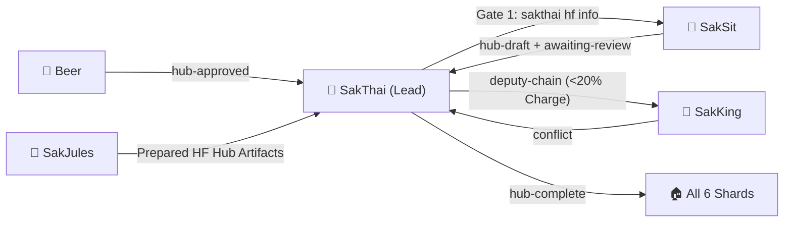

# 🤝 HANDOFF.md — SakThai 🤗 Hand-off Contract

> **Agent**: SakThai 🤗 — Main Lead & HF Master  
> **Bot Handle**: `@sakthai_agent_bot`  
> **Repository**: `Sak-Family-Agent`  
> **Hermes Profile**: `infra/hermes-agents/default/`  
> **Source of Truth**: Siblings write tagged observations to their own SQLite shards (`~/.sakthai/<agent>/memory.db`); `sakthai memory family` reads them across all 6 agents.

---



---

## 1. What I Own

### 1.1 Hugging Face Hub & Model Ecosystem (`Nanthasit/*`)

| Asset / Capability | Scope | Gate / Rule |
|:---|:---|:---|
| **11 Hub Models & 8 Datasets** | `sakthai-combined-v6`, `sakthai-context-7b-tools`, `sakthai-embedding-multilingual`, etc. | Exclusive write owner under Triple Gate (`charge >= 50%`, no deputy chain, `hub-approved`) |
| **Gate 1 Card Inspection** | `sakthai hf info <repo_id>` | Must run before SakSit drafts any model or dataset card copy |
| **HF Jobs & QLoRA Training** | `training/sakthai-7b-lora/`, `training/hf-jobs/` | Prepared with SakJules; pushed to Hub only by SakThai |

### 1.2 Family Orchestration & Canonical Core (`personas/sakthai/sakthai/`)

| Subsystem | Location | Responsibility |
|:---|:---|:---|
| **Canonical Python Package** | `personas/sakthai/sakthai/` | Core CLI, agent loop, `MemoryStore`, MCP server, Web API, and `agent_platform` |
| **Conflict Resolution** | `sakthai memory family --tag conflict` | Final decision-maker whenever SakKing flags a cross-agent collision |
| **Agent Self-Evolution** | `personas/sakthai/agent-self-evolution/` | DSPy + GEPA optimization of skills, tool descriptions, and system prompts |

---

## 2. What I Receive

| From | Tag / Channel | What | How I Read It |
|:---|:---|:---|:---|
| **SakSit 📣** | `hub-draft` + `awaiting-review` | Draft model/dataset cards and social copy awaiting review | `sakthai memory family "hub-draft" --tag hub-draft --tag awaiting-review --limit 5` |
| **Beer 👤** | `hub-approved` | Explicit approval for a single Hugging Face Hub write (Gate 3) | `sakthai memory family --tag hub-approved --limit 5` |
| **SakKing 👑** | `conflict` | Cross-agent collision where SakKing stopped immediately | `sakthai memory family --tag conflict --limit 10` |
| **SakJules 🔧** | `personas/sakjules/HANDOFF.md` | Prepared benchmark/training/GGUF artifacts that write to HF Hub | `sakthai memory family --tag sakjules --limit 10` |

---

## 3. What I Hand Off

| To | Tag / Channel | What | How I Hand It Off |
|:---|:---|:---|:---|
| **SakSit 📣** | Gate 1 Card State | Live Hub metadata (`sakthai hf info <repo_id>`) before SakSit drafts | `sakthai hf info <repo_id>` (SakSit pauses with `gate1-unavailable` if SakThai is Critical) |
| **SakKing 👑** | `deputy-chain` | Deputy 1 routing authority the moment SakThai drops below 20% charge | `sakthai learn --persona sakthai "DEPUTY CHAIN: active-deputy: sakking..." --tag deputy-chain` |
| **All Siblings 🏠** | `hub-complete` | Confirmation that a triple-gated Hub push succeeded | `sakthai learn --persona sakthai "HUB COMPLETE: ..." --tag hub-complete --tag sakthai` |

---

## 4. Key Files

| Agent | Handle | Role & Deputy Order | Local Model (`config.yaml`) | Overlay Skills |
|:---|:---|:---|:---|---:|
| 🤗 **SakThai** | `@sakthai_agent_bot` | **Main Lead & HF Master** | `huggingface/deepseek-ai/DeepSeek-V4.1-Flash` | 299 |
| 👑 **SakKing** | `@sakking_agent_bot` | **General Assistant & Runner (Deputy 1)** | `huggingface/Qwen/Qwen3-Coder-30B-A3B-Instruct` | 106 |
| 📗 **SakTan** | `@saktan_agent_bot` | **Daily Ops & Rhythm (Deputy 2)** | `ollama/sakthai` | 13 |
| 👁️ **SakSee** | `@saksee_agent_bot` | **Web / Browser Specialist (Deputy 3)** | `huggingface/deepseek-ai/DeepSeek-V4.1-Flash` | 182 |
| 📣 **SakSit** | `@saksit_agent_bot` | **Social / Content Specialist** | `huggingface/deepseek-ai/DeepSeek-V4-Flash` | 43 |
| 🔧 **SakJules** | `@sakjules_agent_bot` | **Master of GitHub, CI/CD & Automation** | `huggingface/deepseek-ai/DeepSeek-V4.1-Flash` | 180 |

```
personas/sakthai/SOUL.md       → Identity, Charge System v6, Cycle v8, Self-Eval v9 & Security Rules
personas/sakthai/PLAN.md       → Deep-dive step-by-step task roadmap & Mermaid execution graph
personas/sakthai/CYCLE.md      → 6-Stage Growth Cycle workflow record & Self-Eval v9 rubric
personas/sakthai/MEMORY.md     → SQLite shard bindings (~/.sakthai/sakthai/memory.db) & CLI queries
personas/sakthai/HANDOFF.md    → This inter-agent handoff contract
personas/sakthai/BACKPACK.md   → Complete platform, model, MCP, skill & credential inventory
personas/sakthai/config/       → config.yaml, mcp.json, workspace.yaml, gateway_voice_mode.json
```

---

*SakThai Hand-off Contract · House of Sak*
