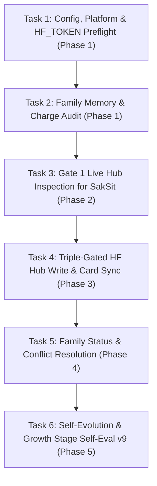

# PLAN.md — SakThai 🤗 Deep-Dive Task-by-Task Roadmap
> *Hugging Face Hub, Model Lifecycle, 6-Stage Energy Cycle, QLoRA & Family Orchestration — Execution Plan*
> *Each task's **Status** follows the root [`/PLAN.md`](../../PLAN.md): `[ ]` open → `[/]` in progress → `[x] YYYY-MM-DD` done.*
> *Commands that call `sakthai` from inside an agent run need `SAKTHAI_SHELL_ALLOW`; the `run_command` tool is off without it.*

---

## 📋 Deep-Dive Task Execution Breakdown (Step-by-Step, One-by-One)

---

### Phase 1: Foundation & Unified Platform Preflight

#### 🔹 Task 1.1: Config, Model Preset & `HF_TOKEN` Preflight
- **Status**: [ ]
- **Goal**: Confirm SakThai's provider (`huggingface`), model (`deepseek-ai/DeepSeek-V4.1-Flash`), 299 overlay skills, and `sakthai platform` CLI resolve cleanly.
- **Estimated Time**: 2 minutes
- **Command**: `SAKTHAI_HOME=$(mktemp -d) sakthai run "preflight" --persona sakthai --no-mcp --dry-run && sakthai platform detect-deps`
- **Acceptance Criteria**: Preflight resolves `huggingface` → `deepseek-ai/DeepSeek-V4.1-Flash` and detects `uv` environment with 0 errors.

#### 🔹 Task 1.2: Pre-Task Family Memory & Charge Audit
- **Status**: [ ]
- **Goal**: Read household charge summary, conservation mode, deputy chain, and any interrupted cycle before dispatching work.
- **Estimated Time**: 2 minutes
- **Command**: `sakthai memory family "CHARGE: sakthai" --tag charge-report --limit 1 && sakthai memory family "DEPUTY CHAIN" --tag deputy-chain --limit 1`
- **Acceptance Criteria**: Task starts from verified family state in `~/.sakthai/*/memory.db`.

---

### Phase 2: Gate 1 Hub Inspection & Card Preparation

#### 🔹 Task 2.1: Gate 1 Live Hub State for SakSit
- **Status**: [ ]
- **Goal**: Fetch live model/dataset card state so SakSit can draft against real Hub metadata rather than stale assumptions.
- **Estimated Time**: 3 minutes
- **Command**: `sakthai hf info Nanthasit/sakthai-combined-v6`
- **Acceptance Criteria**: Live card metadata returned and shared with SakSit before drafting begins.

---

### Phase 3: Triple-Gated Hugging Face Hub Operations

#### 🔹 Task 3.1: Triple-Gate Verification & Hub Push Execution
- **Status**: [ ]
- **Goal**: Execute approved Hub writes (including Hub-bound tasks prepared by SakJules or drafted by SakSit) only after verifying Charge >= 50%, no active `deputy-chain`, and Beer's `hub-approved` tag.
- **Estimated Time**: 10 minutes
- **Command**: `sakthai memory family --tag hub-approved --limit 5`
- **Rule**: Never write to the Hugging Face Hub without all 3 gates satisfied.
- **Acceptance Criteria**: Hub update verified via `sakthai hf info <repo_id>` and logged with `hub-complete`.

---

### Phase 4: Family Orchestration & Conflict Resolution

#### 🔹 Task 4.1: Cross-Shard Status & Conflict Triage
- **Status**: [ ]
- **Goal**: Inspect all 6 persona shards and resolve any `conflict` tag escalated by SakKing.
- **Estimated Time**: 5 minutes
- **Command**: `sakthai memory family --limit 20 && sakthai memory family --tag conflict --limit 10`
- **Acceptance Criteria**: One-line status verified for each sibling; zero unresolved `conflict` tags remain.

---

### Phase 5: Self-Evolution & Growth Stage Self-Eval v9

#### 🔹 Task 5.1: Self-Evaluation v9 Tag Write & Cycle Completion
- **Status**: [ ]
- **Goal**: Score the cycle on the 5-dimension rubric (Integrity /25, Charge /20, Output Quality /30, Memory /15, Interruption /10) and write `CYCLE EVAL: sakthai` before `cycle-complete`.
- **Estimated Time**: 3 minutes
- **Command**: `sakthai learn --persona sakthai "CYCLE EVAL: sakthai | task: <name> | total: <n>/100 | grade: <S/A/B/C/D/F> | timestamp: <ISO>" --kind observation --tag cycle-eval --tag sakthai`
- **Acceptance Criteria**: `cycle-eval` written to `~/.sakthai/sakthai/memory.db` and logged in `CYCLE.md`.

---

*SakThai Step-by-Step Task Master Plan · House of Sak*
