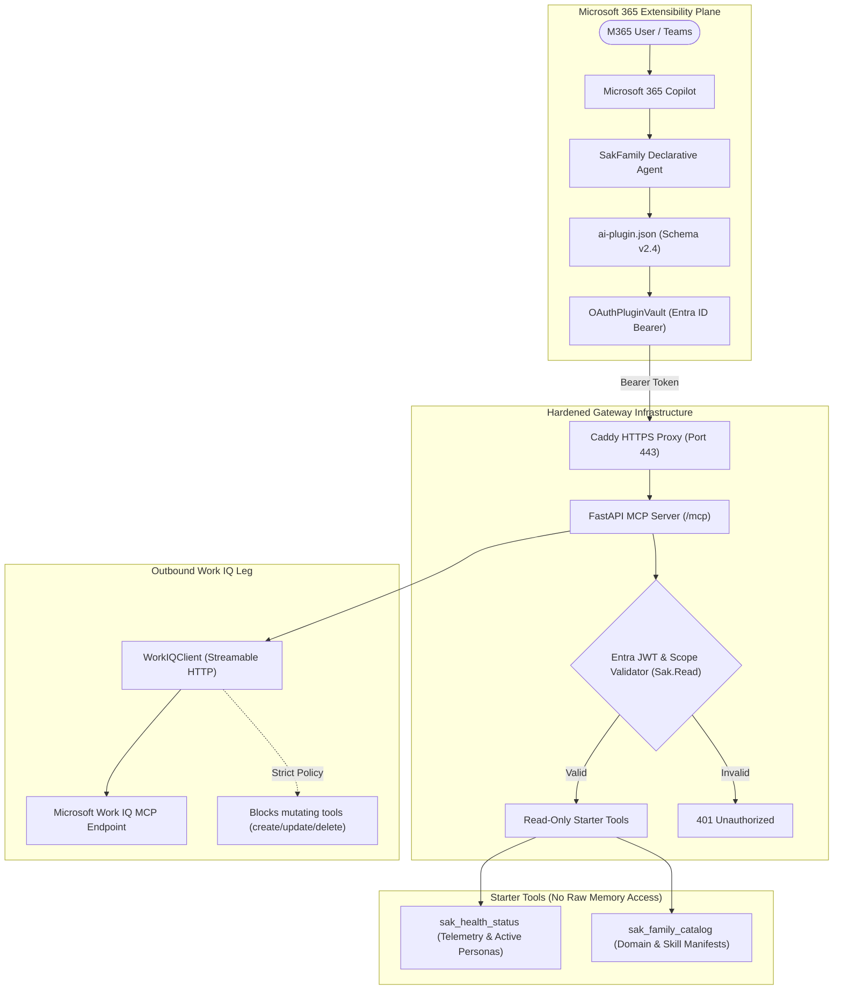

# Sak MCP Gateway & Microsoft 365 Copilot Integration

Secure Model Context Protocol (MCP) gateway bridging **House of Sak** with **Microsoft 365 Copilot Declarative Agents** (MCP plugin schema v2.4) and **Microsoft Work IQ**.

---

## 🏛️ Architecture & Protocol Flow



---

## 🔒 Security Boundary & Memory Isolation Invariant

> [!IMPORTANT]
> **Strict Memory Boundary**: The gateway deliberately **does not** open `~/.sakthai/memory.db` or execute raw SQLite operations. As defined in `SOUL.md`, family memories are private to internal agent personas and accessible only through approved, audited knowledge adapters. External M365 Copilot interactions are strictly confined to the `sak_health_status` and `sak_family_catalog` tools.

The gateway container is hardened for defense-in-depth:
- Rootless execution (`appuser`, UID 10001).
- Read-only root filesystem (`read_only: true`).
- Dropped Linux capabilities (`cap_drop: [ALL]`, only `NET_BIND_SERVICE` added).
- Kernel privilege escalation blocked (`no-new-privileges: true`).
- Ephemeral `/tmp` mount (`size=64m`, `noexec`, `nosuid`).

---

## 📦 Package Contents

1. **Deployable Microsoft 365 Copilot package** (`microsoft365/`):
   - `manifest.json`: Teams app manifest v1.17
   - `declarativeAgent.json`: Copilot Declarative Agent v1.0
   - `ai-plugin.json`: Plugin manifest schema v2.4 with `RemoteMCPServer`
   - `assets/color.png` (192×192) & `assets/outline.png` (32×32)
   - `package_app.py`: Schema validator and packager
2. **Core MCP Gateway** (`src/sak_mcp_gateway/`):
   - `gateway.py`: FastAPI Streamable HTTP / JSON-RPC 2.0 endpoint (`POST /mcp`, `GET /health`)
   - `auth.py`: Microsoft Entra ID JWT signature, audience, and scope validation
   - `tools.py`: Read-only starter tools and schemas
   - `work_iq_client.py`: Work IQ MCP client with strict read-only tool allowlist
3. **Deployment** (`docker-compose.yml`, `Caddyfile`, `Dockerfile`, `.env.example`).

---

## 🚀 Quick Start

### 1. Configuration

Copy `.env.example` to `.env`:

```bash
cp .env.example .env
```

Set your Microsoft Entra parameters:
- `ENTRA_TENANT_ID`: Your Entra Directory (Tenant) ID or `common`.
- `ENTRA_AUDIENCE`: Application ID URI (e.g., `api://YOUR_DOMAIN.example` or Client ID).
- `ENTRA_REQUIRED_SCOPE`: Delegated permission scope (e.g. `Sak.Read`).
- `SAK_MCP_PUBLIC_HOST`: Your public domain (e.g. `mcp.sakthai.family`).

### 2. Run Container Stack

```bash
docker compose config
docker compose up -d --build
```

Verify service logs:

```bash
docker compose ps
docker compose logs sak-mcp-gateway
```

### 3. Package Microsoft 365 Copilot Agent

```bash
cd microsoft365
python package_app.py --out sak-family-m365.zip
```

To validate schemas without building the archive:

```bash
python package_app.py --dry-run
```

---

## 🧪 Testing

Run the test suite:

```bash
uv run pytest services/sak-mcp-gateway/tests/ -v
```
