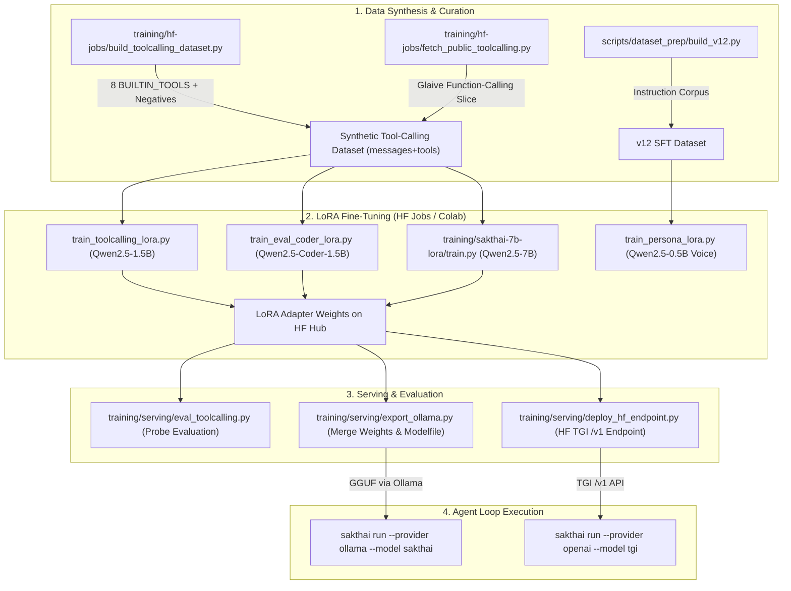

# SakThai Model Training & Serving Subsystem

Welcome to the **SakThai Model Training & Serving Subsystem** of the House of Sak (`Sak-Family-Agent`). This directory houses the recipes, dataset builders, evaluation harnesses, and export tools used to fine-tune and serve custom open-source models for the SakThai agent loop.

---

## 🏛️ Architecture Overview



---

## 📁 Directory Structure

| Directory | Description | Key Artifacts |
|---|---|---|
| [`hf-jobs/`](./hf-jobs/) | PEP 723 training and dataset scripts for remote Hugging Face Jobs. | `build_toolcalling_dataset.py`, `train_toolcalling_lora.py`, `train_persona_lora.py`, `train_eval_coder_lora.py` |
| [`serving/`](./serving/) | Model evaluation, local GGUF/Ollama export, and cloud TGI deployment. | `eval_toolcalling.py`, `export_ollama.py`, `deploy_hf_endpoint.py` |
| [`sakthai-7b-lora/`](./sakthai-7b-lora/) | 7B Qwen parameter-efficient fine-tuning launcher and submission tooling. | `submit_job.py`, `train.py` |
| [`sakthai-1.5b-lora/`](./sakthai-1.5b-lora/) | Google Colab interactive notebook for single-click T4 GPU fine-tuning. | `sakthai_lora_training.ipynb` |
| [`notebooks/`](./notebooks/) | Colab benchmarking and diagnostic notebooks. | `eval_sakthai_bench_colab.ipynb` |
| [`run2-dataset-v10/`](./run2-dataset-v10/) | Dataset specification and model card metadata for `sakthai-combined-v10`. | `README.md` |
| [`run2-model-7b-128k/`](./run2-model-7b-128k/) | 7B 128k context model card, benchmark telemetry, and evaluation metrics. | `README.md` |
| [`run2-model-coder-browser/`](./run2-model-coder-browser/) | Coder browser agent diagnostics and merge verification logs. | `README.md` |
| [`../evaluation_tasks/`](../evaluation_tasks/) | Unified Grader Suite (`CodeGrader`, `ModelGrader`) and benchmark batch runners. | `graders.py`, `tasks.json` |

---

## ⚡ CLI Integration & Quick Start

All training and serving workflows are accessible via the `sakthai train` CLI command group.

### 1. Inspect Training Runs & Recipes
```bash
sakthai train list
sakthai train list --json
```

### 2. Generate Tool-Calling Datasets
```bash
# Compile standard v12 dataset:
sakthai train dataset --limit 500

# Generate synthetic tool-calling dataset for the 8 core SakThai built-in tools:
sakthai train dataset --synthetic-tools
```

### 3. Launch Fine-Tuning Recipes
```bash
# Standard QLoRA SFT run:
sakthai train sft --recipe sft_qlora -- --config path/to/config.yaml

# Remote Hugging Face Jobs tool-calling training (dry-run):
sakthai train sft --recipe toolcalling --dry-run
```

### 4. Evaluate Adapter Fidelity
```bash
# Smoke-test tool calling vs direct answers with built-in probes:
sakthai train eval --dry-run
```

### 5. Export to Ollama for Local Offline Execution
```bash
# Merge adapter and create Ollama Modelfile:
sakthai train export -- --out ./sakthai-merged

# Follow the printed instructions to convert to GGUF and register with Ollama:
#   python3 llama.cpp/convert_hf_to_gguf.py ./sakthai-merged --outfile ./sakthai-merged.gguf
#   ollama create sakthai -f Modelfile

# Run the agent loop 100% locally:
sakthai run --provider ollama --model sakthai "Remember I use uv, never pip"
```

### 6. Cloud TGI Inference Endpoints
```bash
# Dry-run cloud deployment plan (safe, no billing):
sakthai train deploy --repo Nanthasit/sakthai-toolcalling-1.5b-merged

# Provision cloud endpoint (billable):
HF_TOKEN=... sakthai train deploy --repo Nanthasit/sakthai-toolcalling-1.5b-merged --create
```

### 7. OpenEnv RL (GRPO) Ecosystem Bridge (`beer-sakthai/openenv-rl-training`)
When [`beer-sakthai/openenv-rl-training`](https://github.com/beer-sakthai/openenv-rl-training) is cloned as a sibling repository (`../openenv-rl-training`) or pointed to via `SAKTHAI_OPENENV_ROOT`, `sakthai train openenv` orchestrates its 5 independent workspaces in process-isolated `uv run` environments:

```bash
# Inspect OpenEnv RL workspace discovery and readiness:
sakthai train openenv status
sakthai train openenv status --json

# Run CPU environment_factory contract verification:
sakthai train openenv verify

# Run all 149 tests across the 5 OpenEnv RL workspaces in a single invocation:
sakthai train openenv test
sakthai train openenv test --workspace custom

# Run CPU heuristic policy competition and GRPO reward-variance checks:
sakthai train openenv baselines

# Run deterministic Evaluation Manager Agent rubric benchmark:
sakthai train openenv benchmark --json

# Launch or dry-run GRPO training (simple, mcp, agent_tools, browsergym, multi, catalog):
sakthai train openenv grpo --env mcp --dry-run

# Launch or dry-run the 8-catalog A2A protocol server:
sakthai train openenv a2a --port 9000 --dry-run
```

---

## 🛡️ Security & Operational Guardrails

1. **No Accidental Billing**: `deploy_hf_endpoint.py` and `submit_job.py` dry-run by default. Explicit `--create` or omitting `--dry-run` is required for live network execution.
2. **Secret Forwarding**: Tokens (`HF_TOKEN`) are read from environment variables or secure credential stores (`~/.cache/huggingface/token`) only — never baked into code, committed, or hardcoded.
3. **Reproducibility**: All base models are pinned to immutable commit SHAs in accordance with Bandit rule B615.
4. **Hermetic Workspaces**: Training artifacts and temp files use private directories (`tempfile.mkdtemp` with 0700 permissions) to prevent shared directory vulnerabilities (Bandit B108).
5. **Process-Isolated RL Pinsets**: `openenv-rl-training` runs via `uv run --with ...` subprocess isolation so `Sak-Family-Agent`'s locked runtime environment never collides with SFT/GRPO `torch`/`trl`/`vllm` pinsets.

